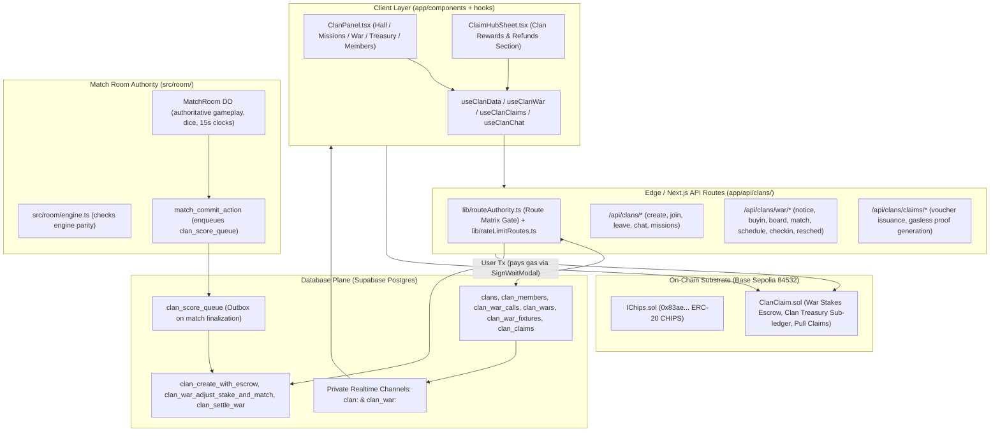
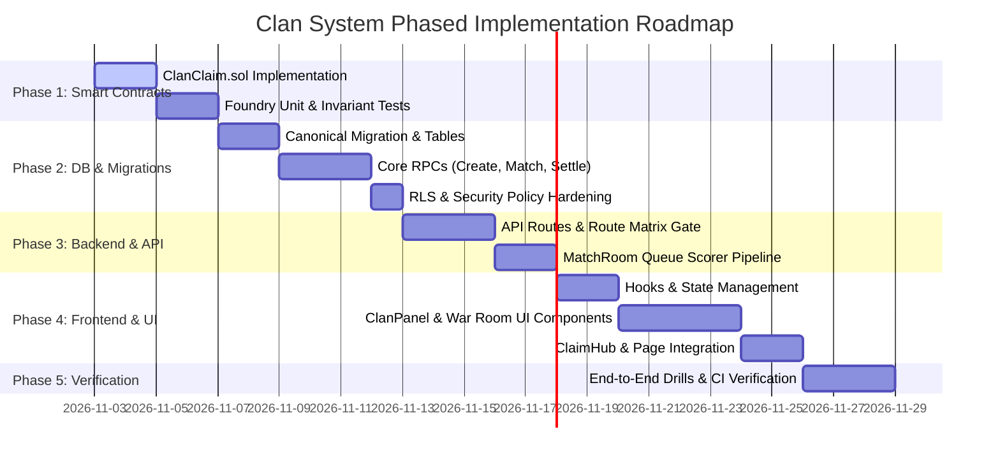

# Clan System Implementation Plan (Technical Architecture & Phased Execution)

> **Document Version:** 1.0.0 (Engineering Architecture Blueprint)  
> **Status:** APPROVED & READY FOR EXECUTION  
> **Target Environment:** Next.js 16 (App Router), Base Sepolia (`84532`), Supabase (Postgres + Realtime), MatchRoom DO, Foundry  
> **Companion Document:** [`docs/planning/CLAN_SYSTEM_PLAN.md`](docs/planning/CLAN_SYSTEM_PLAN.md) (Product Specification & Rules)

---

## 1. System Architecture Overview & Workload Placement

In accordance with [`docs/architecture/WORKLOAD_PLACEMENT_MATRIX.md`](docs/architecture/WORKLOAD_PLACEMENT_MATRIX.md) and [`AGENTS.md`](AGENTS.md), the Clan System adheres strictly to single-source-of-truth boundaries:



### Workload Placement Decision Table

| Component | Target Location | Rationale & Invariants |
| :--- | :--- | :--- |
| **Clan Gameplay Logic** | `src/room/engine.ts` | **ZERO impact on game state.** Clans never modify board rules, dice RNG, power rarities, or timers. Parity with `lib/engine/core.ts` remains 100% untouched. |
| **Match Scoring Bridge** | `clan_score_queue` (Postgres Outbox) | MatchRoom DO attaches `war_id` / `fixture_id` on final commit; asynchronous DB worker dequeues and scores without blocking the match WebSocket loop. |
| **War Matchmaking & Race Locks** | Postgres RPCs (`pg_advisory_xact_lock`) | Strict serializability for dual matching (Auto-Match & War Board Stake Adjustment). Zero double-matches or escrow race conditions. |
| **Chat & Live Telemetry** | Supabase Private Realtime | Membership-gated private channels (`clan:<clanId>`, `clan_war:<warId>`) via `202610180005_private_realtime` pattern. Plaintext with chat wire caps. |
| **Escrow & Value Settlement** | `ClanClaim.sol` + Escrow RPCs | Self-funded 2W war stakes lock per war; 100% pull-based claims (`D16`) where the user pays Base Sepolia L2 gas. |

---

## 2. Phase 1: Smart Contract Architecture (`ClanClaim.sol`)

### 2.1 Contract Specifications (`contracts/src/ClanClaim.sol`)
A new dedicated contract based on the tested patterns of `ClaimHub.sol`, `SeasonClaim.sol`, and `MissionClaim.sol`:

```solidity
// SPDX-License-Identifier: MIT
pragma solidity ^0.8.24;

import {IChips} from "./interfaces/IChips.sol";
import {ReentrancyGuard} from "./lib/ReentrancyGuard.sol";

/// @title ClanClaim
/// @notice Non-custodial escrow, Clan Treasury sub-ledger, and pull-based reward claims for Ludo Base Clans.
/// @dev Implements EIP-712 voucher validation for instant user pull-claims and merkle epoch support.
contract ClanClaim is ReentrancyGuard {
    IChips public immutable chips;
    address public owner;
    address public settlementOracle; // authorized backend relayer/signer
    address public protocolTreasury; // 5% war rake recipient (D5)

    // Clan Treasury sub-ledger: clanId => balance
    mapping(bytes32 => uint256) public clanTreasuryBalance;

    // War Escrow tracking: warId => total locked stake
    mapping(bytes32 => uint256) public warEscrowBalance;
    mapping(bytes32 => bool) public warSettled;

    // Replay protection for pull claims: claimId => executed
    mapping(bytes32 => bool) public claimExecuted;

    bytes32 public constant CLAIM_TYPEHASH = keccak256(
        "ClanClaim(bytes32 claimId,bytes32 clanId,address recipient,uint256 amount,uint8 claimType,uint256 nonce,uint256 deadline)"
    );

    event WarStakeDeposited(bytes32 indexed warId, bytes32 indexed clanId, address indexed contributor, uint256 amount);
    event WarSettled(bytes32 indexed warId, bytes32 indexed winningClanId, uint256 netPot, uint256 protocolRake);
    event ClanTreasuryCredited(bytes32 indexed clanId, uint256 amount, bytes32 reason);
    event ClanTreasuryDebited(bytes32 indexed clanId, uint256 amount, bytes32 reason);
    event RewardClaimed(bytes32 indexed claimId, address indexed recipient, uint256 amount, uint8 claimType);

    enum ClaimType { WarPrincipal, WarProfitMerit, WarGovernanceStake, WarRefund, WeeklyVault, TreasuryGrant }

    // External functions:
    // 1. depositWarStake(bytes32 warId, bytes32 clanId, uint256 amount) external
    // 2. fundTreasury(bytes32 clanId, uint256 amount) external
    // 3. claimReward(ClaimVoucher calldata voucher, bytes calldata signature) external nonReentrant
    // 4. claimBatch(ClaimVoucher[] calldata vouchers, bytes[] calldata signatures) external nonReentrant
    // 5. settleWar(bytes32 warId, bytes32 winningClanId, uint256 treasuryCut, ...) external onlyOracle
}
```

### 2.2 Foundry Unit & Invariant Tests (`contracts/test/ClanClaim.t.sol`)
1. **`test_WarStakeLockAndRefund()`**: Proves a member can lock fees and pull a 100% claimable refund if the war is cancelled.
2. **`test_WarSettlementPrincipalProtection()`**: Proves that winning roster participants receive 100% of their staked principal back before any profit is distributed.
3. **`test_WarSettlement8020Split()`**: Verifies that 80% is allocated to War Points and 20% splits across stakers, treasury, leader, and officers according to locked percentages.
4. **`test_ClanTreasurySubsidyViceVersa()`**: Verifies that the Clan Treasury can fund war stakes and receive its principal + stakers' share back upon victory.
5. **`test_PullClaimReplayProtection()`**: Ensures signature replay fails closed (`ClaimAlreadyUsed`).

---

## 3. Phase 2: Database Schema & Canonical Migrations

Create canonical migration file:  
📁 `supabase/migrations/202611020001_clan_system_core.sql`

```sql
-- 1. Clans & Level Config
CREATE TABLE public.clan_level_config (
    level INT PRIMARY KEY,
    cxp_required BIGINT NOT NULL,
    member_cap INT NOT NULL,
    officer_slots INT NOT NULL,
    unlocks JSONB NOT NULL DEFAULT '{}'
);

CREATE TABLE public.clans (
    id UUID PRIMARY KEY DEFAULT gen_random_uuid(),
    name VARCHAR(24) NOT NULL UNIQUE,
    tag VARCHAR(5) NOT NULL UNIQUE,
    bio VARCHAR(200),
    crest JSONB NOT NULL DEFAULT '{"emblem":"shield","primary":"#00E5FF","secondary":"#0D1117"}',
    leader_wallet TEXT NOT NULL REFERENCES public.players(wallet_address),
    level INT NOT NULL DEFAULT 1 REFERENCES public.clan_level_config(level),
    cxp BIGINT NOT NULL DEFAULT 0,
    division VARCHAR(16) NOT NULL DEFAULT 'Bronze',
    cwr INT NOT NULL DEFAULT 1000,
    join_policy VARCHAR(16) NOT NULL DEFAULT 'request' CHECK (join_policy IN ('open', 'request', 'invite_only')),
    min_rxp INT NOT NULL DEFAULT 0,
    min_level INT NOT NULL DEFAULT 1,
    member_count INT NOT NULL DEFAULT 1,
    treasury_balance NUMERIC NOT NULL DEFAULT 0 CHECK (treasury_balance >= 0),
    farcaster_channel VARCHAR(64),
    status VARCHAR(16) NOT NULL DEFAULT 'active' CHECK (status IN ('active', 'archived')),
    created_at TIMESTAMPTZ NOT NULL DEFAULT NOW()
);

-- 2. Clan Members & Social
CREATE TABLE public.clan_members (
    id UUID PRIMARY KEY DEFAULT gen_random_uuid(),
    clan_id UUID NOT NULL REFERENCES public.clans(id) ON DELETE CASCADE,
    wallet_address TEXT NOT NULL UNIQUE REFERENCES public.players(wallet_address),
    role VARCHAR(16) NOT NULL DEFAULT 'member' CHECK (role IN ('commander', 'officer', 'elite', 'member')),
    weekly_cxp INT NOT NULL DEFAULT 0,
    total_cxp BIGINT NOT NULL DEFAULT 0,
    war_points INT NOT NULL DEFAULT 0,
    joined_at TIMESTAMPTZ NOT NULL DEFAULT NOW()
);

-- 3. Plaintext Clan Chat
CREATE TABLE public.clan_chat (
    id UUID PRIMARY KEY DEFAULT gen_random_uuid(),
    clan_id UUID NOT NULL REFERENCES public.clans(id) ON DELETE CASCADE,
    wallet_address TEXT NOT NULL REFERENCES public.players(wallet_address),
    sender_name TEXT NOT NULL,
    content VARCHAR(280) NOT NULL,
    created_at TIMESTAMPTZ NOT NULL DEFAULT NOW()
);

-- 4. Stake-Backed Clan Wars, Calls & Offers
CREATE TABLE public.clan_war_calls (
    id UUID PRIMARY KEY DEFAULT gen_random_uuid(),
    clan_id UUID NOT NULL REFERENCES public.clans(id) ON DELETE CASCADE,
    bracket INT NOT NULL CHECK (bracket IN (5, 10, 15, 20)),
    member_fee NUMERIC NOT NULL CHECK (member_fee >= 500),
    stakers_pct INT NOT NULL DEFAULT 50,
    treasury_pct INT NOT NULL DEFAULT 25,
    leader_pct INT NOT NULL DEFAULT 15,
    officers_pct INT NOT NULL DEFAULT 10,
    treasury_subsidy NUMERIC NOT NULL DEFAULT 0,
    booster_buffer NUMERIC NOT NULL DEFAULT 0,
    total_stake NUMERIC NOT NULL DEFAULT 0,
    status VARCHAR(20) NOT NULL DEFAULT 'notice_open' CHECK (status IN ('notice_open', 'searching', 'matched', 'cancelled', 'expired')),
    search_expires_at TIMESTAMPTZ,
    created_at TIMESTAMPTZ NOT NULL DEFAULT NOW()
);

CREATE TABLE public.clan_war_stakes (
    id UUID PRIMARY KEY DEFAULT gen_random_uuid(),
    war_call_id UUID NOT NULL REFERENCES public.clan_war_calls(id) ON DELETE CASCADE,
    wallet_address TEXT NOT NULL REFERENCES public.players(wallet_address),
    stake_amount NUMERIC NOT NULL CHECK (stake_amount > 0),
    kind VARCHAR(16) NOT NULL DEFAULT 'member_fee' CHECK (kind IN ('member_fee', 'booster', 'treasury_subsidy')),
    status VARCHAR(20) NOT NULL DEFAULT 'locked' CHECK (status IN ('locked', 'claimable_refund', 'settled')),
    created_at TIMESTAMPTZ NOT NULL DEFAULT NOW(),
    UNIQUE (war_call_id, wallet_address, kind)
);

CREATE TABLE public.clan_wars (
    id UUID PRIMARY KEY DEFAULT gen_random_uuid(),
    clan_a_id UUID NOT NULL REFERENCES public.clans(id),
    clan_b_id UUID NOT NULL REFERENCES public.clans(id),
    bracket INT NOT NULL,
    stake_per_clan NUMERIC NOT NULL,
    status VARCHAR(20) NOT NULL DEFAULT 'prep_phase' CHECK (status IN ('prep_phase', 'active_war', 'settling', 'completed', 'draw_refunded')),
    matched_at TIMESTAMPTZ NOT NULL DEFAULT NOW(),
    war_start_at TIMESTAMPTZ NOT NULL,
    war_end_at TIMESTAMPTZ NOT NULL,
    winner_clan_id UUID REFERENCES public.clans(id),
    clan_a_score INT NOT NULL DEFAULT 0,
    clan_b_score INT NOT NULL DEFAULT 0
);

-- 5. Fixtures Matrix & Scheduling (3N Table)
CREATE TABLE public.clan_war_fixtures (
    id UUID PRIMARY KEY DEFAULT gen_random_uuid(),
    war_id UUID NOT NULL REFERENCES public.clan_wars(id) ON DELETE CASCADE,
    fixture_index INT NOT NULL,
    game_shape VARCHAR(8) NOT NULL CHECK (game_shape IN ('1v1', '2v2')),
    clan_a_seats TEXT[] NOT NULL,
    clan_b_seats TEXT[] NOT NULL,
    scheduled_at TIMESTAMPTZ,
    status VARCHAR(24) NOT NULL DEFAULT 'unscheduled' CHECK (status IN ('unscheduled', 'scheduled_agreed', 'reschedule_pending', 'in_progress', 'completed', 'walkover', 'mutual_void')),
    winner_clan_id UUID REFERENCES public.clans(id),
    match_id TEXT,
    created_at TIMESTAMPTZ NOT NULL DEFAULT NOW(),
    UNIQUE (war_id, fixture_index)
);

-- 6. Universal Pull-Based Claims Ledger (D16)
CREATE TABLE public.clan_claims (
    id UUID PRIMARY KEY DEFAULT gen_random_uuid(),
    wallet_address TEXT NOT NULL REFERENCES public.players(wallet_address),
    clan_id UUID NOT NULL REFERENCES public.clans(id),
    claim_type VARCHAR(24) NOT NULL CHECK (claim_type IN ('war_principal', 'war_merit_wp', 'war_gov_share', 'war_refund', 'weekly_vault', 'treasury_grant')),
    amount NUMERIC NOT NULL CHECK (amount > 0),
    source_id UUID NOT NULL,
    status VARCHAR(16) NOT NULL DEFAULT 'claimable' CHECK (status IN ('claimable', 'claimed')),
    tx_hash TEXT,
    created_at TIMESTAMPTZ NOT NULL DEFAULT NOW()
);

-- 7. RLS Hardening (Security Invariant 4)
ALTER TABLE public.clans ENABLE ROW LEVEL SECURITY;
ALTER TABLE public.clan_members ENABLE ROW LEVEL SECURITY;
ALTER TABLE public.clan_chat ENABLE ROW LEVEL SECURITY;
ALTER TABLE public.clan_war_calls ENABLE ROW LEVEL SECURITY;
ALTER TABLE public.clan_war_stakes ENABLE ROW LEVEL SECURITY;
ALTER TABLE public.clan_wars ENABLE ROW LEVEL SECURITY;
ALTER TABLE public.clan_war_fixtures ENABLE ROW LEVEL SECURITY;
ALTER TABLE public.clan_claims ENABLE ROW LEVEL SECURITY;

REVOKE ALL ON public.clans, public.clan_members, public.clan_chat, public.clan_war_calls, 
               public.clan_war_stakes, public.clan_wars, public.clan_war_fixtures, public.clan_claims 
FROM anon, authenticated;
```

---

## 4. Phase 3: Edge Backend Services & Route Authority

Every new route is registered in [`lib/routeAuthority.ts`](lib/routeAuthority.ts) and [`lib/rateLimitRoutes.ts`](lib/rateLimitRoutes.ts):

### Route Map

| Endpoint | Method | Scope | Description |
| :--- | :--- | :--- | :--- |
| `/api/clans/create` | `POST` | `session` | Creates clan, atomically debits 10,000 CHIPS from escrow to treasury |
| `/api/clans/list` | `GET` | `public` | Search & discovery with CWR/division/region filters |
| `/api/clans/[id]` | `GET` | `public` | Detailed clan dossier, member roster, public crest |
| `/api/clans/[id]/action` | `POST` | `session` | Join, request, accept, kick, promote, leave, disband |
| `/api/clans/[id]/chat` | `GET`, `POST` | `session` | Plaintext clan chat history and verified message broadcasting |
| `/api/clans/war/notice` | `POST` | `session` | Commander posts War Notice with 20% governance configuration |
| `/api/clans/war/buyin` | `POST` | `session` | Member locks fee into `clan_war_stakes` via session |
| `/api/clans/war/board` | `GET` | `public` | Open War Board listing near/above stake searches |
| `/api/clans/war/match` | `POST` | `session` | Auto-match or War Board stake-adjusted match (`pg_advisory_xact_lock`) |
| `/api/clans/war/schedule` | `POST` | `session` | Availability submission & bilateral time slot acceptance |
| `/api/clans/war/reschedule` | `POST` | `session` | Reschedule request application & response |
| `/api/clans/war/checkin` | `POST` | `session` | 15m check-in lobby and Officer emergency substitute swap |
| `/api/clans/claims/list` | `GET` | `session` | Lists claimable balances for Wallet Claim Hub & Clan Panel |
| `/api/clans/claims/voucher`| `POST` | `session` | Issues EIP-712 signed claim voucher for `ClanClaim.sol` execution |

---

## 5. Phase 4: Frontend State Architecture (`hooks/` & `app/components/`)

### 5.1 Custom Hooks
1. **`hooks/useClanData.ts`**:
   - Fetches clan state, member count, role (`commander`, `officer`, `member`), level progress.
   - Subscribes to private Realtime channel `clan:<clanId>` for instant roster and role sync.
2. **`hooks/useClanWar.ts`**:
   - Handles the active war state machine (`NOTICE_OPEN` $\to$ `SEARCHING` $\to$ `PREP_PHASE` $\to$ `ACTIVE_WAR` $\to$ `SETTLING` $\to$ `COMPLETED`).
   - Manages Open War Board queries and stake-adjustment actions.
   - Drives the 48h Preparation availability grid and fixture time agreements.
   - Provides 15m Check-in and Emergency Sub controls.
3. **`hooks/useClanClaims.ts`**:
   - Unified hook powering both **`ClaimHubSheet.tsx`** and **`ClanPanel.tsx`**.
   - Queries pending pull claims from `/api/clans/claims/list`.
   - Executes `claimBatch` or `claimReward` on `ClanClaim.sol` with `SignWaitModal` telemetry.

### 5.2 Component Hierarchy

```
app/components/
├── ClanPanel.tsx                      <-- Main sandwich shell container in app/page.tsx
│   ├── ClanHeader.tsx                 <-- Crest, tag, level bar, Unclaimed CHIPS pill
│   ├── tabs/
│   │   ├── ClanHallTab.tsx            <-- Plaintext chat, pinned War Notice, active members
│   │   ├── ClanMissionsTab.tsx        <-- Daily contracts, weekly objectives, Sunday Vault
│   │   ├── ClanWarTab.tsx             <-- Dynamic state-driven War Room:
│   │   │   ├── WarNoticeView.tsx      <-- 20% Split Sliders & Buy-In button
│   │   │   ├── WarBoardModal.tsx      <-- Open War Board table with Adjust & Match
│   │   │   ├── PrepFixtureBoard.tsx   <-- 30 Fixtures grid, availability heatmap & time proposals
│   │   │   ├── ActiveWarRoom.tsx      <-- 15m Check-in card, Fixtures live list, Telemetry charts
│   │   │   └── WarSettlementCard.tsx  <-- Standings, payout breakdown & direct Claim CTA
│   │   ├── ClanTreasuryTab.tsx        <-- Treasury balance, Vice-Versa war subsidy toggle, grants
│   │   └── ClanMembersTab.tsx         <-- Roster management, promotion, kick
│   └── modals/
│       ├── ClanCreateModal.tsx        <-- 10,000 CHIPS creation spend with SignWaitModal
│       └── FixtureRescheduleModal.tsx <-- 1-click slot picker & counter-offers
├── ClaimHubSheet.tsx                  <-- Integrated "Clan Rewards & Refunds" section
└── BoardTokens.tsx & BoardHome.tsx    <-- Server-sourced [TAG] badges rendered next to player names
```

---

## 6. Execution Tasks Breakdown



### Task List by Engineering Sprint

- [ ] **Sprint 1: Smart Contract & Core Schema (Phase 1 & 2)**
  - [ ] Implement `contracts/src/ClanClaim.sol` with EIP-712 pull claims, war stake escrow, and `clanTreasuryBalance`.
  - [ ] Write Foundry tests in `contracts/test/ClanClaim.t.sol` covering 100% principal return, 80/20 merit/stake split, and replay protection.
  - [ ] Write migration `supabase/migrations/202611020001_clan_system_core.sql` defining all 12 tables and strict RLS policies.
  - [ ] Write Postgres atomic RPCs: `clan_create_with_escrow`, `clan_war_adjust_stake_and_match`, and `clan_settle_war`.

- [ ] **Sprint 2: Backend Routes & Scoring Integration (Phase 3)**
  - [ ] Implement API endpoints under `app/api/clans/` (`create`, `join`, `leave`, `chat`, `war/*`, `claims/*`).
  - [ ] Register all new endpoints in `lib/routeAuthority.ts` and `lib/rateLimitRoutes.ts`.
  - [ ] Wire `clan_score_queue` outbox consumer to update CXP and War Points on `match_commit_action`.

- [ ] **Sprint 3: Hooks & UI Implementation (Phase 4)**
  - [ ] Implement `hooks/useClanData.ts`, `hooks/useClanWar.ts`, and `hooks/useClanClaims.ts`.
  - [ ] Build `app/components/ClanPanel.tsx` with Hall, Missions, War Room, Treasury, and Settings.
  - [ ] Build the 48h Preparation Fixture Scheduler & 15m Check-in lobby.
  - [ ] Integrate "Clan Rewards & Refunds" into `app/components/ClaimHubSheet.tsx`.
  - [ ] Add server-verified `[TAG]` display to `app/components/BoardTokens.tsx` and `app/components/BoardHome.tsx`.

- [ ] **Sprint 4: Verification, Audits & Deployment (Phase 5)**
  - [ ] Run Foundry test suite: `forge test --match-contract ClanClaimTest`.
  - [ ] Run database integrity tests: `npm run check:engine` and schema verification.
  - [ ] Run CI gates: `npx tsc --noEmit` (0 errors), `npm run lint`, and visual diff gate `npm run visual:diff`.
  - [ ] Deploy `ClanClaim.sol` to Base Sepolia (`84532`) via `DeployStack.s.sol` and register address in `TOKEN_PARAMS.md`.

---

## 7. Verification Criteria & Invariants Checklist

Before merging into `main`, every deliverable must pass:

1. **Parity Gate (`npm run check:engine`)**: Parity between `lib/engine/core.ts` and `src/room/engine.ts` must remain 100% identical.
2. **Typecheck Gate (`npx tsc -p tsconfig.json --noEmit`)**: Strictly 0 errors.
3. **Route Authority Gate**: CI `auth-gate` must verify all `/api/clans/*` routes are cataloged.
4. **Pull-Based Gas Invariant**: No automated backend ETH/CHIPS transfers to users; all claims execute via user-paid transactions on `ClanClaim.sol`.
5. **Universal Dual-Modal Wallet Guard**: Every on-chain transaction or signature triggers `SignWaitModal` with custom copy and Pre-Flight Telemetry.
6. **No-Purple Rule**: All UI components strictly adhere to theme design tokens (`#00E5FF` Cyan, `#F59E0B` Amber, `#10B981` Emerald, `#EF4444` Crimson) with zero purple/violet elements.
