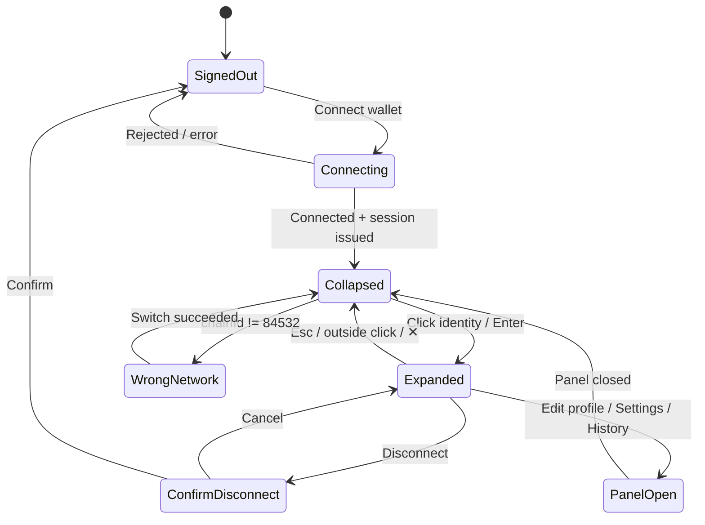

# Ludo 3077 — Lobby UI/UX Production Plan

> **Scope:** the `theme-3077` lobby shell (dashboard state of `app/page.tsx`): `GameLobby.tsx`, `HeaderNavPanel.tsx`, `FooterNavPanel.tsx`, the ticker, the slide-over panels, and a new bottom-left Account Dock.
> **Out of scope:** Retro and Daybreak keep their current look. Board gameplay motion (GSAP token hops, dice roll) stays as it is, because it carries game information.
> **Owner:** Product Design / UI Architecture · **Status:** Proposed · **Date:** 2026-11-07

## 0. Decision Log (2026-11-07)

| # | Decision | Effect on this plan |
| :--- | :--- | :--- |
| D1 | **This plan covers the mobile layout only (< 640px, incl. the Farcaster frame).** The desktop layout (264px side rail, §3.1 grid, 640–1023px icon rail) is deferred to a separate desktop plan. | §3.1 and the tablet/desktop rows of §3.2 are **reference only, not in scope**. The Account Dock ships in its mobile form: the avatar slot in `FooterNavPanel` opens a bottom sheet (§5.1, mobile). The desktop dock and popover in §5.2–5.3 define the content and states that the bottom sheet reuses. |
| D2 | **Shared [global] fixes wait until the 3077 work is done.** That covers the duplicate `@keyframes pulse` in `motion.css` and consolidating `--app-vh` / `--layout-vh` / `--visible-vh`. | They are removed from P1 and P4 and parked in a post-3077 phase (P9). Until then, the 3077 work must not depend on them. Use 3077-scoped keyframe names (e.g. `rail-sweep-3077`) and read the existing `--app-vh` as is. |

> **Status:** plan only. Implementation has not started.

All rules below are scoped under `body.theme-3077` unless marked **[global]**. Global changes need a visual gate (`npm run visual:diff`) on all three themes.

---

## 1. Current UI Audit & Deprecation List

### 1.1 Visual noise: high-frequency animation

The audit counted these `animate-pulse` / `animate-ping` / `animate-bounce` uses in `app/` (only the top files are listed):

| File | Count | Action in 3077 |
| :--- | :---: | :--- |
| `SignWaitModal.tsx` | 7 | Keep **one** progress signal (the 32px `ThinkingOrb` beacon). Remove the pulsing dots. Status becomes a static `StatusChip`. |
| `QuickMatchPanel.tsx` | 7 | Replace "searching" pulses with a determinate/indeterminate 2px progress rail (§2.6, `rail-sweep`). |
| `FriendsPanel.tsx` | 5 | Online dots become static: solid `--sig-ok` fill with a 1px ring. No ping. |
| `WalletConnectCard.tsx`, `PublicProfileModal.tsx`, `MessagesPanel.tsx`, `ActivityFeed.tsx` | 4 each | Static status dots. Unread state becomes a count badge, not a pulse. |
| `BoardHeaderCompact.tsx` | 3 | Out of lobby scope. Turn signal stays but is capped at one element. |
| `page.tsx:193` (ticker dot, `bg-cyan-400 animate-pulse` / `bg-pink-400 animate-pulse`) | 2 | Static dot. `pink-400` also breaks the palette, so swap it for `--sig-info`. |
| `UnsyncedMatchesPanel`, `TeamUpMatchPanel`, `SpectatorHUD`, `MatchHistoryTab`, `MarketplacePanel` | 2 each | Static semantic chips. |

Strip or neutralize these keyframes in 3077 (`app/styles/motion.css`):

- **Infinite loops to delete in the lobby:** `ping-glow`, `pulse` (both definitions, at lines 48 and 175, which is a duplicate name collision **[global bug]**), `active-pulse`, `glow`, `bounce`, `avatar-await-pulse`, `await-ring-expand`, `arena-bug-pulse`, `mystery-breathe`, `drift-orb`, `slow-rotate`.
- **Keep, one-shot only:** `fade`, `drawer`, `slide`, `chat-composer-in`, `chat-bubble-arrive`, `shimmer` (skeletons only, max 1.2s, no infinite loop after data lands).
- **Board-only (unchanged):** `pulse-draggable-svg`, `token-target-pulse`, `token-boost-trail`, `blockade`, `nuke-blink`.

Also remove from the 3077 layer:

- `.cosmic-orb`, `.boot-dot` (already hidden in 3077; delete the hide rules once the markup is gated).
- **Card dimming:** any `opacity-50` / `opacity-40` / `saturate` applied to non-selected cards or modes. Unselected means a neutral surface, not a dimmed one. Disabled is the only state allowed to lower contrast, and it must stay ≥ 3:1 for the label.
- **Glow shadows used as status:** `box-shadow: 0 0 Npx <accent>` on chips, ticks and buttons. This includes `.porcelain-holo-tick` (glow) and the `theme-3077.css` rules for `.board-header-shell`, `.ludo-ticker-scope > div:hover` and the scope `:is(...)` block (`0 0 35px rgba(0,229,255,.20)`). Replace them with a border-luminance step.

### 1.2 Destructive hover states

| Location | Current | Problem | Replacement |
| :--- | :--- | :--- | :--- |
| `GameLobby.tsx:428` mode pills | `hover:scale-[1.02] active:scale-95 transition-all` | Scale changes the hit box and overlaps neighbours; `transition-all` animates layout props. | `transition-[border-color,background-color] 150ms ease-out`; hover = border step + tint. |
| `GameLobby.tsx:464` match-type buttons | `hover:scale-110 active:scale-90` | A 10% overflow collides in the 3-button row. | Same as above. Active state uses an inner `::after` inset (no scale). |
| `GameLobby.tsx:502, 530, 547` utility buttons | `hover:scale-105 shadow-lg` | Shadow expansion plus scale. | Border plus tint only. |
| `MessagesPanel.tsx` (6), `FriendsPanel`, `ActivityFeed`, `LiveArenaDirectory`, `SpectatorHUD` (2 each), `Leaderboard`, `LiveMatchmakingFeed`, `MarketplacePanel`, `WalletConnectCard` (1 each) | `hover:scale-*` / `whileHover={{ scale }}` | Rows and cards shift inside lists, and scroll containers clip the overflow. | Row hover = `--surface-hover` tint plus a 2px left accent bar drawn with `inset box-shadow` (no size change). |
| `ActionDice.tsx` (2) | `whileHover scale` | Gameplay CTA. | Allowed **only** as an internal transform on a child inside a fixed-size wrapper (`contain: layout paint`). |
| `TokenVisual.tsx` `whileHover scale 1.25 y:-6` | — | Board scope. | Unchanged. |

**Global rule:** in 3077, `transition-all` is banned on interactive elements. Transitions list their properties explicitly.

### 1.3 Scroll jank & overflow collisions

- **Nested `overflow-y-auto`:** `ClanPanel.tsx` (6), `MessagesPanel.tsx` (3), `MarketplacePanel.tsx` (3), `ActivityFeed.tsx` (3), `TeamUpMatchPanel.tsx` (2), and one each in `UserProfilePanel`, `SettingsPanel`, `RankingsPanel`, `QuickMatchPanel`, `MissionPanel`, `OfflineMatchPanel`, `PublicProfileModal`, `SignWaitModal`, `SpectatorHUD`, `UnsyncedMatchesPanel`.
- **Viewport-height drift:** `board.css:1430–1440` and `panels.css:249–250` write `height: var(--app-vh, 100vh)` and then `100dvh` as a fallback pair. `panels.css:749–751` defines three overlapping vars (`--app-vh`, `--layout-vh`, `--visible-vh`). These get consolidated (§3.3).
- **Scrollbars:** only `landing.css` styles `::-webkit-scrollbar`. Panels fall back to the OS default, so scrollbars look different from panel to panel.

---

## 2. Design System Tokens (3077)

Define these in `app/styles/themes/theme-3077.css`. They extend the existing semantic tokens (`--surface-*`, `--ink-*`, `--line-*`, `--accent`) and do not fork them.

### 2.1 Color

| Token | Value | Use | Contrast on `--surface-0` |
| :--- | :--- | :--- | :--- |
| `--surface-0` | `#05070A` | Page / obsidian base | — |
| `--surface-1` | `#0A0E14` | Shell rails (dock, header) | — |
| `--surface-2` | `rgba(14, 19, 27, 0.72)` | Glass card | — |
| `--surface-3` | `rgba(20, 27, 38, 0.84)` | Popover / drawer | — |
| `--surface-hover` | `rgba(255, 255, 255, 0.04)` | Hover tint | — |
| `--surface-selected` | `rgba(0, 229, 255, 0.08)` | Selected tint | — |
| `--ink-strong` | `#F1F5F9` | Primary text | 17.6:1 |
| `--ink-muted` | `#A3AEBD` | Secondary text | 8.4:1 |
| `--ink-faint` | `#6B7685` | Tertiary / meta (≥ 12px only) | 4.6:1 |
| `--line-soft` | `rgba(255, 255, 255, 0.08)` | Default glass border | — |
| `--line-strong` | `rgba(255, 255, 255, 0.16)` | Hover border | — |
| `--line-accent` | `rgba(0, 229, 255, 0.56)` | Selected / focus border | — |
| `--accent` | `#00E5FF` | Primary action, focus | 12.9:1 |
| `--accent-ink` | `#02090D` | Text on accent fill | 12.9:1 on accent |
| `--sig-ok` | `#22C55E` | Online, confirmed | 7.9:1 |
| `--sig-warn` | `#F59E0B` | Pending, timers, wagers | 9.6:1 |
| `--sig-danger` | `#F43F5E` | Error, disconnect | 5.4:1 |
| `--sig-info` | `#38BDF8` | Neutral info, streaming | 9.0:1 |

Team colors stay as defined (`#00FF66`, `#FF0055`, `#0099FF`, `#FFD000`) and are used **only** for team identity, never for UI state. The Purple Ban still applies: no violet, magenta or pink anywhere.

### 2.2 Elevation & glass layers

| Level | Surface | Blur | Border | Shadow |
| :--- | :--- | :--- | :--- | :--- |
| E0 Page | `--surface-0` + static grid backdrop | — | — | — |
| E1 Rail | `--surface-1` (opaque) | none | `1px --line-soft` on the inner edge | none |
| E2 Card | `--surface-2` | `blur(16px) saturate(120%)` | `1px --line-soft` | `0 1px 0 rgba(255,255,255,.04) inset` |
| E3 Popover | `--surface-3` | `blur(20px)` | `1px --line-strong` | `0 16px 40px rgba(0,0,0,.6)` (static, never animated) |
| E4 Modal | `--surface-3` over a `rgba(2,3,5,.72)` scrim | `blur(24px)` | `1px --line-strong` | same as E3 |

Rules:
- Text never sits directly on blur. Every glass surface has an opaque-enough base color so that contrast holds at **0% backdrop**.
- **Fallback:** `@supports not (backdrop-filter: blur(1px))` raises the surface alpha to `0.96`.
- No more than **2 stacked blur layers** on screen at once (performance on mid-range Android).

### 2.3 Typography

| Role | Family | Size / line-height | Weight | Case / tracking |
| :--- | :--- | :--- | :--- | :--- |
| Display (lobby title) | Chakra Petch | 32 / 40 | 600 | Uppercase, 0.08em |
| H1 panel title | Chakra Petch | 20 / 28 | 600 | Uppercase, 0.06em |
| H2 section label | Chakra Petch | 12 / 16 | 600 | Uppercase, 0.12em, `--ink-muted` |
| Body | Inter | 14 / 20 | 400–500 | Sentence case |
| Caption / meta | Inter | 12 / 16 | 500 | `--ink-faint` |
| Telemetry / numerals | `ui-monospace, "JetBrains Mono", SFMono-Regular, Menlo` | 12–14 / 16–20 | 500 | `tabular-nums` |
| CTA | Chakra Petch | 14 / 20 | 700 | Uppercase, 0.1em |

Wallet addresses, CHIPS balances, ping, sequence numbers and timers always use the mono role. Nothing on screen goes below 10px.

### 2.4 Spacing: 8pt grid

`--space-0: 0` · `--space-0_5: 4px` (icon gaps only) · `--space-1: 8px` · `--space-2: 16px` · `--space-3: 24px` · `--space-4: 32px` · `--space-5: 40px` · `--space-6: 48px` · `--space-8: 64px`

Component heights snap to 8: inputs/buttons 40px, compact chips 24px, list rows 56px, the dock 64px, and the header 56px. Touch targets are at least 40px (44px on coarse pointers via `@media (pointer: coarse)`).

### 2.5 Radius & chamfer

`--radius-sm: 4px` (chips) · `--radius-md: 8px` (buttons/inputs) · `--radius-lg: 12px` (cards/popovers).
The 3077 signature chamfer is `clip-path` with a 6px corner cut. Use it **only on primary CTAs and selected segmented controls**, not on every surface. A clip-path also clips focus rings, so a chamfered element draws its focus ring on a wrapper (§4.4).

### 2.6 Motion

| Token | Value | Use |
| :--- | :--- | :--- |
| `--ease-out` | `cubic-bezier(0.2, 0, 0, 1)` | Hover, tint, border |
| `--ease-emphasized` | `cubic-bezier(0.3, 0, 0, 1.2)` | Popover open |
| `--dur-instant` | `100ms` | Press feedback |
| `--dur-fast` | `150ms` | Hover / focus |
| `--dur-base` | `200ms` | Popover / drawer open |
| `--dur-exit` | `150ms` | Close (exits are faster than entries) |

- Only `opacity`, `transform`, `border-color`, `background-color` and `color` may animate.
- No infinite animation in the lobby **except** one indeterminate progress rail during matchmaking (`rail-sweep`, a 1.6s linear `translateX`, 2px tall).
- `prefers-reduced-motion` goes through `lib/motion.ts`: durations collapse to `0ms`, and popovers appear without the translate. The CI motion gate must stay green.

---

## 3. Layout & Scroll Architecture

### 3.1 Shell grid (desktop ≥ 1024px)

```
┌──────────────────────────────────────────────────────────────┐
│ HEADER 56px  (brand · ticker · CHIPS · notifications)        │
├──────────────┬───────────────────────────────────────────────┤
│ SIDE RAIL    │ MAIN STAGE (single scroll owner)              │
│ 264px        │  Mode select · Match type · Primary CTA       │
│  Nav groups  │  Live arena / activity cards                  │
│  (scrolls    │                                               │
│   only if    │                                               │
│   overflow)  │                                               │
├──────────────┤                                               │
│ ACCOUNT DOCK │                                               │
│ 64px         │                                               │
└──────────────┴───────────────────────────────────────────────┘
```

```css
body.theme-3077 .app-shell {
  height: 100dvh;
  overflow: hidden;
  display: grid;
  grid-template-columns: 264px minmax(0, 1fr);
  grid-template-rows: 56px minmax(0, 1fr);
  grid-template-areas: "header header" "rail main";
}
.shell-rail  { grid-area: rail; display: grid; grid-template-rows: minmax(0,1fr) 64px; }
.shell-main  { grid-area: main; overflow-y: auto; overscroll-behavior: contain; scrollbar-gutter: stable; }
```

### 3.2 Breakpoints

| Range | Layout |
| :--- | :--- |
| < 640px (mobile, Farcaster frame) | Single column. Header 56px, main scroll, existing `FooterNavPanel` 64px. The Account Dock collapses into the footer's avatar slot, and the popover becomes a bottom sheet. |
| 640–1023px | Rail collapses to a 72px icon rail; the dock shows the avatar only and expands the same popover. |
| ≥ 1024px | Full grid (§3.1). Main content max width 1120px, centered. |

Use container queries (`container-type: inline-size` on `.shell-main`) for card grids so cards respond to the space they actually have, not the viewport.

### 3.3 Scroll rules

1. **One scroll owner per view.** In the lobby, that is `.shell-main`. Slide-over panels own **one** body scroller (`GamePanelShell` body), and their headers/footers stay fixed.
2. Inner lists (chat, activity, clan roster) do **not** get their own `overflow-y-auto` unless they are virtualized or chat-anchored. Allowed exceptions: `MessagesPanel` thread (bottom-anchored chat) and `ClanPanel` chat. Each uses `overflow-anchor: auto` and gets a fixed-height parent.
3. **Viewport vars:** consolidate on a single `--app-vh` (JS-set from `visualViewport`, fallback `100dvh`). Retire `--layout-vh` and `--visible-vh` after migrating their readers. **[global]**
4. **Scrollbars:** a 3077 thin scrollbar (`scrollbar-width: thin; scrollbar-color: rgba(255,255,255,.16) transparent`), with a WebKit equivalent of 8px track and a 4px-radius thumb. Applied to `.shell-main`, `.panel-body` and the two exceptions only.
5. `overscroll-behavior: contain` on every scroll owner, so the page never rubber-bands behind a panel.

---

## 4. Component Refactoring Specs

### 4.1 Card stability contract

Every card (mode card, live match card, arena card, marketplace item, leaderboard row):

```css
.card-3077 {
  position: relative;
  min-height: var(--card-min, 120px);   /* locked; content never grows the row */
  background: var(--surface-2);
  border: 1px solid var(--line-soft);
  border-radius: var(--radius-lg);
  backdrop-filter: blur(16px);
  contain: layout paint;               /* isolate repaint and overflow */
  transform: translateZ(0);            /* own GPU layer, no transform change on hover */
  transition: border-color var(--dur-fast) var(--ease-out),
              background-color var(--dur-fast) var(--ease-out);
}
.card-3077:hover        { border-color: var(--line-strong); background-color: color-mix(in srgb, var(--surface-2), white 4%); }
.card-3077[aria-selected="true"],
.card-3077[aria-pressed="true"] { border-color: var(--line-accent); background-color: var(--surface-selected); }
.card-3077:active       { background-color: color-mix(in srgb, var(--surface-2), white 2%); }
```

- Grids use `grid-template-columns: repeat(auto-fill, minmax(240px, 1fr))` with `grid-auto-rows: minmax(var(--card-min), auto)`. Media slots use `aspect-ratio`.
- Text truncates (`text-overflow: ellipsis` / `line-clamp: 2`); it never reflows the card.
- Loading uses a skeleton at the **same dimensions** as the loaded card (zero CLS).

### 4.2 Interactive state matrix

| State | Border | Background | Text | Other |
| :--- | :--- | :--- | :--- | :--- |
| Default | `--line-soft` | `--surface-2` | `--ink-strong` | — |
| Hover | `--line-strong` | + 4% white | unchanged | 150ms ease-out |
| Focus-visible | `--line-accent` | unchanged | unchanged | 2px `--accent` outline, 2px offset (on the wrapper if chamfered) |
| Pressed | `--line-strong` | + 2% white | unchanged | 100ms; optional child `scale(.98)` inside `contain` |
| Selected | `--line-accent` | `--surface-selected` | `--accent` label | static 2px top bar in `--accent` |
| Disabled | `--line-soft` | `--surface-2` | `--ink-faint` | `cursor: not-allowed`; no dimming of siblings |
| Loading | `--line-soft` | `--surface-2` | label kept | inline 2px rail; width locked |

### 4.3 Lobby components

**Mode selector (`Classic` / `Power`):** replaces the `GameLobby.tsx:428` pills.
- A segmented control with `role="radiogroup"`, 2 segments at 160×48. The selected segment gets the chamfer, a `--line-accent` border and the `--surface-selected` tint.
- A one-line mono caption beneath it describes the mode (`6 POWER TILES · BOOSTS ON`).

**Match type (`1v1` / `2v2` / `4P`):** replaces `GameLobby.tsx:464`.
- 3 segments at 72×48 each. Each shows a seat glyph plus a mono label, and the same state matrix applies.
- Seat glyphs follow the seating spec (1v1 diagonal, 2v2 teammates diagonal) and use the team colors drawn from `TEAM_PAIRINGS`. Never hardcode them.

**Primary CTA (`PLAY` / `FIND MATCH`):**
- Full width of the controls column, 56px tall, with an `--accent` fill, `--accent-ink` text and the chamfer.
- Hover: background changes to `#33EBFF`. No glow, no scale.
- Matchmaking state: the label switches to `SEARCHING · 00:14` (mono timer), the 2px `rail-sweep` runs along the bottom edge, and a secondary `CANCEL` button appears. The width stays locked.

**Utility buttons (`GameLobby.tsx:502–547`):** 40×40 icon buttons following the state matrix. Each gets an `aria-label` and a tooltip after a 400ms delay.

**Ticker (`page.tsx` ~193):**
- A 32px rail inside the header. Static dot in `--sig-info` (streaming) or `--sig-warn` (pending). Text in mono 12px.
- Marquee motion is replaced by a 6s **crossfade** rotation (opacity only), which pauses on hover/focus and under reduced motion.

**Live arena / activity cards:**
- `--card-min: 112px`. The live state shows a static `LIVE` chip (`--sig-danger` text on a 12% tint). No ping animation.

**Slide-over panels (`GamePanelShell`):**
- E3 surface. Panel width 440px on desktop; full-screen sheet on mobile.
- Opens with a 200ms `translateX(16px)→0` plus fade. Header 56px, single body scroller, optional 64px footer.

### 4.4 Accessibility

- Focus is always visible (`:focus-visible`). For chamfered elements the outline goes on a non-clipped wrapper.
- State is never conveyed by color alone: every status chip includes a text label.
- Contrast is checked against the 0%-backdrop fallback.
- Roles: segmented controls use `role="radiogroup"`; the dock popover is `role="dialog"` with `aria-modal="false"`, a focus trap while open, and `Esc` to close.

---

## 5. Bottom-Left Account System Specification

### 5.1 Placement

- **Desktop/tablet:** the bottom 64px row of `.shell-rail` (grid row 2). It is part of the grid, so it **never overlaps content and never shifts layout**.
- **Mobile (< 640px):** the avatar slot in `FooterNavPanel`. Expansion uses a bottom sheet (max height 85dvh).

### 5.2 Collapsed dock (264×64)

```
┌──────────────────────────────────────────────┐
│ [AV]●  vitalik.base             ⚙  🔊  ⏻    │
│ 40px   0x1a2b…9f3c · BASE SEP               │
└──────────────────────────────────────────────┘
```

| Element | Spec |
| :--- | :--- |
| Avatar | 40×40, `--radius-md`. Falls back to an identicon generated from the address. |
| Status badge | 10px dot in the avatar's bottom-right corner with a 2px `--surface-1` ring. `--sig-ok` online / `--sig-warn` signing or pending / `--ink-faint` offline. **Static, never blinks.** |
| Handle | ENS / Farcaster handle / profile name, Chakra Petch 14/20 600, truncated. |
| Address | Mono 12/16 `--ink-muted`, `0x1a2b…9f3c`, plus a network label (`BASE SEP`). It turns `--sig-warn` and reads `WRONG NETWORK` when off chain 84532. |
| Quick actions | Three 32×32 icon buttons: Settings (opens `SettingsPanel`), Audio/FX toggle (`useSoundEffects` mute; the icon reflects state, with `aria-pressed`), Disconnect (asks for confirmation inside the popover; it never disconnects on a single click). |
| Trigger | The avatar + identity block is a `button` with `aria-expanded` / `aria-controls="account-popover"`. |

Signed-out variant: the same 64px slot shows a `CONNECT WALLET` secondary button. The row height stays the same.

### 5.3 Expanded popover (360×auto, max 560px)

It opens **upward**, anchored to the dock's top-left (`bottom: 72px; left: 8px`), and is rendered in a portal with `position: fixed` so it **does not affect layout**. It uses the E3 surface. Entry is 200ms (`opacity 0→1`, `translateY(8px)→0`); exit is 150ms.

```
┌ ACCOUNT ─────────────────────────────── ✕ ┐
│ [AV 56] vitalik.base        [EDIT PROFILE]│
│         Tier: GOLD III · LV 24            │
├ WALLET ───────────────────────────────────┤
│ 0x1a2b3c…7d8e9f3c            [COPY] [↗]   │
│ Mode: IN-GAME (CDP) | EXTERNAL (MetaMask) │
│ CHIPS   12,450.00      USDC   20.00       │
│ ETH     0.0142                            │
├ NETWORK ──────────────────────────────────┤
│ ● Base Sepolia · 84532   Room: CONNECTED  │
│ Latency 42ms · Session v2 · exp 23h       │
├ RECENT ───────────────────────────────────┤
│ W  1v1 Classic   +240 CHIPS   2h ago      │
│ L  4P Power      −100 CHIPS   5h ago      │
│ [VIEW FULL HISTORY →]                     │
├ SECURITY ─────────────────────────────────┤
│ (in-game) Passkey boot lock      [ON ]    │
│ (in-game) Auto-sign match msgs   [OFF]    │
│ Allowances  2 active      [MANAGE →]      │
│ Active session            [SIGN OUT]      │
├───────────────────────────────────────────┤
│ [DISCONNECT WALLET]                       │
└───────────────────────────────────────────┘
```

Section rules:

- **Profile:** opens `UserProfilePanel` for edits. Tier and level come from `lib/progression.ts`.
- **Wallet telemetry:** balances in mono, right-aligned. The mode label comes from `useWalletMode()`.
- **Network:** the chain row reads `--sig-warn` with a `SWITCH TO BASE SEPOLIA` action (it calls the same `switchChainAsync({ chainId: 84532 })` path as `NetworkAutoSwitcher`). The room row reflects `roomAuthority` (WebSocket connected) vs the P2P host. It is display only and changes no authority.
- **Recent:** the last 3 matches from `/api/matches/history` (session-authenticated), with a deep link to `MatchHistoryTab`.
- **Security (wallet boundary, mandatory):**
  - Passkey/biometric rows render **only when `useWalletMode() === 'ingame'`**.
  - For external wallets, show the line "Security is managed by your wallet (MetaMask)". There are no Ludo passkey toggles and no WebAuthn prompts (per `AGENTS.md` and `docs/architecture/WALLET_SIGNING_POLICY.md`).
  - `MANAGE →` opens `AllowanceHubSheet`. Any revoke goes through the `SignWaitModal` dual-modal guard.
- **Disconnect:** clicking it swaps the footer in place for `Confirm disconnect? [CANCEL] [DISCONNECT]` (same height, no layout jump).

### 5.4 State machine



- `WrongNetwork` is a **decorated** collapsed state: the warning label shows and the actions still work.
- Opening any slide-over panel closes the popover first, so there is only ever one E3 surface on screen.
- `ConfirmDisconnect` times out back to `Expanded` after 8s.

### 5.5 Component hierarchy

```
app/components/account/
├── AccountDock.tsx            // grid slot; chooses Dock vs MobileAvatarSlot
│   ├── AccountIdentityButton  // avatar + StatusBadge + handle + address
│   ├── StatusBadge            // static dot, props: 'online'|'pending'|'offline'
│   └── DockQuickActions       // Settings · AudioToggle · Disconnect
├── AccountPopover.tsx         // portal, focus trap, Esc, outside-click
│   ├── ProfileSection
│   ├── WalletTelemetrySection // balances (useChipsAllowance / wagmi reads)
│   ├── NetworkSection         // chain + room + session expiry
│   ├── RecentMatchesSection   // /api/matches/history (session)
│   ├── SecuritySection        // gated by useWalletMode()
│   └── DisconnectFooter       // inline confirm
├── useAccountDockState.ts     // reducer implementing §5.4
└── account-dock.css           // 3077 tokens; imported from globals.css
```

Data sources reuse existing hooks only (`useWalletMode`, `usePreferences`, wagmi `useAccount` / `useChainId`, `TeamUpContext` room status, the app session). No new API routes, so the route-auth matrix is unaffected.

---

## 6. Phased Implementation Roadmap

| Phase | Deliverable | Files | Gate |
| :--- | :--- | :--- | :--- |
| **P0: Baseline** | Capture the visual baselines for all three themes before any change. | `scripts/visual-diff.mjs` | `npm run build && npm start` → `npm run visual:baseline` |
| **P1: Tokens** | §2 tokens in `theme-3077.css`. Remove the glow shadows. (Duplicate `pulse` fix deferred to P9, per D2.) | `theme-3077.css` | `tsc`, `lint`, motion gate, `visual:diff` (Retro/Daybreak unchanged) |
| **P2: Motion & noise purge** | Gate `animate-pulse` / `ping` / `bounce` behind a `.motion-static` override in 3077. Convert status dots to `StatusChip` / `StatusBadge`. Ticker crossfade. | §1.1 files, `page.tsx` | Motion gate; manual pass with reduced motion on |
| **P3: Hover stability** | Strip `hover:scale` / `transition-all` from the lobby. Introduce `.card-3077` and the state matrix. | `GameLobby.tsx`, list panels in §1.2 | `visual:diff` hover snapshots; zero CLS in a Lighthouse lobby run |
| **P4: Shell & scroll (mobile)** | Mobile shell: header 56px, main as the single scroll owner, footer 64px, `100dvh` lock, thin scrollbars. Desktop rail is out of scope (D1); `--app-vh` consolidation is deferred (D2). | `page.tsx`, `panels.css`, `GamePanelShell.tsx` | Device pass 320 / 360 / 390 / 430. No double scrollbars, no body scroll behind panels. |
| **P5: Lobby components** | Segmented mode/match controls, CTA states, and the matchmaking rail. | `GameLobby.tsx`, `QuickMatchPanel.tsx` | `npm test` (lobby-doors, matchmaking-shape), keyboard-only run |
| **P6: Account Dock (mobile)** | Footer avatar slot opens an `AccountSheet` bottom sheet with the §5.3 sections, the §5.4 reducer and wallet-mode gating. | `app/components/account/*`, `FooterNavPanel.tsx` | Unit tests for the reducer and wallet-mode gating (external wallets get no passkey UI); `scripts/wallet-guard.test.ts` green |
| **P7: Panels** | Apply E3 and the single-scroller rule to the slide-overs (Clan, Messages, Marketplace, Activity first, since they have the most nested scrollers). | §1.3 files | `visual:diff`; scroll audit |
| **P8: Hardening** | Contrast audit at 0% backdrop, the `@supports` blur fallback, the two-blur-layer budget, and docs (`DESIGN.md` 3077 section). | — | Full CI: `npm test`, `tsc`, `lint`, `check:wrangler-guard`, `check-routes`, `npm run build` |

| **P9: Post-3077 global fixes (deferred, D2)** | Fix the duplicate `@keyframes pulse` in `motion.css`; consolidate the viewport vars on `--app-vh`. | `motion.css`, `panels.css`, `board.css` | `visual:diff` on all three themes |
| **Separate plan: Desktop layout (deferred, D1)** | §3.1 grid, 264px rail, desktop Account Dock and popover. | — | Own plan doc |

**Definition of done (lobby, 3077, mobile):**
- No infinite animation except the matchmaking rail.
- No hover changes geometry (no size or position shift).
- One scroll owner per view.
- AA contrast at 0% backdrop.
- The Account Dock follows the wallet boundary.
- All CI gates green, and Retro/Daybreak show zero visual diff.
