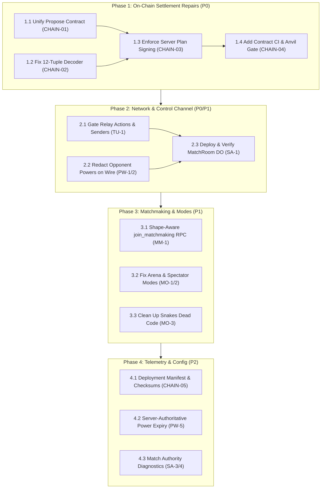

# Ludo Base — System Review & Implementation Plan

**Date:** 2026-10-20  
**Target Git Ref:** `a9b3a3d` (Post-MatchRoom Migration & Settlement Surface)  
**Status:** Unified Authoritative Review & Implementation Plan  
**Scope:** Rules engine, MatchRoom Durable Object, network authority, matchmaking, private lobbies, power mechanics, game modes, and on-chain settlement contracts (`MatchPool` / `ClaimHub`).

---

## 1. Executive Summary

A comprehensive system-wide audit of Ludo Base reveals a defining architectural contrast:
- **Game Engine & Seat Mathematics are Solid:** Pure engine calculations in `lib/engine/core.ts` (1,043 lines), 2v2 diagonal seating in `TEAM_PAIRINGS`, and seeded LCG power mechanics are deterministic, well-tested, and passing 454 unit tests across all static gates.
- **Authority Migration is In-Flight:** The legacy architecture relied on a split authority—a P2P host browser (`TeamUpContext.tsx`) and unversioned Supabase Edge functions (`roll-dice`, `move-auth`, `resolve-bet` which were deleted from source yet remained active in production). The repository has introduced the **MatchRoom Durable Object** (`src/room/MatchRoom.ts`) and Session v2 to centralize game state, turns, and atomic database commits. Operational deployment and binding proofs remain required.
- **On-Chain Settlement is Severely Broken (Blocker):** While the Solidity contracts (`contracts/src/MatchPool.sol`) implement robust EIP-712 signature verification, delay periods, and seat binding, **the frontend and API glue cannot execute settlements**. A schema mismatch (`CHAIN-01`), an off-by-one 12-tuple decoding bug (`CHAIN-02`), and submission of client-constructed plans rather than server-signed plans (`CHAIN-03`) cause immediate 400 errors or smart contract transaction reverts.

**Release Verdict:** The paid-pool and real-value settlement features are **NOT release-ready**. The implementation plan in Section 4 must be executed to unblock on-chain claims and ensure control-channel integrity.

---

## 2. Architecture & Trust Topology

```
┌────────────────────────────────────────────────────────────────────────┐
│                          CLIENT BROWSERS                               │
│  - React UI & Canvas Motion (FLIP / GSAP)                              │
│  - Optimistic Player Actions (REQUEST_ROLL, REQUEST_MOVE)               │
│  - Wallet Signatures (EIP-712 / SIWE / CDP Passkeys)                   │
└──────────────────────────────────┬─────────────────────────────────────┘
                                   │
               ┌───────────────────┴───────────────────┐
               ▼                                       ▼
┌───────────────────────────────┐     ┌──────────────────────────────────┐
│   MATCHROOM DURABLE OBJECT    │     │   SUPABASE REALTIME & REST       │
│  - Authoritative Room State   │     │  - Session v2 Authentication     │
│  - Turn Clock & Autoplay      │     │  - Ephemeral Signaling           │
│  - Deterministic Dice RNG     │     │  - Atomic match_commit_action    │
│  - EIP-712 Settle Plan Signing│     │  - Canonical matches store       │
└──────────────┬────────────────┘     └─────────────────┬────────────────┘
               │                                        │
               └───────────────────┬────────────────────┘
                                   ▼
┌────────────────────────────────────────────────────────────────────────┐
│                      BASE ON-CHAIN CONTRACTS                           │
│  - MatchPool.sol (Escrow, EIP-712 Settle Verification, Nonces, Slashing)│
│  - ClaimHub.sol (Delayed Prize Claims, Pull Payouts, Merkle Proofs)    │
│  - CHIPS (ERC-20 In-Game Currency)                                     │
└────────────────────────────────────────────────────────────────────────┘
```

### Subsystems Breakdown

| Layer | Source Location | Authority Model | Current Operational State |
|---|---|---|---|
| **Rules Engine** | `lib/engine/core.ts` (1,043 lines) | Pure functional engine | Verified green; byte-identical to room engine. |
| **Server Room** | `src/room/MatchRoom.ts` + `engine.ts` | Authoritative Cloudflare DO | Source complete; requires Cloudflare worker binding verification. |
| **Signaling & Relay** | `hooks/useSupabaseRelay.ts` + `TeamUpContext.tsx` | Supabase Realtime Broadcast | Vulnerable: unauthenticated control verbs (`TU-1`); needs channel RLS. |
| **Settlement API** | `app/api/chips/settle/propose/route.ts` | Server EIP-712 Co-Signer | Broken: expects `winners` array, caller sends `winnerAddresses` (`CHAIN-01`). |
| **Smart Contracts** | `contracts/src/MatchPool.sol` | On-Chain Escrow & Rules | Secure source; frontend tuple decoding is shifted off-by-one (`CHAIN-02`). |

### Mode Matrix Reality
- **Classic (1v1, 2v2, 4P):** Fully functional. Clean logic with zero power tiles.
- **Power (1v1, 2v2, 4P):** Functional mechanics, but wire sanitizer broadcasts opponent inventory (`PW-2`), and guest local resolution diverges from host (`PW-3`).
- **Snakes & Ladders:** Unreachable dead code (670 lines in `SnakesBoard.tsx`).
- **Live Arena (Power 4P):** Mislabelled; executes classic rules via `Math.random()` without power logic (`MO-1`).

---

## 3. Findings Register

### 3.1 Severity Matrix

| Severity | Count | IDs |
|---|---|---|
| **Critical** | 7 | `CHAIN-01`, `CHAIN-02`, `CHAIN-03`, `TU-1`, `TU-2`, `PW-1`, `SA-2` |
| **High** | 9 | `CHAIN-04`, `CHAIN-05`, `SA-1`, `PW-2`, `PW-3`, `PW-4`, `TU-3`, `TU-4`, `MM-1` |
| **Medium** | 9 | `TU-5`, `MM-2`, `MM-3`, `SA-3`, `SA-4`, `MO-1`, `MO-2`, `MO-3`, `PW-5` |
| **Low** | 6 | `MM-4`, `MM-5`, `MO-4`, `MO-5`, `PW-6`, `SA-5` |

---

### 3.2 Finding Details

#### On-Chain Settlement & Contracts

##### CHAIN-01 (Critical) — Settlement Propose Schema Mismatch
- **Location:** `app/api/chips/settle/propose/route.ts:47-58` vs `hooks/useSettlePool.ts:70-86`
- **Mechanism:** The API route enforces `if (!poolId || !Array.isArray(winners) || winners.length === 0) return 400`. The hook sends `{ winnerAddresses, payoutPlan, poolId, ... }` without `winners`.
- **Impact:** **100% failure rate** on settlement proposals via the UI. Paid settlement is completely blocked.

##### CHAIN-02 (Critical) — Off-By-One Tuple Decoding in `useChipsPool`
- **Location:** `hooks/useChipsPool.ts:167-180` vs `contracts/src/MatchPool.sol:286-318`
- **Mechanism:** `MatchPool.getPoolSummary` returns 12 values:
  `[status, maxSeats, filledSeats, shape, authority, entryFee, gross, prizeFund, hostBond, settleBy, claimUnlockAt, settleNonce]`.
  The hook casts data to a stale 10-value tuple missing `shape` at index 3.
- **Impact:** Every decoded field after `filledSeats` is shifted: `authority` receives `shape`, `entryFee` receives `authority`, `prizeFund` receives `gross`, and `claimUnlockAt` receives `settleBy`. UI displays corrupted data and computes fees against wrong fields.

##### CHAIN-03 (Critical) — Hook Submits Client Plan Instead of Server-Signed Plan
- **Location:** `hooks/useSettlePool.ts:126-134` vs `contracts/src/MatchPool.sol:716-730`
- **Mechanism:** The route derives `planHash` from a canonical server-generated payout plan. The hook takes the server's `edgeSig` but submits client-constructed `args.plan` to the contract.
- **Impact:** Any difference in dust division, winner ordering, or wei conversion causes contract `settleStructHash` mismatch, triggering an **instant transaction revert**.

##### CHAIN-04 (High) — Contract Tests Excluded from GitHub Actions CI
- **Location:** `package.json:56-62`, `.github/workflows/ci.yml`
- **Mechanism:** Foundry is installed in CI only for deploy-guardrail tests. `forge test` and Anvil E2E integration tests are never run in CI.
- **Impact:** Contract regressions can merge without failing PR checks.

##### CHAIN-05 (High) — Chain and Contract Address Configuration Lacks Validation
- **Location:** `lib/chips.ts:135-145`, `hooks/useSettlePool.ts:54`
- **Mechanism:** Addresses are trusted if they begin with `0x`. An unrecognized chain defaults to Base Sepolia.
- **Impact:** Configuration errors lead to mismatched bytecode or signing transactions against the wrong network.

---

#### Authority & Settlement

##### SA-1 (High) — Legacy Edge Functions Deployed but Deleted from Git
- **Location:** Hosted Supabase project vs `supabase/functions/`
- **Mechanism:** `roll-dice`, `move-auth`, and `resolve-bet` remain active on Supabase but were deleted from the repository.
- **Impact:** Production behavior diverges from version control. Must be completely superseded by the MatchRoom DO.

##### SA-2 (Critical) — Match Result Settlable Without Signature or Proof
- **Location:** `app/api/match/record/route.ts:74-83`
- **Mechanism:** If signatures are absent, any authenticated `scope: 'app'` session is accepted. The route awards LXP/RXP scaled by an unbounded client-supplied `wager`.
- **Impact:** Progression exploit allowing participants to self-mint millions of LXP.

##### SA-3 (Medium) — Session v2 Lacks Seat Binding
- **Location:** `lib/serverAuth.ts:107-110`, `app/api/match/record/route.ts:76-80`
- **Mechanism:** Match-scoped sessions bind to `matchId` and wallet address, but do not bind to seat index or player color.

##### SA-4 (Medium) — Lack of Continuous State Reconciliation Loop
- **Location:** `hooks/useMatchStates.ts:76-98`, `hooks/useGameActions.ts:159-253`
- **Mechanism:** Clients poll match states on mount, but lack an ongoing seq-reconciliation loop during P2P play.

---

#### Netcode & Room Security

##### TU-1 (Critical) — Unauthenticated Control Channel on Public Relay
- **Location:** `hooks/useSupabaseRelay.ts:105`, `hooks/TeamUpContext.tsx:843-895`
- **Mechanism:** `game-room-<roomCode>` is a public broadcast topic. The receiver processes `START_GAME` (re-seeds board mid-match) and `MOVE_TOKEN` (writes arbitrary `targetPosition`) without validating sender identity.
- **Impact:** Malicious participants or observers can tamper with active game boards and force arbitrary token movements.

##### TU-2 (Critical) — Trusting Peer-Supplied Coin Balances
- **Location:** `hooks/TeamUpContext.tsx:586-588`
- **Mechanism:** `seatGuestPlayer` reads `playerCoins` directly from peer payload, re-opening the vulnerability patched in SEC-12.

##### TU-3 (High) — REST Join Fallback Fails During Room Formation
- **Location:** `app/api/lobby/join/route.ts:156-166`, `hooks/TeamUpContext.tsx:1186-1231`
- **Mechanism:** Host poll requires a `live_matches` row that is only written after the match starts. The fallback always returns 403 during lobby formation.

##### TU-4 (High) — Host and Guest Diverge on Move and Power Execution
- **Location:** `hooks/useGameActions.ts:159,721`
- **Mechanism:** In P2P lobbies, guests execute moves/powers via the server while the host resolves locally without synchronizing budgets or turn clocks.

##### TU-5 (Medium) — Disconnect and Abandon Lacks Settlement Penalty
- **Location:** `lib/netcode/abandon.ts:37-64`, `hooks/useGamePresence.ts:63-78`
- **Mechanism:** Abandonment classification exists but does not burn stakes or mark matches unrated.

---

#### Power Mechanics & Privacy

##### PW-1 (Critical) — Authority State Leaks Held Powers
- **Location:** `hooks/useMoveAuth.ts:503-511`, `lib/engine/core.ts:588-596`
- **Mechanism:** `move-auth` action `get` requires no authentication and returns `playerPowers` containing all held types and expiries.

##### PW-2 (High) — Player Power Inventory Broadcast to All Peers
- **Location:** `hooks/TeamUpContext.tsx:512-517`, `lib/wireSanitize.ts:6-14`
- **Mechanism:** Wire sanitizer masks `powerTiles[].type` on the board, but broadcasts `playerPowers` (opponent hands) in plaintext.

##### PW-3 (High) — Guest Power Never Reaches Host Board
- **Location:** `hooks/useGameActions.ts:721`, `hooks/useMatchStates.ts:76-98`
- **Mechanism:** Powers applied on the server by guests are not propagated to the host's authoritative local board.

##### PW-4 (High) — Triple Implementation of Power Semantics
- **Location:** `lib/engine/core.ts`, `src/room/engine.ts`, `hooks/useGameActions.ts:796-943`
- **Mechanism:** Power rules are implemented in three separate files with only two covered by byte-sync gates.

##### PW-5 (Medium) — Power Expiry Dependent on Client Clock
- **Location:** `lib/engine/core.ts:744-746`, `hooks/useGameActions.ts:800`
- **Mechanism:** Expiry is filtered using local `Date.now()`, causing desync under clock skew.

##### PW-6 (Low) — Duplicate LCG Reseed Formula
- **Location:** `hooks/useGameActions.ts:339-347` duplicates `lib/engine/core.ts:966-968`.

---

#### Matchmaking & Modes

##### MM-1 (High) — Quick Match Cannot Fill 2v2 or 4P Tables
- **Location:** `supabase/migrations/00000000000000_baseline.sql:457-469`
- **Mechanism:** `join_matchmaking` RPC selects `limit 1` opponent and hardcodes `array[p_player_id, opponent.player_id]`.
- **Impact:** 2v2 and 4P queues create 2-player matches that stall waiting for missing seats and force players into bot matches.

##### MM-2 (Medium) — Orphan Ticket Cancel 401s
- **Location:** `hooks/useMatchmaking.ts:400-409`
- **Mechanism:** Cancel request omits `sessionId`, failing authentication and leaving stale tickets.

##### MM-3 (Medium) — Expanding Search is Client Decoration
- **Location:** `hooks/useMatchmaking.ts:7,255`, `app/components/QuickMatchPanel.tsx:189-194`
- **Mechanism:** Search expansion updates local state but does not broaden query parameters in the database.

##### MM-4 (Low) — API Boundary Lacks Game Mode / Match Type Validation
- **Location:** `app/api/matchmaking/join/route.ts:107-114` trusts input strings directly.

##### MM-5 (Low) — Ambiguous Edge Transports
- **Location:** `lib/teamup/edge-server-client.ts` vs Supabase edge URLs.

##### MO-1 (Medium) — Power 4P Arena Runs Classic Engine
- **Location:** `app/api/live-arena/power4p/route.ts:79-190`
- **Mechanism:** Matches use `Math.random()`, omit power calls, and write fake participant IDs.

##### MO-2 (Medium) — Spectator View Hardcodes 4P Power
- **Location:** `app/page.tsx:920-921` renders every spectated match as 4P Power.

##### MO-3 (Medium) — Snakes Mode is Unreachable Dead Code
- **Location:** `app/components/SnakesBoard.tsx`, `lib/snakesLogic.ts`

##### MO-4 (Low) — Duplicate Match Rows in Quick Match
- **Location:** `app/page.tsx:627-640` inserts a second match row for the same `room_code`.

##### MO-5 (Low) — Coordinate Frame Discrepancy
- **Location:** `lib/boardLayout.ts:177-211` has two conflicting coordinate implementations.

##### SA-5 (Low) — In-Process Rate Limiter Not Shared Across Isolates
- **Location:** `lib/rateLimit.ts` requires RateLimitDO centralization.

---

## 4. Implementation Plan



---

### Phase 1: On-Chain Settlement Repairs (P0 — Immediate Blocker)

#### Step 1.1: Unify Settle Propose Contract (`CHAIN-01`)
Create a shared, strictly-typed request/response contract between API and client.

1. **Create Shared Definition (`lib/types/settle.ts`):**
   ```ts
   export interface PayoutEntryWire {
       addr: `0x${string}`;
       amount: string; // Wei value serialized as decimal string
   }

   export interface SettleProposalRequest {
       walletAddress: `0x${string}`;
       sessionId: string;
       chainId?: number;
       poolId: `0x${string}`;
       authority?: `0x${string}`;
       winnerAddresses: `0x${string}`[];
       split?: 'standard' | 'even' | 'custom';
       nonce?: string;
       deadline?: string;
       mode?: 'dual' | 'edge-only';
   }

   export interface SettleProposalResponse {
       poolId: `0x${string}`;
       plan: PayoutEntryWire[];
       planHash: `0x${string}`;
       edgeSig: `0x${string}`;
       nonce: string;
       deadline: string;
       effectiveSettleBy: number;
       claimUnlockAt: number;
   }
   ```

2. **Update Route (`app/api/chips/settle/propose/route.ts`):**
   - Accept `winnerAddresses` directly from `SettleProposalRequest`.
   - Provide backward-compatible alias fallback: `const winners = body.winnerAddresses || body.winners;`.
   - Derive canonical payout plan and sign `planHash`.

3. **Update Hook (`hooks/useSettlePool.ts`):**
   - Transmit payload conforming exactly to `SettleProposalRequest`.

#### Step 1.2: Correct 12-Tuple Pool Summary Decoding (`CHAIN-02`)
Fix the tuple index mapping in `hooks/useChipsPool.ts` to match `MatchPool.sol:getPoolSummary`.

1. **Update `PoolSummaryView` Interface:**
   ```ts
   export interface PoolSummaryView {
       status: number;
       maxSeats: number;
       filledSeats: number;
       shape: number;
       authority: `0x${string}` | undefined;
       entryFee: bigint;
       gross: bigint;
       prizeFund: bigint;
       hostBond: bigint;
       settleBy: bigint;
       claimUnlockAt: bigint | undefined;
       settleNonce: bigint;
   }
   ```

2. **Update Decoder in `useChipsPoolSummary`:**
   ```ts
   const a = data as unknown as readonly unknown[];
   return {
       status: Number(a[0] ?? 0),
       maxSeats: Number(a[1] ?? 0),
       filledSeats: Number(a[2] ?? 0),
       shape: Number(a[3] ?? 0),
       authority: a[4] as `0x${string}` | undefined,
       entryFee: (a[5] as bigint) ?? BigInt(0),
       gross: (a[6] as bigint) ?? BigInt(0),
       prizeFund: (a[7] as bigint) ?? BigInt(0),
       hostBond: (a[8] as bigint) ?? BigInt(0),
       settleBy: (a[9] as bigint) ?? BigInt(0),
       claimUnlockAt: (a[10] as bigint) ?? undefined,
       settleNonce: (a[11] as bigint) ?? BigInt(0),
   };
   ```

#### Step 1.3: Enforce Server Payout Plan Integrity (`CHAIN-03`)
Prevent transaction reverts by ensuring the client submits the exact plan signed by the server.

1. **Update Contract Call in `hooks/useSettlePool.ts`:**
   ```ts
   // Map server-returned canonical plan to contract PayoutEntry[]
   const contractPlan = data.plan.map((p: PayoutEntryWire) => ({
       addr: p.addr,
       amount: BigInt(p.amount),
   }));

   // Verify local plan hash matches server edgeSig commitment
   const localHash = payoutPlanHash(contractPlan);
   if (localHash !== data.planHash) {
       throw new Error("Plan integrity check failed: local hash does not match server signature");
   }

   // Submit verified canonical plan
   const tx = await writeContractAsync({
       address: pool,
       abi: MATCH_POOL_ABI,
       functionName: "settlePool",
       args: [
           args.poolId,
           contractPlan,
           BigInt(data.deadline),
           BigInt(data.nonce),
           hostSig,
           data.edgeSig,
       ],
   });
   ```

#### Step 1.4: Add Contract CI & Anvil Test Harness (`CHAIN-04`)
1. Update `.github/workflows/ci.yml` to include Foundry testing:
   ```yaml
   - name: Run Foundry Contract Tests
     run: forge test --root contracts -vvv
   ```
2. Add an automated regression test script `scripts/settle-contract-integration.test.ts` to verify tuple decoding and settlement propose payload alignment.

---

### Phase 2: Network Authority & Control Channel Lockdown (P0 / P1)

#### Step 2.1: Enforce Sender Authorization on Relay Actions (`TU-1`)
1. **Gate Room Actions in `hooks/TeamUpContext.tsx`:**
   - For `START_GAME`: Verify that `senderAddress === roomHostAddress`. Reject messages from any other sender.
   - For `MOVE_TOKEN`: Enforce engine legal move check:
     `calculateNextPosition(currentPos, diceValue, color, corner) === targetPosition`.
     Reject unvalidated position overrides.
   - For `JOIN_REQUEST`: Enforce valid room secret or invite token.

#### Step 2.2: Redact Opponent Power Inventory (`PW-1`, `PW-2`)
1. **Update `lib/wireSanitize.ts`:**
   ```ts
   export function sanitizeGameStateForWire(state: GameState, viewerColor?: PlayerColor): GameState {
       const sanitized = { ...state };
       
       // Mask board power tiles
       if (sanitized.powerTiles) {
           sanitized.powerTiles = sanitized.powerTiles.map(pt => ({
               ...pt,
               type: undefined as unknown as PowerType,
           }));
       }
       
       // Redact opponent held powers
       if (sanitized.playerPowers) {
           const maskedPowers: Partial<Record<PlayerColor, PowerInventoryItem[]>> = {};
           for (const [color, items] of Object.entries(sanitized.playerPowers) as [PlayerColor, PowerInventoryItem[]][]) {
               if (viewerColor && color === viewerColor) {
                   maskedPowers[color] = items;
               } else {
                   // Mask opponent items
                   maskedPowers[color] = items.map(p => ({
                       ...p,
                       type: 'masked' as unknown as PowerType,
                   }));
               }
           }
           sanitized.playerPowers = maskedPowers as Record<PlayerColor, PowerInventoryItem[]>;
       }
       
       return sanitized;
   }
   ```

#### Step 2.3: Operational Deployment of MatchRoom DO (`SA-1`)
1. Validate Cloudflare worker binding in `wrangler.jsonc` (`MATCH_ROOM` DO class).
2. Direct all multiplayer room traffic through `/api/room/:matchId/ws`.
3. Sunset legacy Supabase Edge function dependencies (`roll-dice`, `move-auth`, `resolve-bet`).

---

### Phase 3: Matchmaking & Mode Truthfulness (P1)

#### Step 3.1: Shape-Aware Table Formation (`MM-1`)
1. Update SQL RPC `join_matchmaking` in `supabase/migrations/`:
   - Determine `slots_needed = (p_match_type = '1v1' ? 2 : 4)`.
   - Select up to `slots_needed - 1` matching tickets inside the advisory lock.
   - Bundle all matched players into `matches.participants` array.
2. *UI Guardrail:* Temporarily disable 2v2/4P tabs in `app/components/QuickMatchPanel.tsx` with "Under Maintenance" until the migration is executed.

#### Step 3.2: Reconcile Arena and Spectator Modes (`MO-1`, `MO-2`)
1. Update `app/api/live-arena/power4p/route.ts` to utilize the engine's power mechanics and standard `serviceDb()`.
2. Update `app/page.tsx:920` spectator view to pass dynamic `playerCount` and `gameMode` from the loaded match record instead of hardcoding `"4P"` and `"power"`.

#### Step 3.3: Snakes Mode Deprecation (`MO-3`)
Archive `app/components/SnakesBoard.tsx` and `lib/snakesLogic.ts` or restrict to a dedicated retro mini-game route outside the standard Ludo progression engine.

---

### Phase 4: Operational Quality, Timing, & Observability (P2)

#### Step 4.1: Explicit Deployment Manifest & Address Checksumming (`CHAIN-05`)
Create `lib/contracts/manifest.json` specifying validated contract addresses, bytecode hashes, and supported chain IDs (Base Sepolia: `84532`, Base Mainnet: `8453`). Validate at startup.

#### Step 4.2: Server-Authoritative Power Expiry (`PW-5`)
Remove client `Date.now()` evaluation for power inventory. Drive expiry strictly from server turn sequence numbers or server timestamps.

#### Step 4.3: Per-Match Authority Telemetry (`SA-3`, `SA-4`)
Emit structured Sentry/log breadcrumbs recording `matchId`, `room_version`, `seq`, and `authority_mode` on every state transition.

---

## 5. Acceptance Criteria & Verification Gates

```
┌────────────────────────────────────────────────────────────────────────┐
│                       RELEASE VERIFICATION GATES                       │
├────────────────────────────────────────────────────────────────────────┤
│ 1. Contract Alignment Gate:                                            │
│    npx tsx scripts/settle-propose.test.ts (CHAIN-01 & 03 verification)  │
│                                                                        │
│ 2. Tuple Decoding Gate:                                                │
│    npx tsx scripts/pool-summary.test.ts (CHAIN-02 verification)        │
│                                                                        │
│ 3. Foundry Contract Gate:                                              │
│    forge test --root contracts (Unit & invariant tests pass)           │
│                                                                        │
│ 4. Full Engine & Netcode Regression Suite:                             │
│    npm test (465 tests / 0 failures)                                   │
│                                                                        │
│ 5. TypeScript & Lint Hygiene:                                          │
│    npx tsc --noEmit && npm run lint (0 errors)                         │
└────────────────────────────────────────────────────────────────────────┘
```

The system is ready for real-value play on Base Sepolia only when Gates 1 through 5 pass and an end-to-end funded pool (join → lock → settle → delayed claim) completes successfully on-chain.
