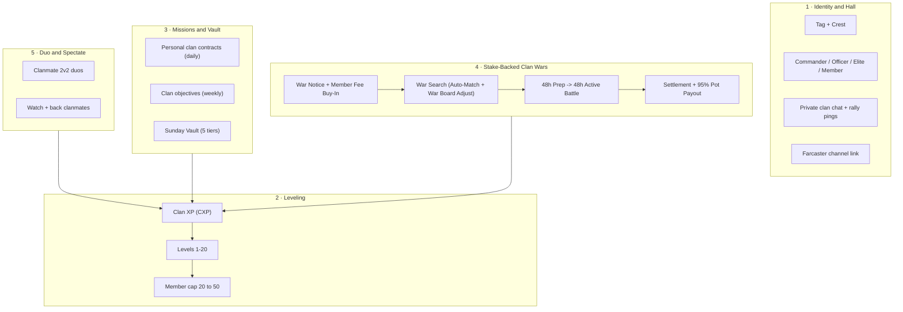
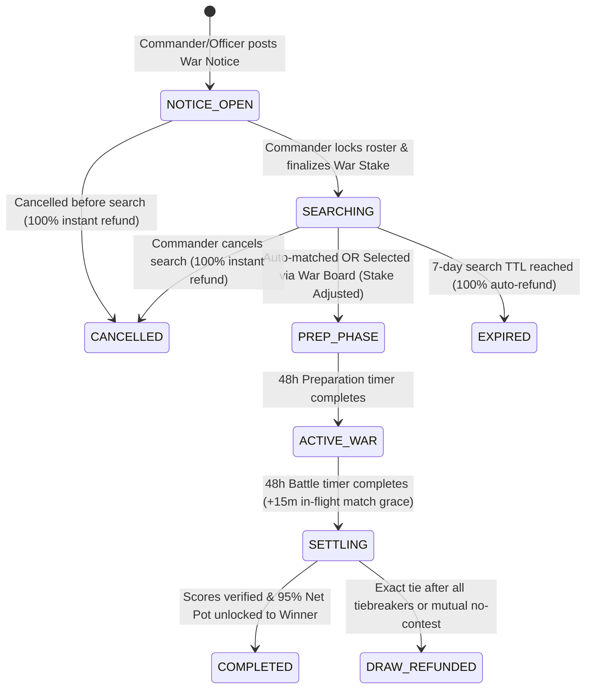
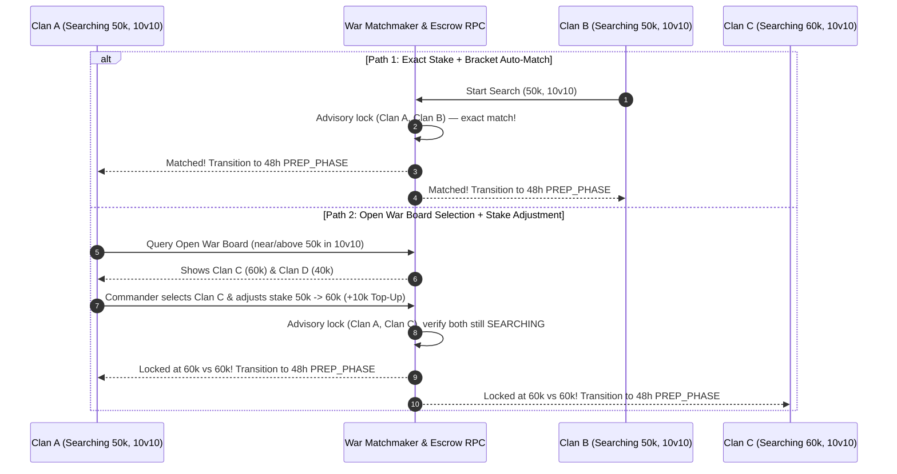
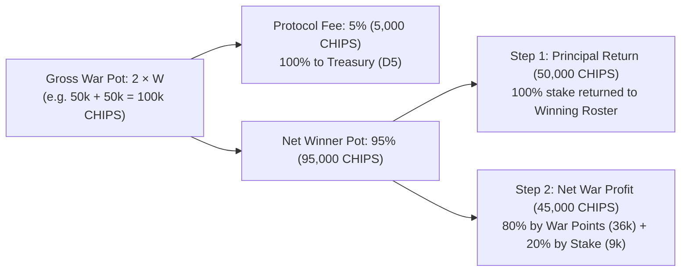
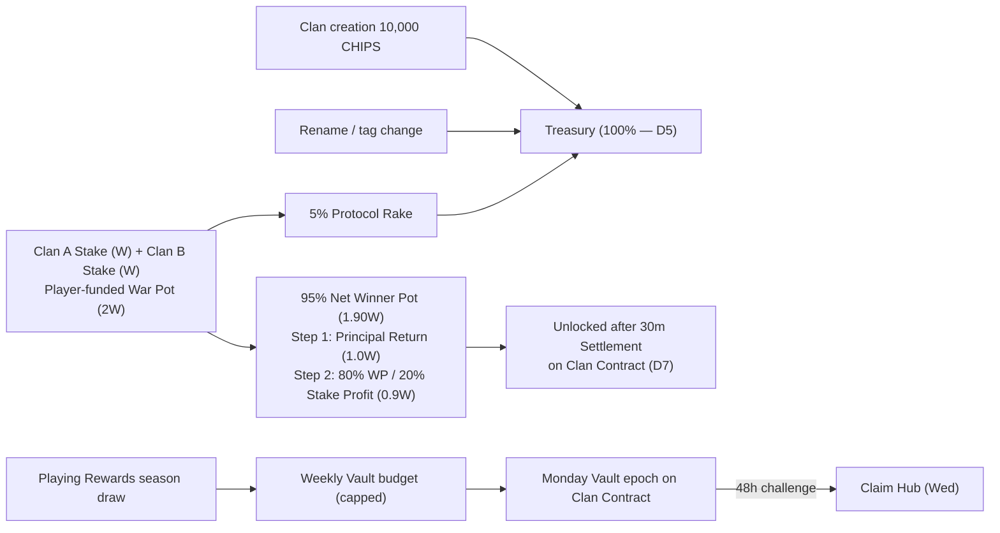
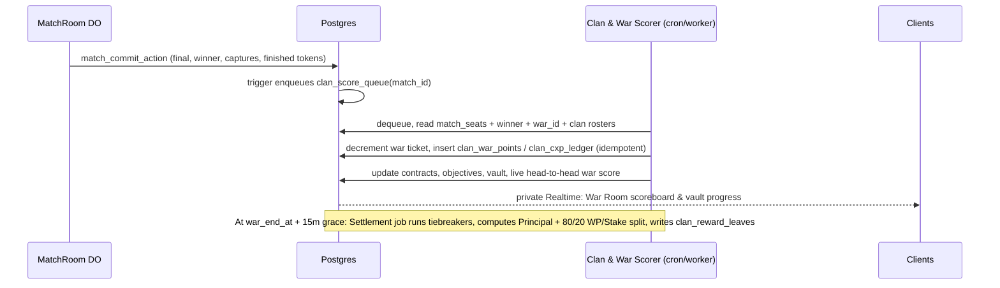

# CLAN_SYSTEM_PLAN.md — Tactical Syndicates (Clans, Leveling, Missions, Wars)

> **Status:** Research + product design **LOCKED for architecture planning** (2026-11-02; stake-backed Clan War lifecycle D11–D15 finalized).
> **Next step:** technical architecture (workload placement, migrations, routes, RPCs, gates).
> **Scope:** product rules, economy, anti-abuse, and the integration constraints the
> architecture must respect. No code lands from this doc directly.
> **Related:** `AGENTS.md` (trust model), `docs/tokenomics/TOKEN_PARAMS.md` (fee tiers,
> paid-volume floor), `docs/tokenomics/SYBIL_MODEL.md`, `docs/architecture/WALLET_SIGNING_POLICY.md`,
> `docs/architecture/WORKLOAD_PLACEMENT_MATRIX.md`, `docs/research/COMPETITIVE_LUDO_WORLD_LUDO_KING.md` §10.

---

## 0. Locked owner decisions

| # | Decision | Value |
| --- | --- | --- |
| D1 | Member cap | **Starts at 20**, grows with **clan level** (50 at L20 in v1; levels open-ended for later seasons) — see §4 |
| D2 | Creation cost | **10,000 CHIPS** (= one High-roller entry, `TOKEN_PARAMS` §3.5) |
| D3 | War model & timeline | **Stake-backed Clan-vs-Clan Wars**: Call-to-Arms Notice + Member Buy-In → War Search (seconds up to 7 days) → **48 h Preparation** → **48 h Active War** → **30 min Settlement & Payout** — see §6 |
| D4 | Model | **Hybrid "Tactical Syndicate"**: off-chain social + progression, server-authoritative scoring, on-chain value only at the edges (creation spend, war stakes, CHIPS claims) |
| D5 | Clan fees (creation, rename, tag change, war protocol rake) | **100% to treasury** (`chips_escrow_config.treasury_wallet`) — no burn split |
| D6 | Free matches in wars | **0 war weight** — wars score official War Battles / staked pools only (no config flag) |
| D7 | Clan contract | **New dedicated clan contract** (working name `ClanClaim` / `ClanWarPool`) for war stake escrow, war payouts, and Vault claims — design discussed separately |
| D8 | Clan chat | **Plain text**, same model as live broadcast chat (`live_chat`): caps, moderation, reports; no E2E |
| D9 | Duo party queue | Two clanmates queue together for 2v2 — **pulled into C3** (ships with wars) |
| D10 | Level ceiling | **Leave headroom** — v1 ships L1–20; curve and unlocks are data-driven so L21+ can be added without migration of logic |
| D11 | War Call & member buy-in | Commander/Officer posts a **War Notice** specifying roster bracket and per-member war fee; members apply, lock their fee in escrow, and confirm participation |
| D12 | War Search & Open War Board | Commander finalizes the pooled war entry fee and starts a **War Search** (TTL up to 7 days). Exact stake + bracket matches **immediately**; near/above searches appear on the **Open War Board** where a Commander can select an opponent by **adjusting the war entry fee** |
| D13 | War phases (48h / 48h) | Matched clans enter a **48-hour Preparation Phase** followed by a **48-hour Active War Phase**, then a deterministic **Settlement Period** that unlocks rewards to the winning clan |
| D14 | War battle fairness (anti-dodge) | Each locked participant gets an equal allocation of **8 War Tickets** for the 48h battle (Priority 1: Direct Head-to-Head vs opponent clan; Priority 2 after 90s: anti-dodge cross-war contender fallback so a leading clan can never win by hiding offline) |
| D15 | War prize distribution | Self-funded **2 × Stake Gross Pot** (95% Net Winner Pot after 5% treasury rake): **Step 1** returns 100% of staked principal to active winning participants; **Step 2** splits net profit **80% by War Points + 20% by CHIPS staked** |

---

## 1. Why clans, and why this model

Ludo Base already has the pieces clans amplify but no layer that binds them:

| Existing asset | What clans add |
| --- | --- |
| 2v2 engine (`TEAM_PAIRINGS` Green+Blue vs Red+Yellow, trap truce, assist) | Organized duos instead of random teammates who go AFK |
| Live Arena + spectator bets | Clan rivalries create *reasons to watch* (`[BASE] vs [DEGEN]`) |
| Missions (`mission_catalog`, `MissionClaim`) | Collective goals — losses still contribute, softening loss aversion |
| Season rank (`rxp`, `SeasonClaim` merkle) | Team prestige layer above individual rank |
| Farcaster identity (Neynar, Frame SDK) | Channels map naturally to clans; war results are castable |
| Onboarding track `clan` (`lib/onboardingShared.ts`, 100 CHIPS, already defined, never wired) | Finally has a feature behind it |

Competitor gap (research doc §10.2): *"Creator/guild distribution has no stage."*

### Models evaluated

| | Casual co-op (Ludo King / Monopoly GO) | Pure on-chain DAO | **Tactical Syndicate (chosen)** |
| --- | --- | --- | --- |
| Core loop | Shared bar → gift box | Governance, multisig vault | Weekly vault + missions + 2v2 duos + weekend wars |
| Friction | None | Signature/gas per action | Zero for play; signature only for value |
| CDP passkey / mobile frame fit | Good | Poor | Good |
| Competitive depth | Shallow | Governance-heavy | High |
| Verdict | Too thin for a paid-pool game | Alienates casuals | **Best fit** |

---

## 2. Non-negotiable constraints (inherited from the trust model)

These override any feature idea in this doc. The architecture review must check each one.

1. **Clans never touch the game state.** No dice, move, power, timer, or capture effect.
   No "clan passive perks" in matches. Paid pools must stay identical for clan and
   solo players, and `npm run check:engine` parity (`lib/engine/core.ts` ↔ `src/room/engine.ts`) stays untouched.
2. **Score authority = recorded outcome.** CXP, mission progress, and War Points derive only
   from server-recorded results (`match_states.state.winner`, MatchRoom commits via
   `match_commit_action`, `match_seats`). Never from client reports, relay messages, or the P2P host.
3. **Relay is not authority (TU-1).** Clan chat / war feeds use **private** Realtime channels
   (`202610180005_private_realtime` pattern) with membership checks — never a public
   `game-room-*`-style topic anyone can publish to.
4. **RLS on every clan table**, `revoke all from anon, authenticated`; writes through
   service-role API routes / RPCs only. Each new route enters `lib/routeAuthority.ts`
   (route-auth matrix gate) and `lib/rateLimitRoutes.ts`.
5. **Wallet Guard.** Every value-moving signature or tx (creation spend, escrow deposit,
   claim) goes through `SignWaitModal` with Tier-1 custom copy; chain gate 84532.
   No Ludo passkey/biometric prompts for external wallets (`useWalletMode()`).
6. **Clan tag on the wire is server-sourced.** MatchRoom / profile sync attaches the tag
   from the DB by wallet; a client-claimed tag is ignored (prevents tag spoofing).
7. **Paid-volume floor applies** (`TOKEN_PARAMS` §3.3): CHIPS rewards from clans need
   ≥1 paid on-chain join that week. Free-only players earn CXP and cosmetics, not CHIPS.
8. **Migrations** go only in `supabase/migrations/`; `ENGINE_LOGIC.md` updated if settlement docs change.

---

## 3. Pillars overview

> **Change from the first research draft:** the "Power Armory" (donating Shields/Boosts) is
> **removed**. Powers are match-scoped items that expire in 3–5 min (`POWER_EXPIRY_MS`) and
> there is no persistent power inventory (`lib/inventory.ts` holds cosmetics only).
> Donating powers would require a new inventory *and* create pay-to-win in paid pools,
> violating constraint 2.1. Replaced by **Duo and Spectate** (Pillar 5).

---

## 4. Pillar 2 — Clan leveling (D1)

### 4.1 Clan XP (CXP) sources

CXP is earned per member and summed into the clan. **Clan level never decreases.**

| Source | CXP | Notes |
| --- | --- | --- |
| Paid match win (any shape) | 30 | Recorded winner only |
| Paid match loss / non-winning finish | 10 | Completed match only — abandon/AFK-kick = 0 |
| Free online match win | 10 | MatchRoom/recorded matches only |
| Free online match loss | 3 | |
| Offline / vs AI | 0 | Never counts (same rule as welcome grant) |
| 2v2 with a clanmate as teammate | ×1.25 on the above | Both teammates share `clan_id` at match start |
| Personal clan contract complete | 20–60 | §5.1 |
| Weekly clan objective complete | 500–1,500 (to clan) | §5.2 |
| War participation (≥3 scoring war matches) | 100 per member | §6 |

**Caps:** per member **300 CXP/day** from matches + contracts (objectives and war bonuses are
clan-level and excluded). Matches where clanmates sit on **opposing** sides award **0 CXP** to
both (anti-farm).

### 4.2 Level curve

`CXP required to reach level n = 1,000 × (n − 1)²` (same quadratic family as player LXP in
`lib/progression.ts`). **v1 ships levels 1–20; the ceiling is open-ended (D10).**

Headroom rules:

- Level thresholds and unlocks live in a config table (`clan_level_config`: level, cxp_required,
  member_cap, officer_slots, unlocks jsonb), not hardcoded constants. Adding L21+ is a data insert.
- CXP keeps accruing past the current max level (stored as `bigint`), so when new levels open,
  clans that already earned the CXP level up immediately — no lost progress.
- The UI shows "MAX (season cap)" at the current ceiling rather than a hard "MAX".
- Indicative continuation (not committed): L25 = 576,000 CXP / cap 60; L30 = 841,000 CXP / cap 70.

| Level | Total CXP | Pace at ~100 CXP/member/day, 20–30 members |
| --- | --- | --- |
| 2 | 1,000 | Day 1 |
| 5 | 16,000 | ~1 week |
| 10 | 81,000 | ~6 weeks |
| 15 | 196,000 | ~10–12 weeks |
| 20 | 361,000 | ~4–5 months |

Initial tuning — retune from telemetry before the first season locks.

### 4.3 Level unlocks

| Level | Member cap | Officer slots | Unlock |
| --- | --- | --- | --- |
| 1 | **20** | 2 | Tag, basic crest, private chat, 3 vault tiers |
| 3 | 22 | 2 | **Clan War eligibility** (also needs ≥5 members) |
| 4 | 22 | 2 | Vault tier 4 |
| 5 | 25 | 3 | Crest frame I |
| 7 | 25 | 3 | Vault tier 5 |
| 8 | 30 | 3 | Custom tag colour |
| 10 | 30 | 4 | Crest frame II, clan banner on victory screen |
| 11 | 35 | 4 | |
| 12 | 35 | 4 | Animated banner |
| 14 | 40 | 5 | |
| 15 | 40 | 5 | Crest frame III |
| 17 | 45 | 5 | |
| 20 | **50** | 6 | Crest frame IV (prestige), Hall of Fame entry |
| 21+ | reserved | reserved | Opened in later seasons via `clan_level_config` (D10) |

All unlocks are **cosmetic or organizational** — none affect match outcomes.

---

## 5. Pillar 3 — Clan missions and the Weekly Vault

Three mission layers. All progress is computed server-side from recorded outcomes
(constraint 2.2). Clan missions live in a **separate `clan_mission_catalog`**, not in
`mission_catalog`, so that table's CHIPS 5..20 reward band and its on-chain periodId semantics
stay intact. Clan missions pay **CXP / WP**; CHIPS reach players only via the Vault and War
payouts (§5.3, §6.7).

### 5.1 Personal clan contracts (daily, per member)

Three contracts are rolled per member per UTC day from a weighted pool. Rerolls: 1/day.

| Example contract | Target | Reward |
| --- | --- | --- |
| Play 3 online matches | 3 | 20 CXP |
| Win a 2v2 with a clanmate | 1 | 60 CXP |
| Capture 5 tokens (online) | 5 | 30 CXP |
| Win a paid match | 1 | 40 CXP |
| Finish all 4 tokens in a match | 1 | 30 CXP |
| Spectate a clanmate's live match for 3 min | 1 | 20 CXP (low weight: presence evidence is weak) |

### 5.2 Clan objectives (weekly, collective)

Four objectives rotate each ISO week (Mon 00:00 UTC). Targets scale with
`active_members = max(10, members who played this week)` so small clans are not locked out.

| Example objective | Target formula | Clan reward |
| --- | --- | --- |
| Clan wins N online matches | 6 × active_members | 1,000 CXP |
| N clanmate-duo 2v2 wins | 1.5 × active_members | 1,500 CXP |
| Capture N tokens | 25 × active_members | 500 CXP |
| N distinct members complete ≥3 contracts | 0.6 × active_members | 1,000 CXP |

### 5.3 Weekly Vault (Sunday chest)

Weekly CXP (Mon 00:00 → Sun 23:59 UTC) fills the vault. Tier thresholds are **per active member**:

| Tier | Weekly clan CXP ≥ | CHIPS per eligible member | Extra | Needs clan level |
| --- | --- | --- | --- | --- |
| T1 | 150 × active | 10 | — | 1 |
| T2 | 350 × active | 25 | — | 1 |
| T3 | 600 × active | 50 | Vault badge | 1 |
| T4 | 900 × active | 90 | — | 4 |
| T5 | 1,300 × active | 150 | Weekly crest flair | 7 |

- Pays the **highest tier reached** (not cumulative).
- **Eligibility:** member contributed ≥150 CXP that week, was a member at Sunday 23:59, and meets the
  paid-volume floor for the CHIPS part (otherwise cosmetics only).
- **Calibration:** daily missions pay 5–20 CHIPS each; one Standard 2v2 pot is 4,000 CHIPS.
  T5 = 150 CHIPS/week is deliberately "meaningful, not farmable".
- **Delivery:** batched weekly payout through the **new dedicated clan contract** (D7, working
  name `ClanClaim`). Design is a separate discussion; the assumed baseline is the proven
  `SeasonClaim` shape (frozen merkle root per epoch, 48 h challenge, per-epoch budget), giving
  root proposed Monday → claimable **Wednesday**. Claim lives in Claim Hub.
- **Budget:** weekly global cap from the Playing Rewards season draw; if the sum exceeds the cap,
  payouts scale pro-rata. Line item must be added to `TOKEN_PARAMS.md` before launch.

---

## 6. Pillar 4 — Full Clan War system (D3, D11–D15)

Clan Wars in Ludo Base are **on-demand, stake-backed Clan-vs-Clan battles** funded directly by
participating members (similar to how `MatchPool.sol` funds individual matches). Instead of a
fixed calendar, any eligible clan (Clan Level ≥ 3, ≥ 5 members) can launch a War Call whenever
its roster is ready.

### 6.1 End-to-end War State Machine

| State | Duration | Summary |
| --- | --- | --- |
| `NOTICE_OPEN` | Up to 72 h | Commander/Officer posts War Notice with roster bracket & per-member war fee. Members apply, lock their fee in escrow, and confirm participation. |
| `SEARCHING` | Few seconds → 7 days max | Commander locks the confirmed roster and finalizes the total war entry fee (`W`). System runs instant auto-match and lists the clan on the **Open War Board**. |
| `PREP_PHASE` | **48 hours** | Matched against opposing clan. Roster and equalized war stake are locked. Clans scout opponents, assign 2v2 duo pairs, run internal scrims, and set availability windows. |
| `ACTIVE_WAR` | **48 hours** | Battle live. Each rostered member receives **8 War Tickets** to spend in 1v1 and 2v2 War Battles. Live scoreboard updates in real time. |
| `SETTLING` | **30 minutes** | 15 min in-flight match completion grace + 15 min deterministic verification & tiebreak resolution. |
| `COMPLETED` | Permanent | Winning clan claims the **95% Net War Pot** (principal returned first + profit distributed by WP & stake). CWR and Division ratings update. |

---

### 6.2 Step 1 — Call-to-Arms Notice & Member Buy-In (`NOTICE_OPEN`)

1. **Posting the War Notice**:
   - **Who**: Commander or Officer (provided the clan does not already have an active war in `NOTICE_OPEN`, `SEARCHING`, `PREP_PHASE`, or `ACTIVE_WAR`).
   - **Parameters configured on the Notice**:
     - **Roster Bracket (`N`)**: Standard brackets `5v5`, `10v10`, `15v15`, or `20v20` (must satisfy `5 ≤ N ≤ clan.member_count`). Standard brackets prevent a 20-player clan from overwhelming a 5-player clan by headcount.
     - **Per-Member War Fee (`member_fee`)**: Minimum **500 CHIPS** per seat (e.g., `10v10` × `5,000 CHIPS` = **50,000 CHIPS** target war stake).
     - **Optional War Booster Pool**: Commander/Officers (or any member) may optionally deposit extra CHIPS into the war's **Booster Buffer** above their seat fee to help reach a round war stake or fund upward stake adjustments on the War Board (§6.4).
     - **Sign-Up Window**: Defaults to 72 hours (auto-cancels and refunds if not moved to `SEARCHING` within 72 hours).
2. **Member Application & Fee Escrow**:
   - The War Notice pins to the top of the Clan Hall and triggers a rally notification to clan members.
   - A member clicks **"Join War & Lock Fee"**:
     - Executes via `SignWaitModal` (Tier-1 copy: *"Confirm Clan War Seat — Lock {member_fee} CHIPS in War Escrow"*).
     - Debits `chips_escrow_accounts` (or locks in `ClanWarPool` / `ClanClaim`) with ledger reason `war_stake_lock`, idempotent on `(war_call_id, wallet_address)`.
     - Member status becomes `CONFIRMED_SEAT`.
3. **Over-Subscription, Bench & Withdrawal Rules**:
   - Up to `N + 3` members can pay and sign up (first `N` take primary seats; up to 3 sit on the **Reserve Bench** in case the Commander swaps a seat before locking).
   - **Free withdrawal while in `NOTICE_OPEN`**: Any confirmed member can withdraw and receive a **100% instant refund** at any moment *before* the Commander locks the roster and starts the War Search.
   - **Unselected Reserve Refund**: When the Commander finalizes the `N`-player active roster to enter `SEARCHING`, any paid reserve member not included in the final `N` receives an **automatic 100% instant refund** in the same transaction.

---

### 6.3 Step 2 — Roster Finalization & War Search (`SEARCHING`)

1. **Finalizing the Entry Fee & Locking the Roster**:
   - Once at least `N` members (minimum 5) have confirmed and paid, the Commander clicks **"Finalize War Stake & Start Search"**.
   - Total initial war stake:
     $$\text{Clan Stake } W_A = \sum_{i=1}^{N} \text{member\_stake}_i + \text{booster\_buffer}_A$$
   - Example: 10 confirmed members × 5,000 CHIPS = **50,000 CHIPS**.
   - The `N` participants are now **locked** (cannot leave the clan or withdraw while `SEARCHING`, unless the search is cancelled or expires).
2. **Search Lifespan & Cancellation**:
   - Search stays live from **a few seconds up to 7 days (168 hours)**.
   - **Commander Cancel**: While still in `SEARCHING` (unmatched), the Commander can cancel the search at any time (or unlock to adjust roster), immediately refunding 100% of locked CHIPS back to every participant's escrow balance.
   - **7-Day Auto-Expiry**: A cron/worker sweeps expired searches (`now() > search_expires_at`) and atomically refunds 100% of locked CHIPS to all participants.

---

### 6.4 Step 3 — Dual Matchmaking: Instant Auto-Match & Open War Board (Stake Adjustment)

1. **Path 1 — Instant Exact Auto-Match**:
   - Whenever a clan enters `SEARCHING` with `(bracket = N, total_stake = W)`, the database checks for the oldest active `SEARCHING` clan with the **exact same `bracket = N` and `total_stake = W`** (preferring the closest Clan War Rating `CWR` if multiple exist, excluding the same opponent from the immediately preceding war to block repeat wash-trading).
   - If found, both clans match **within milliseconds** in a single atomic transaction and enter the **48-Hour Preparation Phase**.
2. **Path 2 — Open War Board (Near / Above Stake Discovery & Adjustment)**:
   - If no exact match exists immediately, Clan A's search remains live and appears on the **Open War Board**.
   - Clan A's Commander and Officers can browse all currently searching clans in the same roster bracket (`N vs N`) whose stake is **near or above** Clan A's stake (default filter: `0.5 × W_A` up to `2.5 × W_A`, with a toggle to view all stakes).
   - Each listing shows: Clan Crest & Tag, Clan Level, Division / CWR, Roster Bracket (`10v10`), Searching Stake (e.g., `60,000 CHIPS` or `40,000 CHIPS`), and time remaining on search.
3. **How Stake Adjustment Works Without Financial Deadlocks (Zero-Gap Escrow Math)**:
   - Because Clan A's members have already signed and locked their individual fees (totalling $W_A = 50,000\text{ CHIPS}$), the server **cannot** pull extra tokens from regular members' wallets without their signature. We solve both adjustment directions cleanly:
   - **Case A — Adjusting DOWN to match a lower-stake search (e.g., Clan A at 50k selects Clan D at 40k)**:
     - Required stake is $40,000\text{ CHIPS}$; Clan A has $50,000\text{ CHIPS}$ locked.
     - When Clan A's Commander clicks **"Adjust Stake to 40k & Match"**, the atomic match RPC pairs Clan A and Clan D at $40,000\text{ vs }40,000\text{ CHIPS}$ and **immediately refunds the $10,000\text{ CHIPS}$ excess pro-rata** ($1,000\text{ CHIPS}$ back to each of Clan A's 10 participants' escrow accounts). Zero extra member signatures required.
   - **Case B — Adjusting UP to match a higher-stake search (e.g., Clan A at 50k selects Clan C at 60k)**:
     - Required stake is $60,000\text{ CHIPS}$; Clan A needs $+10,000\text{ CHIPS}$.
     - Clan A's Commander has **three frictionless options** in the War Board modal:
       1. **Instant Commander / Booster Top-Up (1-Click Match)**: The $+10,000\text{ CHIPS}$ delta is drawn from the war's pre-funded **Booster Buffer** or paid on the spot by the Commander via `SignWaitModal`. The war locks **immediately** at $60,000\text{ vs }60,000\text{ CHIPS}$! Because payout principal + stake-share (§6.7) tracks exact CHIPS contributed per wallet, the Commander's extra $10,000\text{ CHIPS}$ is fully accounted for and rewarded on victory.
       2. **Send Counter-Offer ("Meet at 50k")**: Clan A sends a binding counter-offer to Clan C to match at $50,000\text{ CHIPS}$. Clan C's Commander gets an instant alert; if accepted, Clan C adjusts *down* from $60\text{k} \to 50\text{k}$ (auto-refunding $10\text{k}$ pro-rata to Clan C's roster) and the war locks immediately.
       3. **Raise Search Stake (Crowd Top-Up)**: While still unmatched, the Commander raises Clan A's target stake from $50\text{k} \to 60\text{k}$; any roster member can click "Contribute Top-Up" in the Clan Hall until the $+10\text{k}$ gap fills, at which point auto-match triggers.
4. **Concurrency & Race Condition Protection**:
   - Every auto-match or War Board selection acquires transaction-scoped advisory locks in deterministic UUID order (`pg_advisory_xact_lock(hashtext(least(search_a, search_b))), pg_advisory_xact_lock(hashtext(greatest(search_a, search_b)))`), re-verifies `status = 'searching'` and exact stake equality after adjustment, inserts the `clan_wars` record, and flips both searches to `matched`. If another clan matched Clan C 10ms earlier, the transaction aborts cleanly (`409 SEARCH_ALREADY_MATCHED`) with zero funds moved.

---

### 6.5 Step 4 — 48-Hour Preparation Phase (`PREP_PHASE`)

Once matched at timestamp `matched_at`, both clans enter a strict **48-hour Preparation Phase** (`prep_ends_at = matched_at + 48 hours`):

1. **Immutable War Roster & Escrow Lock**:
   - The `N` participants on each side and the matched War Pot ($2 \times W$) are completely locked. Roster members cannot leave or be kicked from the clan until the war settles.
2. **War Room & Opponent Scouting Dossier**:
   - Both clans gain access to the live **War Room** showing the opponent clan's `N` rostered players, their individual rank tiers (`rxp`), levels, 1v1/2v2 win rates, and active timezone bands.
3. **Tactical Lineup & 2v2 Duo Pairing**:
   - Commanders/Officers pre-assign **2v2 Duo Partnerships** (pairing roster members into coordinated Green+Blue teams) and tag **1v1 Duellists**.
   - Roster members mark their **Battle Availability Windows** on a 48h timeline so partners know when to queue together.
4. **Zero-Stake Tactical Scrims**:
   - Roster members can launch 1-click internal 2v2 scrimmages from the War Room to rehearse power tile coordination before the battle clock starts.
5. **Countdown & Automated Wake-Up Alerts**:
   - Push notifications (`push_subscriptions`) and Clan Hall alerts fire at **T-24h**, **T-1h**, and **T-0h (Battle Start)**.

---

### 6.6 Step 5 — 48-Hour Active War Phase & Anti-Dodge Battle System (`ACTIVE_WAR`)

At `war_start_at = matched_at + 48 hours`, the war goes live for **48 hours** (`war_end_at = war_start_at + 48 hours`).

#### Equal War Ticket System (Skill Over Wallet Depth)
- Every locked participant has **already** paid their war entry fee into the War Pot.
- Therefore, at `war_start_at`, every rostered member on both clans receives an equal allocation of **8 War Tickets** for the 48-hour war (no additional per-match CHIPS entry fee is required to play a War Battle; free non-war matches still carry 0 war weight per D6).
- **Ticket Consumption**:
  - **1v1 War Duel**: costs **1 War Ticket**.
  - **2v2 Clanmate War Duo**: costs **1 War Ticket from each of the two clanmates** (seated as diagonal teammates per `TEAM_PAIRINGS`).
- Why fixed War Tickets? It guarantees a **100% level playing field**: a whale cannot buy a war victory by grinding 50 matches while others play 5. Every rostered player has the exact same 8-battle ceiling.

#### Two-Stage War Matchmaking (Solving the "Take Lead & Hide Offline" Exploit)
In a 1v1 clan war, if scoring only occurred when Clan A matched directly against Clan B, a clan that won the first 2 matches could **stop queuing for the remaining 47 hours** and force a win by denying the trailing clan any matches. Our two-stage queue makes lead-camping impossible:

| Queue Stage | Window | Opponent Matched | Win WP Multiplier |
| --- | --- | --- | --- |
| **Stage 1 — Direct Head-to-Head Clash** | `0s → 90s` in War Queue | Paired directly against a queuing member/duo from your **opposing war clan** (`[CLAN A] vs [CLAN B]`) | **1.5× (Direct Clash Bonus)** |
| **Stage 2 — Anti-Dodge Contender Fallback** | `> 90s` in War Queue (opponent clan not queuing) | Paired against a queuing War player/duo from **another active war** (or equivalent-RXP ranked contender) | **1.0× (Standard War WP)** — upgraded to **1.25×** if ≥2 opponent war members are online & idle but declined a Direct Challenge |

- **Why this works**:
  1. **Direct Head-to-Head is always optimal**: Fighting the opposing clan directly yields **+50% more WP** *and* consumes one of their War Tickets in a loss.
  2. **Hiding offline is suicide**: If Clan A wins 2 matches and goes offline, Clan B queues, hits the 90s anti-dodge fallback, spends all $N \times 8$ of its War Tickets earning points, and easily overtakes Clan A.
  3. **Direct War Challenge Button**: Inside the War Room, any member/duo can post an open **"Direct Clash Challenge"** visible to the opponent clan for 90s before Stage 2 fallback activates.
  4. **Pairwise Repeat Cap**: Within the same war, the same specific 1v1 wallet pair (or identical 2v2 duo pair) can play at most **3 Direct Clashes** against each other, forcing full-roster engagement.

#### War Points (WP) Scoring Table (Per Player, Per War Ticket)

| Format | Base Win WP | Direct Clash Win (1.5×) | Completed Loss WP | Abandon / AFK-Kick |
| --- | --- | --- | --- | --- |
| **1v1 War Duel** | 100 WP | **150 WP** | 15 WP | **0 WP** (ticket burned) |
| **2v2 Clanmate War Duo** (per teammate) | 130 WP each | **195 WP each** | 20 WP each | **0 WP** (ticket burned) |

- **Tactical In-Match Bonuses** (recorded by `MatchRoom` at match commit):
  - **Token Capture**: `+5 WP` per opponent token captured (capped at `+20 WP` per player per match).
  - **Clean Sweep (All 4 Home)**: `+15 WP` when all 4 of a seat's tokens reach `BOARD_FINISH_INDEX` (`57`).
- **Full-Roster Participation Bonus (Clan-Wide)**:
  - Each rostered member who completes **≥ 4 of their 8 War Tickets** adds **`+100 WP`** to the clan's total war score.
  - If **100% of the locked roster** completes ≥ 4 War Tickets, the clan earns an additional **`+500 WP` Full Mobilization Bonus**.

---

### 6.7 Step 6 — Settlement Period (30m), Tiebreakers & Winner Payouts (`SETTLING` → `COMPLETED`)

1. **In-Flight Match Grace & Verification (`war_end_at` to `war_end_at + 30m`)**:
   - No new War Battle may start at or after `war_end_at`.
   - Any War Battle already in progress at `war_end_at` has up to **15 minutes** (`war_end_at + 15m`) to finish naturally on its `MatchRoom` DO. If still running at `+15m`, `MatchRoom` adjudicates deterministically (tokens finished at index 57 → sum of token board progress → captures).
   - Between `+15m` and `+30m`, the idempotent settlement job verifies all match receipts in `clan_war_points`, computes final Clan War Scores, and unlocks the payouts on the clan contract (D7) / escrow ledger.
2. **Minimum Activity & Forfeit Rules**:
   - **Single-Sided Forfeit**: If Clan A plays at least $N$ tickets total and Clan B plays $< \lceil N / 2 \rceil$ tickets total, Clan A wins automatically regardless of tiebreakers.
   - **Mutual No-Contest**: If *both* clans play fewer than $\lceil N / 2 \rceil$ tickets total, neither clan wins; both stakes are refunded minus the 5% treasury fee (prevents zero-effort collusion).
3. **Deterministic 5-Level Tiebreaker Cascade**:
   If `clan_score_A == clan_score_B` at settlement:
   1. Higher **Direct Clash (Head-to-Head) wins** between Clan A and Clan B.
   2. Higher **total War Battle wins** across all tickets used.
   3. Higher **total opponent token captures** across all war battles.
   4. Higher **total tokens brought home (index 57)** across all war battles.
   5. Earlier timestamp of reaching the final score (`last_scoring_match_finished_at`).
   *(If still identical—only possible at 0–0—treated as Mutual No-Contest).*
4. **Winner Payout Formula (Principal Protection + Merit Split — D15)**:
   Let each clan's matched stake be $W$ (e.g., $W = 50,000\text{ CHIPS}$).
   - **Gross War Pot** = $2W$ ($100,000\text{ CHIPS}$).
   - **Protocol Rake** = $5\%$ of Gross Pot ($0.10W = 5,000\text{ CHIPS}$) → **100% to Treasury** (D5).
   - **Net Winner Pot** = $95\%$ of Gross Pot ($1.90W = 95,000\text{ CHIPS}$).
   - **Distribution among the Winning Clan's locked roster**:
     - **Active Threshold**: A winning roster member must have completed **≥ 2 War Tickets** (no abandon/AFK) to qualify for war profit.
     - **Step 1 — 100% Principal Return ($1.00W = 50,000\text{ CHIPS}$)**:
       - Every winning participant (and any Booster top-up contributor) gets **100% of their exact staked CHIPS returned first**. (Even an inactive member with $<2$ tickets gets their principal back so their funds are never confiscated by teammates, but they earn **0 profit**; their forfeited profit share redistributes to active teammates).
     - **Step 2 — Net War Profit Split ($0.90W = 45,000\text{ CHIPS}$)**:
       - **80% of Net Profit ($0.72W = 36,000\text{ CHIPS}$)** is distributed **pro-rata by War Points (`WP_i / Σ WP_active`)** among active participants (`tickets_used >= 2`).
       - **20% of Net Profit ($0.18W = 9,000\text{ CHIPS}$)** is distributed **pro-rata by CHIPS Staked (`stake_i / Σ stake_active`)** among active participants (rewarding equal seat commitment and any Commander/Booster top-up!).
   - **Worked Example (10v10 War at 5,000 CHIPS/member = 50k vs 50k)**:
     - Gross Pot = `100,000 CHIPS` | Treasury (5%) = `5,000 CHIPS` | Net Winner Pot = `95,000 CHIPS`.
     - Every active member gets `5,000 CHIPS` principal + `900 CHIPS` stake share + their WP share of `36,000 CHIPS`.
     - Average scorer (`10%` of clan WP) walks away with **`9,500 CHIPS`** (`+4,500 CHIPS` net profit).
     - Top MVP scorer (`18%` of clan WP) walks away with **`12,380 CHIPS`** (`+7,380 CHIPS` net profit).
     - Even an unlucky player who lost every match (`3%` of clan WP via completion points) gets **`6,980 CHIPS`** (`+1,980 CHIPS` net profit — never loses money when their clan wins!).
5. **CXP, CWR & Division Progression**:
   - **Clan XP**: Winning clan earns `+1,000 Clan CXP` + `+100 CXP` per active participant; losing clan earns `+250 Clan CXP` + `+50 CXP` per active participant (so fighting a war always advances Clan Level!).
   - **Clan War Rating (CWR) & Divisions**:
     - Every clan starts at `CWR = 1,000` (Bronze).
     - Winning a war updates `CWR` via an Elo formula weighted by `log10(war_stake)` (higher-stake wars move CWR up to 1.5× faster).
     - Divisions by CWR: **Bronze** (`<1,100`) → **Silver** (`1,100–1,299`) → **Gold** (`1,300–1,499`) → **Platinum** (`1,500–1,699`) → **Diamond** (`1,700–1,949`) → **Apex** (`1,950+`).

---

### 6.8 War Room & War Board UI Surfaces

1. **Clan War Tab (inside `ClanPanel.tsx`)**:
   - **State 1 (`IDLE`)**: "Post War Notice" CTA for Commander/Officers (choose `5v5`/`10v10`/`15v15`/`20v20`, set per-member fee, optional Booster deposit).
   - **State 2 (`NOTICE_OPEN`)**: Pinned Call-to-Arms card showing seats filled (`7 / 10 Confirmed`), per-member fee (`5,000 CHIPS`), "Join & Lock Fee" button for members, and "Finalize & Start Search" button for Commander.
   - **State 3 (`SEARCHING`)**: Live search radar + **Open War Board** table showing other searching clans near/above the stake, with **"Adjust Stake & Match"** and **"Send Counter-Offer"** actions for the Commander.
   - **State 4 (`PREP_PHASE`)**: 48h countdown timer, Opponent Scouting Dossier, 2v2 Duo Lineup Builder, Availability Scheduler, and Scrim button.
   - **State 5 (`ACTIVE_WAR`)**: Live head-to-head scoreboard (`[CLAN A] 1,420 WP vs 1,185 WP [CLAN B]`), personal War Tickets remaining (`6 / 8 Tickets`), **"Queue 1v1 War Duel"**, **"Queue 2v2 War Duo"**, **"Issue Direct Clash Challenge"**, live match spectate links, and war battle log.
   - **State 6 (`SETTLING` / `COMPLETED`)**: Victory/Defeat summary banner, full member payout breakdown, 1-click **Claim War Winnings** button (wired to `ClanClaim`), and Farcaster share frame.

---

## 7. Pillar 1 — Identity, roles, lifecycle

### 7.1 Identity

- **Name** 3–24 chars, **Tag** 3–5 `[A-Z0-9]`, both unique (case-insensitive), profanity filter,
  reserved list (`LUDO`, `BASE`, `ADMIN`, `MOD`, …). Tag renders as `[TAG]` on board seats,
  lobby slots, leaderboards, Arena cards, profiles.
- **Crest:** SVG emblem + frame + two accents from the theme palette (cyan `#00E5FF`, amber, emerald,
  crimson…); must render in both Retro and Daybreak themes. No purple (design rule).
- **Bio** ≤200 chars, **region/language** tags (discovery filters).
- **Farcaster channel** link (optional; verified by Commander's FID being a channel host/member via Neynar).

### 7.2 Roles

| Role | Can |
| --- | --- |
| Commander (1) | Everything; edit identity; set join policy; promote/demote; register for war; transfer command; disband |
| Officer (2–6 by level) | Accept/decline/kick members (not officers); register for war; pin messages; send rally pings |
| Elite (auto) | Top-5 WP last war — badge only |
| Member | Play, chat, contribute |

### 7.3 Lifecycle rules

| Rule | Value |
| --- | --- |
| Create prerequisites | Player level ≥5, not in a clan, 10,000 CHIPS |
| Join policy | `open` / `request` (default) / `invite_only`, optional min RXP and min level |
| One clan per wallet | Enforced by unique constraint |
| Leave/kick cooldown | 24 h before joining another clan |
| Commander inactivity | 14 days → command passes to the officer with most CXP in last 30 days (else top member) |
| Disband | Commander only, when no war is in `SEARCHING`, `PREP_PHASE`, `ACTIVE_WAR`, or `SETTLING`; no refund of creation fee; tag reserved for 30 days |
| Last member leaves | Clan archived; tag reserved 30 days |
| Rename / tag change | Name 1,000 CHIPS, tag 2,000 CHIPS, 30-day cooldown, not while a war is matched/active |

### 7.4 Creation payment (D2)

Reuse the **CHIPS escrow spend rail** from the marketplace
(`202609300017_chips_marketplace.sql`): server-priced, buyer signs a canonical intent
`{wallet, action:"clan_create", name, tag, total, requestId, issuedAt}`, atomic debit of
`chips_escrow_accounts`, idempotent on `(wallet, request_id)`, new ledger reason `clan_create`.
Clan row and debit commit in one RPC — no paid-but-no-clan state. If escrow balance is short, the
UI routes to the existing deposit flow (Wallet Guard transaction mode with Pre-Flight Telemetry).

**Fee destination (D5, locked):** **100% to the treasury** (`chips_escrow_config.treasury_wallet`),
same as marketplace sale revenue. Rename and tag-change fees follow the same rule. No burn split at
the clan layer; any burn or budget allocation is a treasury decision recorded in `TOKEN_PARAMS.md`.

### 7.5 Onboarding hook

Wire the existing `clan` onboarding track (100 CHIPS) via `recordSocialOnboarding(db, wallet, 'clan')`.
Anti-farm: progress fires only after the player has been a member ≥24 h **and** completed one online
match while in the clan; one lifetime grant per wallet regardless of clan hopping.

### 7.6 Hall, chat, notifications

- **Clan chat (D8, locked): plain text, live-broadcast-chat model.** Mirrors `live_chat`: same
  length caps (`lib/constants.ts` chat wire caps ↔ DB CHECK), server-side inserts, rate limits,
  Officer delete, report via `user_reports`, block list respected. No E2E (unlike DMs, which stay
  ECDH sealed boxes). Delivery is still a **membership-gated** private Realtime channel
  `clan:<clanId>` — plain text does not mean public publish (TU-1).
- **Rally pings:** "Satoshi and Vitalik entered a 10,000 CHIPS 2v2" → in-app + web push
  (`push_subscriptions`), rate-limited (max 3 per member per hour).
- **Scrims:** 0-stake private clan matches via the existing invite lobby (room secret). Award no
  CXP/WP (prevents farming), so they need no new trust surface.

---

## 8. Pillar 5 — Duo and Spectate

- **Clanmate duo:** invite a clanmate from the Clan panel into a 2v2 invite lobby; they take the
  teammate seats per `TEAM_PAIRINGS` (diagonal). Duo multipliers apply automatically when the
  server sees both teammates share a `clan_id` at match start.
- **Duo party queue (D9, locked into C3):** two clanmates queue together into ranked 2v2 as one
  party ticket and are seated as teammates (diagonal per `TEAM_PAIRINGS`). Matchmaking today pairs
  individual tickets, so this needs a party-ticket shape in `matchmaking_queue` /
  `/api/matchmaking/join` designed against the shape-aware matchmaking migrations (`202610200001`,
  `202610240001`). Both members must be on the same clan roster, both pass the paid-pool allowance
  check, and either leaving the queue cancels the party ticket.
- **Spectate and back:** Clan panel shows "Live now" clanmates → 1-tap spectate; spectator bets work
  as today (no clan-specific betting rules).

---

## 9. Economy summary

| Flow | Rule |
| --- | --- |
| Clan fees & war rake → treasury | **100%** of creation / rename / tag-change fees and the **5% Clan War protocol rake** credit the treasury wallet (D5) |
| Self-funded Clan Wars | Clan Wars are **100% player-funded** ($2W$ pooled from both clans' participants). They require **zero** protocol emission subsidy, turning wars into a net revenue & velocity engine instead of an inflationary drain |
| Weekly Vault funding | Only the cooperative Sunday Vault draws from the Playing Rewards season budget (subject to a hard weekly global cap with pro-rata scaling) |
| No MatchPool change | MatchPool fee caps (`protocolBps ≤ 500`, `burnBps ≤ 200`) untouched |
| Dedicated contract | War stakes/payouts and Vault claims settle on the new clan contract (D7); design TBD |
| No persistent clan treasury custody in v1 | Avoids governance/rug risk; war stakes lock per-war and pay out directly to winning member claims |
| No gameplay purchases | Nothing a clan buys changes a match |
| Budget sign-off | Weekly Vault cap must land in `TOKEN_PARAMS.md` before C2 ships |

**Sustainability impact of player-funded Clan Wars**:
By moving Clan Wars from protocol-subsidized pod pots to **peer-funded Clan-vs-Clan stakes ($2W$)**,
protocol emission pressure drops by >60% while generating continuous **5% treasury revenue** on every
war pot. Only the Weekly Vault (`~10–150 CHIPS/member/week`) draws from the Season 1 Playing Rewards budget.

---

## 10. Anti-abuse and integrity

| Threat | Mitigation |
| --- | --- |
| **Lead-camping / hiding offline during 48h War** | **Two-stage War Queue (D14)**: if no opponent clan member accepts/queues within 90s, Stage 2 pairs the player/duo against another active War contender so the trailing clan can always spend all 8 War Tickets and overtake a hiding leader |
| **Whale wallet grinding infinite war matches** | **Equal War Ticket cap (D14)**: every locked participant gets the exact same **8 War Tickets** for the 48h battle |
| **Stake adjustment without member consent** | Downward adjustment auto-refunds excess pro-rata immediately; upward adjustment is funded by Commander/Booster top-up or counter-offer — never pulls extra CHIPS from members without signature (§6.4) |
| **Concurrent War Board match race condition** | Ordered pair `pg_advisory_xact_lock` on `(least(search_a, search_b), greatest(search_a, search_b))` + status & stake re-check inside one transaction |
| **AFK freeloader on winning war roster** | Members who play $<2$ War Tickets still get their 100% principal back (no teammate theft), but earn **0 war profit**; their profit share redistributes to active teammates (§6.7) |
| **Mutual non-participation / zero-match collusion** | Single-sided forfeit if one clan plays $< \lceil N / 2 \rceil$ tickets; mutual no-contest if neither reaches threshold (refunded minus 5% treasury fee) |
| **Win trading between clanmates** | Opposing clanmates in regular matches → 0 CXP; inside a War, clanmates can only be paired as teammates |
| **Win trading with a friendly clan** | 5% protocol rake makes self-washing a guaranteed `-5%` net loss every war; CWR rematch cooldown blocks consecutive wars against the same clan; ≤3 Direct Clashes per specific player/duo pair |
| **Alt-account clans farming Vault CHIPS** | Paid-volume floor (`TOKEN_PARAMS` §3.3); creation 10,000 CHIPS + level ≥5 |
| **Clan hopping / mid-war kick abuse** | Roster & stake lock once `SEARCHING` / `PREP_PHASE` starts; Commander/Officers cannot kick a locked war participant until settlement completes; 24 h join cooldown on leaving |
| **Spoofed clan tags in match** | Tags attached server-side by wallet |
| **Chat spoofing / injection** | Membership-gated channels with RLS; server-side inserts; `live_chat`-style caps + rate limits; report flow |
| **In-flight matches at 48h buzzer** | 15-minute completion grace window (`war_end_at + 15m`), followed by deterministic `MatchRoom` adjudication |
| **Double counting** | Append-only score ledger, unique `(war_id, match_id, wallet, kind)`; settlement idempotent and recomputable from the ledger |

---

## 11. Data model sketch (for the architecture phase — not final DDL)

| Table | Purpose |
| --- | --- |
| `clans` | identity, level, total CXP, division, CWR, join policy, caps, status |
| `clan_level_config` | level → cxp_required, member_cap, officer_slots, unlocks (data-driven ceiling, D10) |
| `clan_members` | `wallet_address` **unique**, role, joined_at, left_at (history kept) |
| `clan_join_requests` / `clan_invites` | pending flows with expiry |
| `clan_chat` | plain-text messages, `live_chat` shape and caps (D8) |
| `clan_party_tickets` | duo party queue tickets for 2v2 (D9) — or a party column on `matchmaking_queue` |
| `clan_cxp_ledger` | append-only CXP events (source, match_id, amount), unique per source |
| `clan_mission_catalog` | contract + objective definitions (CXP/WP rewards) |
| `clan_member_contracts` | daily rolled contracts + progress |
| `clan_objectives` | weekly objectives + progress per clan |
| `clan_vault_weeks` | weekly CXP, tier reached, settlement status |
| `clan_war_calls` | Call-to-Arms notice (`NOTICE_OPEN` → `SEARCHING`), bracket `N`, `member_fee`, `booster_buffer`, `total_stake`, `search_expires_at`, status |
| `clan_war_stakes` | per-member locked war fee & booster contributions, status (`locked`, `refunded`, `settled`), unique `(war_call_id, wallet_address, kind)` |
| `clan_war_offers` | counter-offers / stake-adjustment challenges between searching clans on the Open War Board |
| `clan_wars` | matched war instance (`PREP_PHASE` → `ACTIVE_WAR` → `SETTLING` → `COMPLETED`), `clan_a_id`, `clan_b_id`, `bracket`, `stake_per_clan`, `matched_at`, `war_start_at`, `war_end_at`, `winner_clan_id` |
| `clan_war_rosters` | locked `N` participants per clan, `tickets_total` (8), `tickets_used`, `wp_earned`, `principal_return`, `profit_payout`, 2v2 partner pairing |
| `clan_war_points` | append-only WP ledger per war battle, unique `(war_id, match_id, wallet, kind)` |
| `clan_reward_leaves` | per-wallet CHIPS claimables (war payouts + weekly vault epochs) for the clan contract (D7) |
| `clan_score_queue` | outbox filled on match finalization (pattern: `free_match_sync_queue`) |

All `wallet_address` columns lowercase-checked and FK to `players(wallet_address)`.

### Scoring & War Settlement pipeline (proposal)

Placement (DO vs Postgres trigger vs Worker cron) is decided against `WORKLOAD_PLACEMENT_MATRIX.md`.
Default: keep MatchRoom unaware of clans except for attaching tags and `war_id` metadata to the match record.

---

## 12. UI surfaces

| Surface | Change |
| --- | --- |
| `app/page.tsx` | New `activeTab: 'clan'` in the social cluster (Friends / Leaderboard / Clan) |
| `ClanPanel.tsx` (new) | Sub-tabs: **Hall** (chat, pinned War Notice, live clanmates, rally), **Missions** (contracts, objectives, vault), **War** (Call-to-Arms, Open War Board, 48h Prep Dossier, 48h Live War Room, Settlement & Claim), **Members**, **Settings** — same sandwich-shell contract as `FriendsPanel` / `ArenaPanel` |
| Discovery | Search, filters (division, level, region, open slots), recommended, Farcaster channel |
| Board / lobby | `[TAG]` beside names (server-sourced); victory banner for clan duo & war wins |
| Leaderboard | New "Clans" tab (CWR / division / wars won / total war pot won) |
| Arena | Clan tags on live cards; **"WAR CLASH"** badge on live Clan War battles |
| Profile | Clan crest + role on `PublicProfileModal` / `PlayerProfileSheet` |
| Claim Hub | War winnings + weekly Vault claims as dedicated rows |
| Onboarding | `clan` track becomes actionable |

Gates: `visual:diff` for layout-shifting changes (board/lobby tag), motion gate, Retro + Daybreak.

---

## 13. Phased delivery

| Phase | Scope | Exit |
| --- | --- | --- |
| **C0 — Sign-off** | This doc, Vault cap in `TOKEN_PARAMS.md`, architecture doc + ADR, **clan contract design session (D7)** | Owner approval |
| **C1 — Foundation** | Clans, members, roles, create (10,000 CHIPS escrow spend → treasury), join/leave/requests, discovery, tags (server-sourced), plain-text clan chat, onboarding hook, `clan_level_config` | RLS + route-auth + schema gates green; creation idempotency tests |
| **C2 — Progression** | CXP ledger + scorer pipeline, leveling + caps, daily contracts, weekly objectives, Vault; **clan contract** deployed (Sepolia) + weekly Vault claims | Scorer replay test (recompute = stored); farm-case tests; contract Foundry tests |
| **C3 — Stake-Backed Clan Wars** | War Notice + member fee buy-in escrow (`clan_war_calls`, `clan_war_stakes`), War Search + **Open War Board** (exact auto-match + stake adjustment down/up/counter-offer), 48h Prep Phase, 48h Active War (**8 War Tickets + 90s anti-dodge fallback + duo party queue D9**), 30m Settlement + Principal/WP/Stake payouts, CWR & divisions | Full simulated war lifecycle test (buy-in → stake adjust → match → prep → 48h war → tiebreak → payout); race-lock & refund drills |
| **C4 — Social polish** | Farcaster channel link + casts, rally push, Hall of Fame, L21+ level content | Netcode/matchmaking drills updated |

---

## 14. KPIs

- D7 / D30 retention: clan members vs non-members (target: +15 pts D7).
- % of 2v2 matches with a clanmate teammate.
- War volume: weekly wars launched, average war stake (`W`), War Board match rate vs instant auto-match rate, % of 8 War Tickets used per rostered player.
- Treasury revenue: CHIPS collected from clan creations + 5% war protocol rakes.
- Arena spectators per live War Clash match.
- Abuse: auto-refund rate, stage-2 anti-dodge fallback rate, voided match %.

---

## 15. Decision log and remaining open items

Resolved (now D1–D15 in §0):

| # | Question | Decision |
| --- | --- | --- |
| D1 | Member cap | Starts at 20, scales with Clan Level (50 at L20, open-ended) |
| D2 | Creation cost | 10,000 CHIPS |
| D3 | War timeline | Call-to-Arms Notice → Search (up to 7d) → 48h Prep → 48h War → 30m Settlement |
| D5 | Clan & war fee destination | 100% to treasury |
| D6 | Free matches in wars | No — 0 war weight |
| D7 | Claim & war escrow contract | New dedicated clan contract; design discussed in architecture |
| D8 | Clan chat encryption | Plain text, like live broadcast chat (`live_chat`) |
| D9 | Duo party queue timing | Pulled into C3 alongside Clan Wars |
| D10 | Level ceiling | Leave headroom (data-driven `clan_level_config`) |
| D11–D15 | War matchmaking & payouts | Member buy-in escrow, auto-match + Open War Board stake adjustment, 8 War Tickets with 90s anti-dodge fallback, 95% Net Winner Pot (Principal return + 80% WP / 20% Stake profit split) |

Still open for the architecture & contract session:

1. **Clan contract design (D7):** how member war buy-ins and war pots lock on-chain vs escrow ledger (`chips_escrow_accounts`), payout release mechanism after the 30m settlement window, and weekly Vault merkle epochs.
2. **Weekly Vault budget cap:** exact weekly global cap line item in `TOKEN_PARAMS.md`.
3. **Workload placement** of the war matchmaker, 90s anti-dodge fallback timer, and settlement worker (`WORKLOAD_PLACEMENT_MATRIX.md`).
