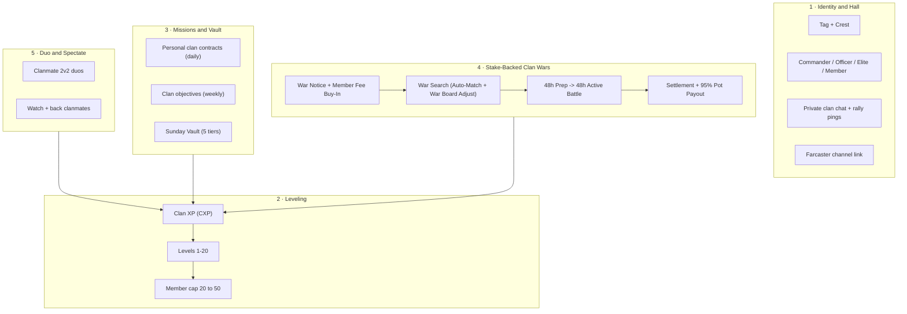
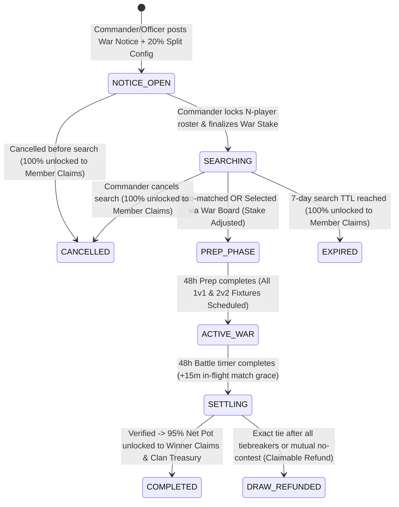
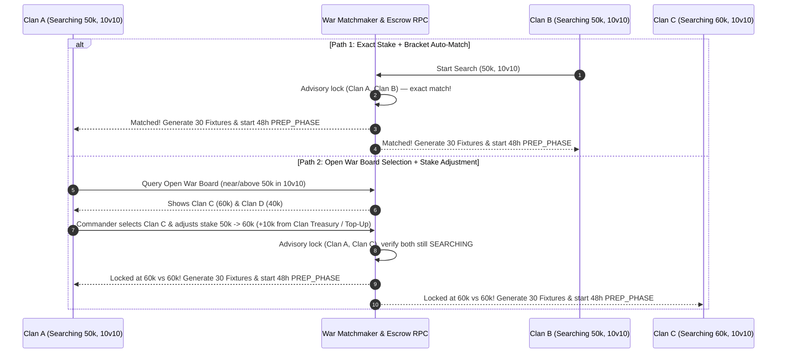
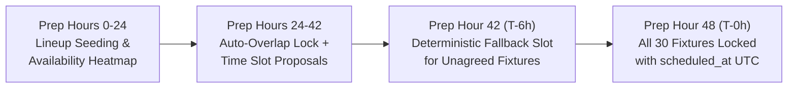
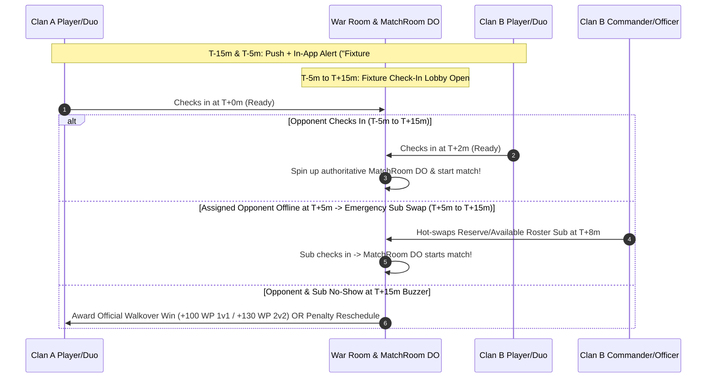
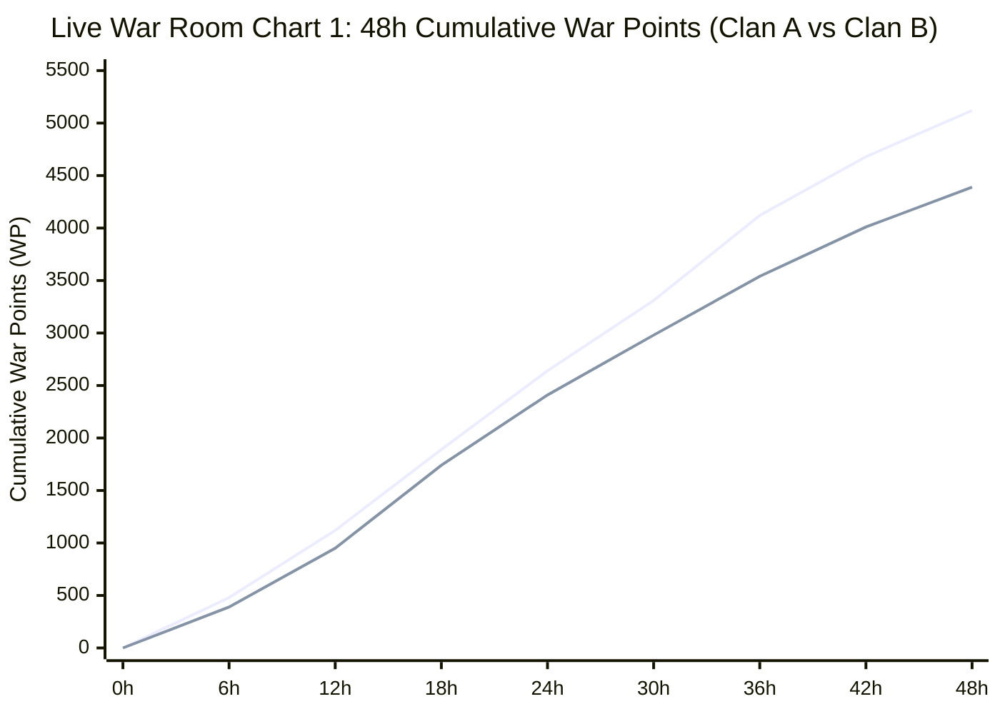
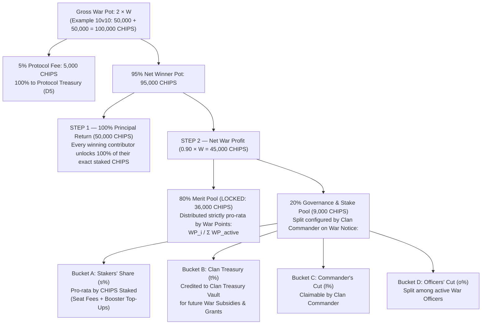
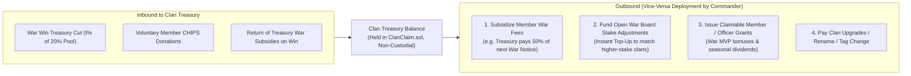
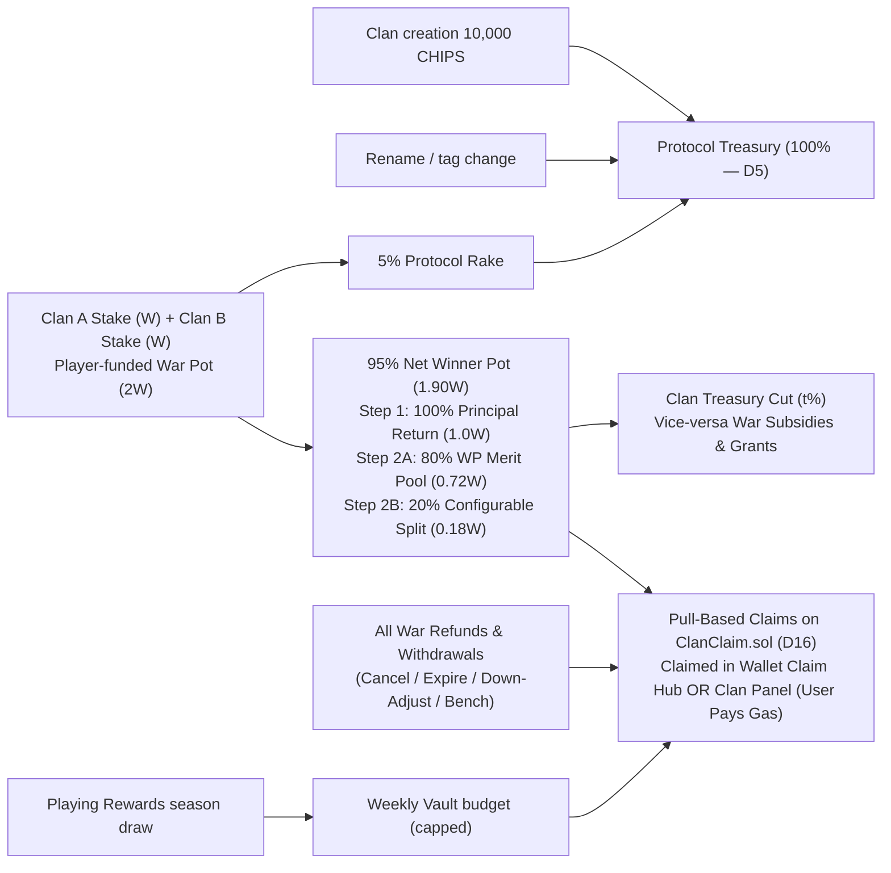
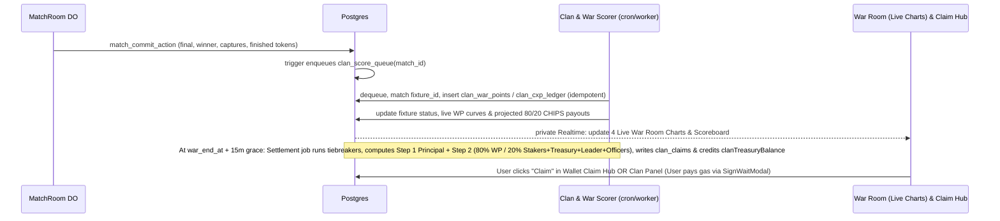

# CLAN_SYSTEM_PLAN.md — Tactical Syndicates (Clans, Leveling, Missions, Wars)

> **Status:** Research + product design **LOCKED for architecture planning** (2026-11-02; stake-backed Clan War lifecycle D11–D15 finalized).
> **Next step:** technical architecture (workload placement, migrations, routes, RPCs, gates).
> **Scope:** product rules, economy, anti-abuse, and the integration constraints the
> architecture must respect. No code lands from this doc directly.
> **Related:** `AGENTS.md` (trust model), `docs/tokenomics/TOKEN_PARAMS.md` (fee tiers,
> paid-volume floor), `docs/tokenomics/SYBIL_MODEL.md`, `docs/architecture/WALLET_SIGNING_POLICY.md`,
> `docs/architecture/WORKLOAD_PLACEMENT_MATRIX.md`, `docs/research/COMPETITIVE_LUDO_WORLD_LUDO_KING.md` §10.

---

## 0. Locked owner decisions

| # | Decision | Value |
| --- | --- | --- |
| D1 | Member cap | **Starts at 20**, grows with **clan level** (50 at L20 in v1; levels open-ended for later seasons) — see §4 |
| D2 | Creation cost | **10,000 CHIPS** (= one High-roller entry, `TOKEN_PARAMS` §3.5) |
| D3 | War model & timeline | **Stake-backed Clan-vs-Clan Wars**: Call-to-Arms Notice + Member Buy-In → War Search (seconds up to 7 days) → **48 h Preparation** → **48 h Active War** → **30 min Settlement & Payout** — see §6 |
| D4 | Model | **Hybrid "Tactical Syndicate"**: off-chain social + progression, server-authoritative scoring, on-chain value only at the edges (creation spend, war stakes, CHIPS claims) |
| D5 | Clan fees (creation, rename, tag change, war protocol rake) | **100% to treasury** (`chips_escrow_config.treasury_wallet`) — no burn split |
| D6 | Free matches in wars | **0 war weight** — wars score official War Battles / staked pools only (no config flag) |
| D7 | Clan contract | **New dedicated clan contract** (working name `ClanClaim` / `ClanWarPool`) for war stake escrow, war payouts, and Vault claims — design discussed separately |
| D8 | Clan chat | **Plain text**, same model as live broadcast chat (`live_chat`): caps, moderation, reports; no E2E |
| D9 | Duo party queue | Two clanmates queue together for 2v2 — **pulled into C3** (ships with wars) |
| D10 | Level ceiling | **Leave headroom** — v1 ships L1–20; curve and unlocks are data-driven so L21+ can be added without migration of logic |
| D11 | War Call & member buy-in | Commander/Officer posts a **War Notice** specifying roster bracket and per-member war fee; members apply, lock their fee in escrow, and confirm participation |
| D12 | War Search & Open War Board | Commander finalizes the pooled war entry fee and starts a **War Search** (TTL up to 7 days). Exact stake + bracket matches **immediately**; near/above searches appear on the **Open War Board** where a Commander can select an opponent by **adjusting the war entry fee** |
| D13 | War phases (48h / 48h) | Matched clans enter a **48-hour Preparation Phase** followed by a **48-hour Active War Phase**, then a deterministic **Settlement Period** that unlocks rewards to the winning clan |
| D14 | War fixtures & schedule | Every war generates a **deterministic Fixture Table** of `1v1` and `2v2` matches (e.g., **10v10 = 30 total matches: 20 × 1v1 + 10 × 2v2**, 4 matches per player). Match times are agreed in the 48h Prep Phase with built-in **Reschedule Requests**, **15m Check-In + Substitute Swaps**, and **No-Show Walkover** protection — see §6.5–§6.6 |
| D15 | War prize distribution (80/20 + Leader Splitter) | Self-funded **2 × Stake Gross Pot** (95% Net Winner Pot after 5% protocol treasury rake): **Step 1** unlocks 100% of staked principal to winning participants; **Step 2** splits net profit **80% pro-rata by War Points** (with live charts) + **20% via the Commander's Configurable Splitter** (`Stakers' Share`, `Clan Treasury`, `Commander's Cut`, `Officers' Cut`) and vice-versa Clan Treasury war subsidies — see §6.7 |
| D16 | 100% Pull-based claims (user pays gas) | **Nothing is ever auto-sent.** All war winnings, war fee refunds, withdrawals, downward stake adjustment refunds, Vault rewards, and Clan Treasury grants are **claim-based (`ClanClaim.sol`)**. Users pay Base L2 gas to claim from **both** their **Wallet Claim Hub** (`ClaimHubSheet.tsx`) and inside their **Clan Panel** (`ClanPanel.tsx`) — see §6.8 |

---

## 1. Why clans, and why this model

Ludo Base already has the pieces clans amplify but no layer that binds them:

| Existing asset | What clans add |
| --- | --- |
| 2v2 engine (`TEAM_PAIRINGS` Green+Blue vs Red+Yellow, trap truce, assist) | Organized duos instead of random teammates who go AFK |
| Live Arena + spectator bets | Clan rivalries create *reasons to watch* (`[BASE] vs [DEGEN]`) |
| Missions (`mission_catalog`, `MissionClaim`) | Collective goals — losses still contribute, softening loss aversion |
| Season rank (`rxp`, `SeasonClaim` merkle) | Team prestige layer above individual rank |
| Farcaster identity (Neynar, Frame SDK) | Channels map naturally to clans; war results are castable |
| Onboarding track `clan` (`lib/onboardingShared.ts`, 100 CHIPS, already defined, never wired) | Finally has a feature behind it |

Competitor gap (research doc §10.2): *"Creator/guild distribution has no stage."*

### Models evaluated

| | Casual co-op (Ludo King / Monopoly GO) | Pure on-chain DAO | **Tactical Syndicate (chosen)** |
| --- | --- | --- | --- |
| Core loop | Shared bar → gift box | Governance, multisig vault | Weekly vault + missions + 2v2 duos + weekend wars |
| Friction | None | Signature/gas per action | Zero for play; signature only for value |
| CDP passkey / mobile frame fit | Good | Poor | Good |
| Competitive depth | Shallow | Governance-heavy | High |
| Verdict | Too thin for a paid-pool game | Alienates casuals | **Best fit** |

---

## 2. Non-negotiable constraints (inherited from the trust model)

These override any feature idea in this doc. The architecture review must check each one.

1. **Clans never touch the game state.** No dice, move, power, timer, or capture effect.
   No "clan passive perks" in matches. Paid pools must stay identical for clan and
   solo players, and `npm run check:engine` parity (`lib/engine/core.ts` ↔ `src/room/engine.ts`) stays untouched.
2. **Score authority = recorded outcome.** CXP, mission progress, and War Points derive only
   from server-recorded results (`match_states.state.winner`, MatchRoom commits via
   `match_commit_action`, `match_seats`). Never from client reports, relay messages, or the P2P host.
3. **Relay is not authority (TU-1).** Clan chat / war feeds use **private** Realtime channels
   (`202610180005_private_realtime` pattern) with membership checks — never a public
   `game-room-*`-style topic anyone can publish to.
4. **RLS on every clan table**, `revoke all from anon, authenticated`; writes through
   service-role API routes / RPCs only. Each new route enters `lib/routeAuthority.ts`
   (route-auth matrix gate) and `lib/rateLimitRoutes.ts`.
5. **Wallet Guard.** Every value-moving signature or tx (creation spend, escrow deposit,
   claim) goes through `SignWaitModal` with Tier-1 custom copy; chain gate 84532.
   No Ludo passkey/biometric prompts for external wallets (`useWalletMode()`).
6. **Clan tag on the wire is server-sourced.** MatchRoom / profile sync attaches the tag
   from the DB by wallet; a client-claimed tag is ignored (prevents tag spoofing).
7. **Paid-volume floor applies** (`TOKEN_PARAMS` §3.3): CHIPS rewards from clans need
   ≥1 paid on-chain join that week. Free-only players earn CXP and cosmetics, not CHIPS.
8. **Migrations** go only in `supabase/migrations/`; `ENGINE_LOGIC.md` updated if settlement docs change.
9. **100% Pull-over-Push (Claim-Only, User Pays Gas — D16).** No server worker or contract ever auto-pushes CHIPS to wallets. Every refund (withdrawn war seat, unselected reserve, cancelled/expired war search, downward stake adjustment delta, mutual no-contest refund), every war payout (principal + 80% WP share + 20% stake/leader/officer share), and every Weekly Vault reward is recorded as a **claimable balance / voucher on `ClanClaim.sol`**. The user initiates the claim transaction, pays the gas on Base Sepolia (`84532`), and can trigger claims from **both** the **Wallet Claim Hub (`ClaimHubSheet.tsx`)** and the **Clan Panel Claim Drawer (`ClanPanel.tsx`)**.

---

## 3. Pillars overview

> **Change from the first research draft:** the "Power Armory" (donating Shields/Boosts) is
> **removed**. Powers are match-scoped items that expire in 3–5 min (`POWER_EXPIRY_MS`) and
> there is no persistent power inventory (`lib/inventory.ts` holds cosmetics only).
> Donating powers would require a new inventory *and* create pay-to-win in paid pools,
> violating constraint 2.1. Replaced by **Duo and Spectate** (Pillar 5).

---

## 4. Pillar 2 — Clan leveling (D1)

### 4.1 Clan XP (CXP) sources

CXP is earned per member and summed into the clan. **Clan level never decreases.**

| Source | CXP | Notes |
| --- | --- | --- |
| Paid match win (any shape) | 30 | Recorded winner only |
| Paid match loss / non-winning finish | 10 | Completed match only — abandon/AFK-kick = 0 |
| Free online match win | 10 | MatchRoom/recorded matches only |
| Free online match loss | 3 | |
| Offline / vs AI | 0 | Never counts (same rule as welcome grant) |
| 2v2 with a clanmate as teammate | ×1.25 on the above | Both teammates share `clan_id` at match start |
| Personal clan contract complete | 20–60 | §5.1 |
| Weekly clan objective complete | 500–1,500 (to clan) | §5.2 |
| War participation (≥3 scoring war matches) | 100 per member | §6 |

**Caps:** per member **300 CXP/day** from matches + contracts (objectives and war bonuses are
clan-level and excluded). Matches where clanmates sit on **opposing** sides award **0 CXP** to
both (anti-farm).

### 4.2 Level curve

`CXP required to reach level n = 1,000 × (n − 1)²` (same quadratic family as player LXP in
`lib/progression.ts`). **v1 ships levels 1–20; the ceiling is open-ended (D10).**

Headroom rules:

- Level thresholds and unlocks live in a config table (`clan_level_config`: level, cxp_required,
  member_cap, officer_slots, unlocks jsonb), not hardcoded constants. Adding L21+ is a data insert.
- CXP keeps accruing past the current max level (stored as `bigint`), so when new levels open,
  clans that already earned the CXP level up immediately — no lost progress.
- The UI shows "MAX (season cap)" at the current ceiling rather than a hard "MAX".
- Indicative continuation (not committed): L25 = 576,000 CXP / cap 60; L30 = 841,000 CXP / cap 70.

| Level | Total CXP | Pace at ~100 CXP/member/day, 20–30 members |
| --- | --- | --- |
| 2 | 1,000 | Day 1 |
| 5 | 16,000 | ~1 week |
| 10 | 81,000 | ~6 weeks |
| 15 | 196,000 | ~10–12 weeks |
| 20 | 361,000 | ~4–5 months |

Initial tuning — retune from telemetry before the first season locks.

### 4.3 Level unlocks

| Level | Member cap | Officer slots | Unlock |
| --- | --- | --- | --- |
| 1 | **20** | 2 | Tag, basic crest, private chat, 3 vault tiers |
| 3 | 22 | 2 | **Clan War eligibility** (also needs ≥5 members) |
| 4 | 22 | 2 | Vault tier 4 |
| 5 | 25 | 3 | Crest frame I |
| 7 | 25 | 3 | Vault tier 5 |
| 8 | 30 | 3 | Custom tag colour |
| 10 | 30 | 4 | Crest frame II, clan banner on victory screen |
| 11 | 35 | 4 | |
| 12 | 35 | 4 | Animated banner |
| 14 | 40 | 5 | |
| 15 | 40 | 5 | Crest frame III |
| 17 | 45 | 5 | |
| 20 | **50** | 6 | Crest frame IV (prestige), Hall of Fame entry |
| 21+ | reserved | reserved | Opened in later seasons via `clan_level_config` (D10) |

All unlocks are **cosmetic or organizational** — none affect match outcomes.

---

## 5. Pillar 3 — Clan missions and the Weekly Vault

Three mission layers. All progress is computed server-side from recorded outcomes
(constraint 2.2). Clan missions live in a **separate `clan_mission_catalog`**, not in
`mission_catalog`, so that table's CHIPS 5..20 reward band and its on-chain periodId semantics
stay intact. Clan missions pay **CXP / WP**; CHIPS reach players only via the Vault and War
payouts (§5.3, §6.7).

### 5.1 Personal clan contracts (daily, per member)

Three contracts are rolled per member per UTC day from a weighted pool. Rerolls: 1/day.

| Example contract | Target | Reward |
| --- | --- | --- |
| Play 3 online matches | 3 | 20 CXP |
| Win a 2v2 with a clanmate | 1 | 60 CXP |
| Capture 5 tokens (online) | 5 | 30 CXP |
| Win a paid match | 1 | 40 CXP |
| Finish all 4 tokens in a match | 1 | 30 CXP |
| Spectate a clanmate's live match for 3 min | 1 | 20 CXP (low weight: presence evidence is weak) |

### 5.2 Clan objectives (weekly, collective)

Four objectives rotate each ISO week (Mon 00:00 UTC). Targets scale with
`active_members = max(10, members who played this week)` so small clans are not locked out.

| Example objective | Target formula | Clan reward |
| --- | --- | --- |
| Clan wins N online matches | 6 × active_members | 1,000 CXP |
| N clanmate-duo 2v2 wins | 1.5 × active_members | 1,500 CXP |
| Capture N tokens | 25 × active_members | 500 CXP |
| N distinct members complete ≥3 contracts | 0.6 × active_members | 1,000 CXP |

### 5.3 Weekly Vault (Sunday chest)

Weekly CXP (Mon 00:00 → Sun 23:59 UTC) fills the vault. Tier thresholds are **per active member**:

| Tier | Weekly clan CXP ≥ | CHIPS per eligible member | Extra | Needs clan level |
| --- | --- | --- | --- | --- |
| T1 | 150 × active | 10 | — | 1 |
| T2 | 350 × active | 25 | — | 1 |
| T3 | 600 × active | 50 | Vault badge | 1 |
| T4 | 900 × active | 90 | — | 4 |
| T5 | 1,300 × active | 150 | Weekly crest flair | 7 |

- Pays the **highest tier reached** (not cumulative).
- **Eligibility:** member contributed ≥150 CXP that week, was a member at Sunday 23:59, and meets the
  paid-volume floor for the CHIPS part (otherwise cosmetics only).
- **Calibration:** daily missions pay 5–20 CHIPS each; one Standard 2v2 pot is 4,000 CHIPS.
  T5 = 150 CHIPS/week is deliberately "meaningful, not farmable".
- **Delivery:** batched weekly payout through the **new dedicated clan contract** (D7, working
  name `ClanClaim`). Design is a separate discussion; the assumed baseline is the proven
  `SeasonClaim` shape (frozen merkle root per epoch, 48 h challenge, per-epoch budget), giving
  root proposed Monday → claimable **Wednesday**. Claim lives in Claim Hub.
- **Budget:** weekly global cap from the Playing Rewards season draw; if the sum exceeds the cap,
  payouts scale pro-rata. Line item must be added to `TOKEN_PARAMS.md` before launch.

---

## 6. Pillar 4 — Full Clan War system (D3, D11–D16)

Clan Wars in Ludo Base are **on-demand, stake-backed Clan-vs-Clan tournament battles** funded
directly by participating members (or subsidized from the Clan Treasury). Instead of a fixed weekly
calendar, any eligible clan (Clan Level ≥ 3, ≥ 5 members) can launch a War Call whenever its roster is ready.

### 6.1 End-to-end War State Machine

| State | Duration | Summary |
| --- | --- | --- |
| `NOTICE_OPEN` | Up to 72 h | Commander/Officer posts War Notice with roster bracket (`5v5` / `10v10` / `15v15` / `20v20`), per-member war fee, and the **20% Governance Split config**. Members apply, lock their fee on-chain/escrow, and confirm participation. |
| `SEARCHING` | Few seconds → 7 days max | Commander locks the confirmed roster and finalizes the total war entry fee (`W`). System runs instant auto-match and lists the clan on the **Open War Board**. |
| `PREP_PHASE` | **48 hours** | Matched against opposing clan. System generates the **Official 1v1 & 2v2 Match Fixture Table** (e.g., 30 matches for `10v10`). Clans assign 2v2 duos, agree on fixture match times, and run practice scrims. |
| `ACTIVE_WAR` | **48 hours** | Scheduled fixtures execute across the 48h window with a **15m check-in window**, **Reschedule Applications**, **Substitute Swaps**, and **No-Show Walkover** protection. Live WP charts update in real time. |
| `SETTLING` | **30 minutes** | 15 min in-flight match completion grace + 15 min deterministic verification & tiebreak resolution. |
| `COMPLETED` | Permanent | **Pull-based claims (`D16`)** unlock in both **Wallet Claim Hub** and **Clan Panel** for the winning clan's **95% Net War Pot** (Step 1: 100% Principal Return; Step 2: 80% WP Merit Pool + 20% Configurable Stake/Treasury/Leader/Officer Split). |

---

### 6.2 Step 1 — Call-to-Arms Notice & Member Buy-In (`NOTICE_OPEN`)

1. **Posting the War Notice**:
   - **Who**: Commander or Officer (provided the clan has no active war in `NOTICE_OPEN`, `SEARCHING`, `PREP_PHASE`, or `ACTIVE_WAR`).
   - **Parameters configured on the Notice (immutably locked once the first member buys in)**:
     - **Roster Bracket (`N`)**: `5v5`, `10v10`, `15v15`, or `20v20` (must satisfy `5 ≤ N ≤ clan.member_count`).
     - **Per-Member War Fee (`member_fee`)**: Minimum **500 CHIPS** per seat (e.g., `10v10` × `5,000 CHIPS` = **50,000 CHIPS** target war stake).
     - **20% Governance & Stake Split Config (§6.7.4)**: Commander sets how the 20% non-WP slice of net war profit will be divided among **Stakers' Share**, **Clan Treasury**, **Commander's Cut**, and **Officers' Cut** (must sum to `100%` of the 20% slice; displayed transparently on the Notice card so every member sees the exact split before paying).
     - **Optional Clan Treasury Subsidy / War Booster Buffer**: The Commander can allocate funds from the **Clan Treasury** (§6.7.5) or contribute a personal **Booster Deposit** to subsidize seats or fund upward stake adjustments on the War Board.
     - **Sign-Up Window**: Defaults to 72 hours (auto-cancels and unlocks 100% claimable refunds if not moved to `SEARCHING` within 72 hours).
2. **Member Application & Fee Lock**:
   - The War Notice pins to the top of the Clan Hall and triggers a rally notification to clan members.
   - A member clicks **"Join War & Pay Fee"**:
     - Executes via `SignWaitModal` (Tier-1 copy: *"Confirm Clan War Seat — Lock {member_fee} CHIPS in Clan War Contract"*).
     - Locks `member_fee` in the clan contract (`ClanClaim` / `ClanWarPool`), recording a `clan_war_stakes` entry (`status = 'locked'`), idempotent on `(war_call_id, wallet_address)`.
     - Member status becomes `CONFIRMED_SEAT`.
3. **Over-Subscription, Reserve Bench & Claim-Based Withdrawal Rules (`D16`)**:
   - Up to `N + 3` members can pay and sign up (first `N` take primary seats; up to 3 sit on the **Reserve Bench**).
   - **Withdrawal while in `NOTICE_OPEN`**: Any confirmed member can withdraw *before* the Commander starts the War Search. Upon withdrawal, their locked fee immediately transitions to `status = 'claimable_refund'` — the user claims their 100% refund from the **Wallet Claim Hub** or **Clan Panel** (user pays gas; zero auto-send per D16).
   - **Unselected Reserve Bench Refund**: When the Commander finalizes the `N`-player active war roster to enter `SEARCHING`, any paid reserve member not included in the locked `N` (or kept as a non-staked substitute) has 100% of their fee immediately unlocked as a **Claimable Refund** in the Claim Hub and Clan Panel.

---

### 6.3 Step 2 — Roster Finalization & War Search (`SEARCHING`)

1. **Finalizing the Entry Fee & Locking the Roster**:
   - Once at least `N` members have confirmed and paid, the Commander clicks **"Finalize War Stake & Start Search"**.
   - Total initial war stake:
     $$\text{Clan Stake } W_A = \sum_{i=1}^{N} \text{member\_stake}_i + \text{clan\_treasury\_subsidy}_A + \text{booster\_buffer}_A$$
   - Example: 10 confirmed members × 5,000 CHIPS = **50,000 CHIPS**.
   - The `N` participants are now **locked** (cannot leave the clan or withdraw while `SEARCHING`, unless the search is cancelled or expires).
2. **Search Lifespan, Cancellation & Expiry Claims (`D16`)**:
   - Search stays live from **a few seconds up to 7 days (168 hours)**.
   - **Commander Cancel / 7-Day Auto-Expiry**: If the Commander cancels an unmatched search or the 7-day TTL expires, every participant's locked stake transitions atomically to `claimable_refund` on `ClanClaim.sol` (and any Clan Treasury subsidy returns to the Clan Treasury ledger). Participants claim their 100% refund at their convenience via the Claim Hub or Clan Panel (user pays gas).

---

### 6.4 Step 3 — Dual Matchmaking: Instant Auto-Match & Open War Board (Stake Adjustment)

1. **Path 1 — Instant Exact Auto-Match**:
   - Whenever a clan enters `SEARCHING` with `(bracket = N, total_stake = W)`, the matchmaker checks for the oldest active `SEARCHING` clan with the **exact same `bracket = N` and `total_stake = W`** (excluding the same opponent from the immediately preceding war).
   - If found, both clans match **immediately** in a single atomic transaction, the **Match Fixture Table** is generated, and both enter the **48-Hour Preparation Phase**.
2. **Path 2 — Open War Board (Near / Above Stake Discovery & Adjustment)**:
   - Unmatched searches appear live on the **Open War Board**.
   - Clan A's Commander and Officers can browse all searching clans in the same roster bracket (`N vs N`) whose stake is **near or above** Clan A's stake (default filter: `0.5 × W_A` up to `2.5 × W_A`, with a toggle for all stakes).
3. **Stake Adjustment Mechanics (100% Claim-Based, Zero Deadlocks)**:
   - **Case A — Adjusting DOWN to match a lower-stake search (e.g., Clan A at 50k selects Clan D at 40k)**:
     - When Clan A's Commander clicks **"Adjust Stake to 40k & Match"**, the atomic match RPC locks the war at $40,000\text{ vs }40,000\text{ CHIPS}$ and moves the $10,000\text{ CHIPS}$ excess pro-rata ($1,000\text{ CHIPS}$ per member) into each participant's **Claimable Refund balance** (`ClanClaim.sol`). Members can claim that $1,000\text{ CHIPS}$ excess immediately from the Claim Hub or Clan Panel (or batch-claim it together with their war winnings after the war!).
   - **Case B — Adjusting UP to match a higher-stake search (e.g., Clan A at 50k selects Clan C at 60k)**:
     - Required stake is $60,000\text{ CHIPS}$ ($+10,000\text{ CHIPS}$ delta):
       1. **Clan Treasury / Booster / Commander Instant Top-Up (1-Click Match)**: Commander funds the $+10,000\text{ CHIPS}$ delta directly from the **Clan Treasury**, the pre-funded **War Booster Buffer**, or their personal wallet via `SignWaitModal`. The war locks **immediately** at $60,000\text{ vs }60,000\text{ CHIPS}$, and the top-up source receives its exact principal return + proportional stake-share on victory.
       2. **Send Counter-Offer ("Meet at 50k")**: Clan A sends a binding counter-offer to Clan C to match at $50,000\text{ CHIPS}$. If Clan C's Commander accepts, Clan C adjusts *down* from $60\text{k} \to 50\text{k}$ (unlocking $10\text{k}$ as claimable refunds for Clan C's members) and the war locks immediately.
       3. **Crowd Top-Up Call**: Commander raises Clan A's target stake from $50\text{k} \to 60\text{k}$ while still searching; any roster member can contribute top-up CHIPS until the $+10\text{k}$ gap fills.
4. **Concurrency & Race Protection**:
   - Uses deterministic UUID-ordered `pg_advisory_xact_lock(hashtext(least(id_a, id_b))), pg_advisory_xact_lock(hashtext(greatest(id_a, id_b)))` so concurrent War Board clicks never double-match a clan.

---

### 6.5 Step 4 — 48-Hour Preparation Phase: Fixture Generation & Timing Agreements (`PREP_PHASE`)

Once Clan A and Clan B match at `matched_at`, the **48-Hour Preparation Phase** (`prep_ends_at = matched_at + 48h`) begins. During this phase, the exact **Match Fixture Table** is generated and every fixture's start time (`scheduled_at`) is locked.

#### 6.5.1 How Many Matches in a Clan War? (Official Fixture Matrix by Bracket — D14)

Every rostered player participates in **4 Official Scheduled Fixtures** over the 48-hour war:
- **2 × `1v1` Duel Matches** (Wave 1: Direct Seed Matchup; Wave 2: Cross-Seed Matchup)
- **2 × `2v2` Tactical Duo Matches** (Wave 1: Primary Duo Clash; Wave 2: Reverse Duo Clash)

Because a `1v1` match seats **1 player per clan** and a `2v2` match seats **2 players (1 Duo) per clan**, for any roster size $N$:
- **Total `1v1` Matches** = $2 \times N$
- **Total `2v2` Matches** = $2 \times \lfloor N / 2 \rfloor = N$ *(for odd brackets like `5v5`, the 5th Ace seed plays an extra `1v1` Ace Tiebreaker Duel so every player still has 4 fixtures)*
- **Total War Matches** = **$3 \times N$ Official Fixtures**

| War Bracket (`N vs N`) | Rostered Players (Both Clans) | `1v1` Duel Fixtures | `2v2` Duo Fixtures | **Total War Matches** | Matches Played per Member (over 48h) |
| --- | --- | --- | --- | --- | --- |
| **`5v5` Squad War** | 5 vs 5 (10 players) | **11 × `1v1`** *(10 base + 1 Ace)* | **4 × `2v2`** *(2 Duos × 2 legs)* | **15 Matches** | **4 Matches** (2×1v1 + 2×2v2; Ace: 3×1v1 + 1×2v2) |
| **`10v10` Standard War** | 10 vs 10 (20 players) | **20 × `1v1`** *(Wave A: 10, Wave B: 10)* | **10 × `2v2`** *(5 Duos × 2 legs)* | **30 Matches** | **4 Matches** (**2 × `1v1` + 2 × `2v2`**) |
| **`15v15` Battalion War** | 15 vs 15 (30 players) | **31 × `1v1`** *(30 base + 1 Ace)* | **14 × `2v2`** *(7 Duos × 2 legs)* | **45 Matches** | **4 Matches** (2×1v1 + 2×2v2; Ace: 3×1v1 + 1×2v2) |
| **`20v20` Grand War** | 20 vs 20 (40 players) | **40 × `1v1`** *(Wave A: 20, Wave B: 20)* | **20 × `2v2`** *(10 Duos × 2 legs)* | **60 Matches** | **4 Matches** (**2 × `1v1` + 2 × `2v2`**) |

**How `10v10` (30 Matches) is Seeded & Paired**:
1. **Roster Seeding (`#1` to `#10`)**: At the start of `PREP_PHASE`, each clan's 10 players are ordered `#1..#10` by Rank (`rxp`) by default; the Commander/Officers can reorder seeds `#1..#10` and pair the **5 Designated 2v2 Duos** (`Duo 1` to `Duo 5`) during the first 24 hours of Prep.
2. **20 × `1v1` Duel Fixtures**:
   - **Wave 1 (`Fixtures #1–#10`)**: `Clan A Seed #k` vs `Clan B Seed #k` ($k = 1..10$).
   - **Wave 2 (`Fixtures #11–#20`)**: Cross-paired within skill bands (`#1 vs #2`, `#2 vs #1`, `#3 vs #4`, `#4 vs #3`, ..., `#9 vs #10`, `#10 vs #9`) so no player plays the exact same 1v1 opponent twice.
3. **10 × `2v2` Duo Fixtures**:
   - **Wave 1 (`Fixtures #21–#25`)**: `Clan A Duo #d` vs `Clan B Duo #d` ($d = 1..5$).
   - **Wave 2 (`Fixtures #26–#30`)**: Cross-paired (`Duo #1 vs Duo #2`, `Duo #2 vs Duo #1`, `Duo #3 vs Duo #4`, `Duo #4 vs Duo #3`, `Duo #5 vs Duo #5 Rematch`).

#### 6.5.2 Fixture Scheduling & Timing Agreement Protocol (During the 48h Prep Phase)

To ensure players across different timezones agree on match times smoothly without deadlocks, scheduling runs in three structured steps during the 48h `PREP_PHASE`:

1. **Step A — Availability Heatmap Selection (Prep Hours `0h → 24h`)**:
   - The 48-hour `ACTIVE_WAR` window is divided into **96 half-hour UTC slots** (or 48 hourly windows).
   - Every rostered player selects **at least 6 available 1-hour windows** (at least 3 on War Day 1 and 3 on War Day 2) in the War Room Availability Grid.
2. **Step B — Auto-Overlap Matcher & Bilateral Time Proposals (Prep Hours `24h → 42h`)**:
   - **Auto-Overlap Lock**: Whenever both opposing sides of a fixture (`Player A` and `Player B` for 1v1, or `Duo A` and `Duo B` for 2v2) mark the same UTC slot as available (with a minimum 30-minute gap between a player's own fixtures), the system **automatically locks `scheduled_at`** to the earliest mutually available slot and marks the fixture `SCHEDULED_AGREED`.
   - **Manual Time Proposal (Handshake)**: For any fixture without an automatic overlap (or if either side wants a different time), either player (or their Commander/Officer) can propose up to **3 candidate time slots** on the fixture card. The opposing player (or their Commander/Officer) clicks **"Accept Slot"** to lock `scheduled_at`.
3. **Step C — Deterministic Default Slot Assignment (`T-6h` before War Start, Prep Hour `42h`)**:
   - If a fixture still has no mutually accepted slot at `T-6h` before `war_start_at`, the scheduler prevents stalemate by automatically assigning a **Deterministic Default Slot**:
     - If one side submitted availability (≥6 slots across ≥2 UTC bands) and the other side submitted *nothing*, the slot is chosen from the responsive side's availability windows! (This rewards responsive clans and prevents an opponent from stalling prep).
     - If both submitted non-overlapping slots, the scheduler picks the UTC midpoint between both players' historical `last_played_at` active hours (spaced ≥45 minutes apart from each player's other fixtures).
   - By `T-6h`, **100% of all fixtures (`30/30` in 10v10) have a locked `scheduled_at` timestamp** and calendar/push reminders armed.

---

### 6.6 Step 5 — 48-Hour Active War Phase: Check-Ins, Reschedules, No-Shows & Live Charts (`ACTIVE_WAR`)

At `war_start_at = matched_at + 48 hours`, the 48-hour war begins.

#### 6.6.1 Fixture Execution & The 15-Minute Check-In Window

1. **Pre-Match Alerts & Lobby Opening (`scheduled_at - 15m` and `- 5m`)**:
   - At `scheduled_at - 15m` and `scheduled_at - 5m`, push notifications (`push_subscriptions`) and in-app banners alert the assigned players and both clans' Officers.
   - At `scheduled_at - 5m`, the **Fixture Check-In Card** activates at the top of the War Room.
2. **15-Minute Check-In Grace (`scheduled_at` to `scheduled_at + 15m`)**:
   - As soon as all assigned seats (2 players for `1v1`, 4 players for `2v2`) click **"Check In & Ready"**, the authoritative [`MatchRoom.ts`](file:///Users/mrongsubho/Documents/Termninal/ludo-base/src/room/MatchRoom.ts) Durable Object launches the match immediately (even if everyone is ready 3 minutes early).
3. **Emergency Substitute Hot-Swap (`scheduled_at + 5m` to `+ 15m`)**:
   - If an assigned player has not checked in by `scheduled_at + 5m`, the **Emergency Sub Button** unlocks for that clan's Commander and Officers for the remaining 10 minutes (`+5m` to `+15m`).
   - The Commander/Officer can slot in either **(a)** a designated **Reserve Bench** member or **(b)** another online war roster member who has not yet used their **1 Emergency Sub Allowance** for this war.
   - This ensures real-life emergencies don't force an automatic forfeit when a clan has active teammates online ready to step in.

#### 6.6.2 What Happens If There Is No Opponent at Match Time? (No-Show & Walkover Rules)

At `scheduled_at + 15m`, if one side (`Clan A`) is checked in and ready (and stayed connected in the check-in lobby), while the opposing side (`Clan B`) failed to check in all required seats:

| Scenario at `scheduled_at + 15m` | Resolution | War Points (WP) Impact |
| --- | --- | --- |
| **1st No-Show by Clan B** *(and `> 12 hours` remain before `war_end_at`, and Clan B had not already rescheduled this fixture)* | **Automatic Penalty Reschedule** OR **Clan A Claims Walkover**: If Clan B's Officer clicked *"Emergency Delay (-25 WP)"* before `+15m`, the fixture shifts forward by `+12 hours` (or to the next mutually open slot) and Clan B takes an immediate **`-25 WP` Lateness Penalty**. Otherwise, Clan A wins by **Immediate Walkover**. | `-25 WP` to Clan B (if delayed) or Walkover WP to Clan A |
| **Final No-Show by Clan B** *(no Emergency Delay used, or 2nd no-show, or `≤ 12 hours` left in war)* | **Official Walkover (Forfeit Victory)** for Clan A. Clan A's checked-in player(s) do not lose their match because the opponent ghosted! | **1v1 Walkover**: **`+120 WP`** to Clan A player (`0 WP` to Clan B). **2v2 Walkover**: **`+150 WP` each** (`+300 WP` total) to Clan A duo (`0 WP` to Clan B). |
| **Optional "Play Live Contender Bonus" after Walkover** | After receiving a Walkover win, Clan A's checked-in player/duo may optionally click **"Play Contender Match for Bonus WP"** within 10 minutes (paired against another active war contender) to earn up to **`+30 WP` extra** from captures/sweeps (`120 → 150 WP` for 1v1; `150 → 195 WP` for 2v2) so an opponent no-show can **never** cap Clan A below a full Direct Clash ceiling! | Up to `+30 WP` (1v1) / `+45 WP each` (2v2) bonus on win |
| **Both Clans No-Show at `+15m`** | Fixture marks **`MUTUAL_VOID`**. Neither side checked in. | **`0 WP`** to both clans; fixture closed. |

#### 6.6.3 Reschedule Application Protocol (How Players Apply for a Reschedule)

Life happens—players can formally apply to reschedule any unplayed fixture during `PREP_PHASE` or `ACTIVE_WAR`:

1. **Who Can Apply**: Either assigned player in the fixture, their 2v2 duo partner, or their Clan Commander/Officer.
2. **Application Window & Constraints**:
   - Must be submitted **at least 60 minutes before the current `scheduled_at`** timestamp.
   - Must propose **1 to 3 new candidate time slots**, all falling within `ACTIVE_WAR` and at least **60 minutes before `war_end_at`**.
   - **Anti-Spam Cap**: Each clan can initiate at most **1 reschedule request per fixture** (max 2 reschedules total per fixture).
3. **Approval & Fallback Rules**:
   - **Instant Notification**: The opposing player(s) and opposing Commander/Officers receive a push + War Room alert with 1-click **"Accept Slot #1 / #2 / #3"** or **"Propose Counter-Slot"** buttons.
   - **Accepted**: If the opponent (or an opposing Officer) clicks Accept, `scheduled_at` updates atomically to the new slot (`status = 'RESCHEDULED_AGREED'`).
   - **Fairness Rule if Declined / Ignored**:
     - If the requester applied **≥ 6 hours before `scheduled_at`** and offered **3 distinct slots across ≥ 2 UTC 4-hour bands**, and the opponent declines or ignores the request:
       - The original `scheduled_at` remains, **AND** the requesting clan unlocks a **Free Roster Substitute Override** for that fixture (allowing any available clanmate on the roster to play that slot without consuming the clan's emergency sub quota).
     - If applied **1h–6h before `scheduled_at`** and declined, the original time stands and standard check-in / emergency sub rules (§6.6.1) apply.

---

#### 6.6.4 Elaborated War Points (WP) System (Driving the 80% Merit Pool)

Every point earned by a player contributes simultaneously to:
1. **The Clan's Total War Score** (which decides which clan wins the war pot), AND
2. **The Player's Individual Merit Share (`WP_i / Σ WP_winning_clan`)**, which directly determines their cut of the **80% Net Profit Merit Pool** (§6.7.4).

##### Complete Individual War Points (WP) Breakdown

| Source / Event | `1v1` Duel Fixture | `2v2` Duo Fixture (Awarded to **Each** Teammate) | Notes & Verification Source |
| --- | --- | --- | --- |
| **Direct Clash Victory** *(Played live vs opposing war clan)* | **`+150 WP`** | **`+195 WP` each** (`+390 WP` team) | Verified from `match_states.state.winner` on `MatchRoom` DO |
| **Official Walkover Victory** *(Opponent No-Show at `+15m`)* | **`+120 WP`** *(+up to `+30 WP` via optional Contender match)* | **`+150 WP` each** *(+up to `+45 WP` each via optional Contender match)* | Protects present players from opponent dodging |
| **Completed Match Loss** *(Played full match to completion, no AFK)* | **`+20 WP`** | **`+25 WP` each** (`+50 WP` team) | Rewards fighting to the end & trying for captures |
| **Opponent Token Capture Bonus** | **`+5 WP` per capture** *(max `+20 WP` / match)* | **`+5 WP` per capture** *(max `+20 WP` / player / match)* | Recorded in `MatchCaptureStats` at match commit |
| **Home Finish Bonus (Token reaches index `57`)** | **`+5 WP` per token home** + **`+10 WP` Clean Sweep** *(all 4 home = `+30 WP`)* | **`+5 WP` per token home** + **`+10 WP` Team Sweep** *(all 8 team tokens home = `+30 WP` each)* | Incentivizes dominant board control & close-outs |
| **Underdog Skill Bonus** *(Beating an opponent with `≥ 500` higher RXP)* | **`+15 WP`** | **`+15 WP` each** *(avg duo RXP diff ≥ 500)* | Rewards lower-ranked members who upset top seeds |
| **Perfect 4/4 War Slate Bonus** *(Winning all 4 assigned fixtures in the war)* | **`+50 WP` one-time bonus** | *(Included in the 4-fixture slate)* | Rewards an undefeated 4-0 individual war campaign |
| **Abandon / AFK-Kick (`≥ 3` AFK strikes)** | **`0 WP`** *(forfeits capture/home bonuses for that match)* | **`0 WP`** for the AFK seat | Enforced by `MAX_AFK_STRIKES` in `MatchRoom.ts` |

##### Clan-Wide Mobilization Bonuses (Added to Clan Score Only)
- **Full Attendance Bonus**: `+50 WP` to the Clan Score for every rostered member who completes all 4 of their assigned fixtures without a no-show (`10v10` = up to `+500 WP` team bonus).
- **Lateness Penalty**: `-25 WP` from the Clan Score if a clan triggers an Emergency Penalty Reschedule at check-in (§6.6.2).

---

#### 6.6.5 Live War Telemetry & Real-Time Charts (War Room UI)

Inside the **War Room (`ClanPanel.tsx` → War Tab)**, four live charts update automatically via private Supabase Realtime broadcasts (`clan_war:<warId>`) every time a fixture finishes:

1. **Chart 1 — 48-Hour Cumulative WP Progression Curve (Dual Area/Line Chart)**:
   - Plots `Clan A Cumulative WP` (Cyan `#00E5FF`) vs `Clan B Cumulative WP` (Amber `#F59E0B`) across the `0h..48h` timeline.
   - Displays interactive markers on every completed fixture (`Fixture #14: [BASE] Duo #2 won +430 WP`) and a dashed horizontal **Mathematical Clinch Line** (`clinch_wp = opponent_current_wp + opponent_max_remaining_wp + 1`).
2. **Chart 2 — Live 80% Merit Pool Leaderboard & Projected CHIPS Payout Bar/Donut Chart**:
   - Shows every rostered member ranked by `WP_i`, their live share percentage $\left(\frac{\text{WP}_i}{\sum \text{WP}_{\text{clan}}} \times 100\%\right)$, and their **Real-Time Projected CHIPS Payout** (assuming victory):
     $$\text{Projected Payout}_i = \underbrace{\text{Principal}_i}_{\text{100\% Return}} + \underbrace{0.80 \times \text{NetProfit} \times \frac{\text{WP}_i}{\sum \text{WP}}}_{\text{80\% Merit Pool Share}} + \underbrace{\text{RoleAndStakeShare}_i}_{\text{From 20\% Pool}}$$
   - Players can literally watch their projected CHIPS payout climb in real time with every token capture and fixture win!
3. **Chart 3 — Scoring Source Breakdown (Stacked Horizontal Bar)**:
   - Compares Clan A vs Clan B across: `1v1 Win WP`, `2v2 Duo Win WP`, `Token Capture WP`, `Home Finish WP`, and `Mobilization/Underdog WP`.
4. **Chart 4 — Fixture Progress & Remaining Potential Gauge**:
   - Shows `Played (22/30)` | `Live Now (2/30)` | `Upcoming Agreed (5/30)` | `Reschedule Pending (1/30)`, alongside the maximum possible WP still on the table for each clan.

---

### 6.7 Step 6 — Settlement Period (30m), 80/20 Profit Split & Clan Treasury (`SETTLING` → `COMPLETED`)

#### 6.7.1 In-Flight Grace (`15m`) & Verification Window (`15m`)
- All fixtures must start before `war_end_at`. Any fixture in progress at `war_end_at` has up to **15 minutes** (`war_end_at + 15m`) to finish naturally on its `MatchRoom` DO; if still running at `+15m`, `MatchRoom` adjudicates deterministically (tokens finished at index `57` → sum of board progress → captures).
- From `war_end_at + 15m` to `+30m`, the settlement job verifies all fixture receipts, applies the 5-level tiebreaker cascade if needed, and writes the final **Claimable Leaves / Balances** to `clan_reward_leaves` and `ClanClaim.sol`.

#### 6.7.2 Minimum Activity & Forfeit Rules
- **Single-Sided Forfeit**: In a $3N$-fixture war (e.g., 30 fixtures in `10v10`), if Clan A checks in for at least $\lceil 3N / 3 \rceil$ fixtures ($\ge 10$) and Clan B checks in for fewer than $\lceil 3N / 6 \rceil$ ($< 5$), Clan A wins automatically.
- **Mutual No-Contest**: If *both* clans check in for fewer than $\lceil 3N / 6 \rceil$ fixtures, the war is declared a `MUTUAL_NO_CONTEST`; both clans' locked stakes unlock as **Claimable Refunds** minus the 5% protocol treasury rake.

#### 6.7.3 Deterministic 5-Level Tiebreaker Cascade
If `clan_score_A == clan_score_B` at settlement:
1. Higher **total fixture wins** (`1v1` + `2v2` live wins + walkovers).
2. Higher **`2v2` Duo fixture wins** (rewards team coordination).
3. Higher **total opponent token captures** across all war fixtures.
4. Higher **total tokens brought home (index `57`)** across all war fixtures.
5. Earlier timestamp of reaching the final score (`last_scoring_match_finished_at`).

---

#### 6.7.4 Deep-Dive: The Winner Payout Formula — 80% WP Merit Pool + Configurable 20% Governance & Stake Splitter (`D15`)

Let each clan's matched war stake be $W$ (e.g., $W = 50,000\text{ CHIPS}$).
- **Gross War Pot** = $2W$ ($100,000\text{ CHIPS}$).
- **Protocol Rake (5%)** = $0.10W$ ($5,000\text{ CHIPS}$) → **100% to Protocol Treasury (`D5`)**.
- **Net Winner Pot (95%)** = $1.90W$ ($95,000\text{ CHIPS}$), divided into **Step 1 (Principal Return)** and **Step 2 (Net Profit Split)**:

1. **Step 1 — 100% Principal Return ($1.00W = 50,000\text{ CHIPS}$)**:
   - Every winning participant (and the Clan Treasury or Booster contributor, if a subsidy/top-up was used) unlocks **100% of their exact contributed principal first**.
   - Even a member who had to miss their matches gets their principal back (no teammate confiscation), though a member with `0 WP` (played 0 fixtures) earns `0` from the Step 2 Merit Pool.

2. **Step 2A — The 80% War Points Merit Pool (Hard-Locked at $80\%$ of Net Profit = $0.72W = 36,000\text{ CHIPS}$)**:
   - **Cannot be reduced by the Commander**: $80\%$ of the net profit is permanently guaranteed to the players who scored the War Points.
   - For each active winning roster member $i$ ($\text{WP}_i > 0$):
     $$\text{MeritPayout}_i = \left(0.80 \times \text{NetProfit}\right) \times \frac{\text{WP}_i}{\sum_{j=1}^{N} \text{WP}_j}$$

3. **Step 2B — The Configurable 20% Governance, Treasury & Stake Pool ($20\%$ of Net Profit = $0.18W = 9,000\text{ CHIPS}$)**:
   - When posting the War Notice (`NOTICE_OPEN`), the Clan Commander configures the four split weights $(s\%, t\%, l\%, o\%)$ of this $20\%$ pool (in whole percentages, where $s + t + l + o = 100\%$ of the $20\%$ pool):

| Bucket within the 20% Pool | Symbol | Allowed Range | Default Preset ("Balanced Syndicate") | Who Receives It & How |
| --- | --- | --- | --- | --- |
| **1. Stakers' Pro-Rata Share** | $s\%$ | `0% – 100%` | **`50%`** *(10% of total profit)* | Distributed pro-rata to every wallet (and Clan Treasury) by **exact CHIPS staked** in the war $\left(\frac{\text{stake}_i}{W}\right)$. Rewards seat buyers & Booster top-up contributors! |
| **2. Clan Treasury Cut** | $t\%$ | `0% – 100%` | **`25%`** *(5% of total profit)* | Credited to the clan's **Clan Treasury Balance** (`clans.treasury_balance`) to fund future wars, subsidies, and member grants (§6.7.5). |
| **3. Commander's Cut (Leader)** | $l\%$ | `0% – 50%` *(hard cap)* | **`15%`** *(3% of total profit)* | Unlocked as a direct **Claimable Reward** for the Clan Commander wallet. |
| **4. Officers' Cut** | $o\%$ | `0% – 50%` *(hard cap)* | **`10%`** *(2% of total profit)* | Split equally among the clan's **Officers who participated or managed check-ins** during the war (if a clan has 0 Officers, auto-rolls into Stakers' Share $s\%$). |

- **One-Click Presets + Custom Sliders on War Notice**:
  - **Preset 1 — "Balanced Syndicate" (Default)**: `50% Stakers / 25% Clan Treasury / 15% Commander / 10% Officers`.
  - **Preset 2 — "100% Player Stakers"**: `100% Stakers / 0% Treasury / 0% Commander / 0% Officers`.
  - **Preset 3 — "Empire Builder (Treasury Focus)"**: `25% Stakers / 50% Clan Treasury / 15% Commander / 10% Officers`.
  - **Preset 4 — "Custom Sliders"**: Commander sets any $(s, t, l, o)$ summing to `100%` (with $l \le 50\%$ and $o \le 50\%$).
- **Anti-Rug Immutability Rule**: The chosen $(s, t, l, o)$ percentages are displayed on the War Notice card **before** any member locks their war fee, and are **immutably frozen on the `clan_war_calls` row** once the first member buys in.

##### Complete Worked Example (`10v10` War, `5,000 CHIPS` per member = `50,000 CHIPS` vs `50,000 CHIPS`, Default Preset `50/25/15/10`)
- **Gross War Pot**: `100,000 CHIPS` $\to$ **Protocol Rake (5%)**: `5,000 CHIPS` $\to$ **Net Winner Pot**: **`95,000 CHIPS`**.
- **Step 1 — Principal Return**: `50,000 CHIPS` (`5,000 CHIPS` returned to each of the 10 players).
- **Step 2A — 80% Merit Pool**: `36,000 CHIPS` distributed by `WP_i / Σ WP`.
- **Step 2B — 20% Governance & Stake Pool (`9,000 CHIPS`)**:
  - **Stakers' Share (`50%` = `4,500 CHIPS`)**: `+450 CHIPS` to each of the 10 equal stakers.
  - **Clan Treasury (`25%` = `2,250 CHIPS`)**: `+2,250 CHIPS` added to the Clan Treasury!
  - **Commander's Cut (`15%` = `1,350 CHIPS`)**: `+1,350 CHIPS` to the Commander!
  - **Officers' Cut (`10%` = `900 CHIPS`)**: `+450 CHIPS` each to the 2 War Officers!
- **Final Claimable Totals per Winning Member**:
  - **Top MVP Player (who is also the Commander, earned `15%` of clan WP)**: `5,000` (Principal) + `5,400` (WP Merit) + `450` (Staker Share) + `1,350` (Commander Cut) = **`12,200 CHIPS`** (`+7,200 CHIPS` net profit!).
  - **Active Officer (earned `10%` of clan WP)**: `5,000` (Principal) + `3,600` (WP Merit) + `450` (Staker Share) + `450` (Officer Cut) = **`9,500 CHIPS`** (`+4,500 CHIPS` net profit!).
  - **Regular Member (earned `10%` of clan WP)**: `5,000` (Principal) + `3,600` (WP Merit) + `450` (Staker Share) = **`9,050 CHIPS`** (`+4,050 CHIPS` net profit!).

---

#### 6.7.5 Vice-Versa Flow: How the Clan Treasury Works (Inbound & Outbound)

Earlier we avoided an unguarded EOA clan wallet; instead, the **Clan Treasury** is a **contract-held sub-ledger inside `ClanClaim.sol` (`clanTreasuryBalance[clanId]`)** that can **only** move through governed clan actions ("vice-versa" between War Profits, War Subsidies, and Member Claims):

1. **Inbound Sources to Clan Treasury**:
   - **War Profit Allocation ($t\%$ of the 20% Pool)**: Credited automatically on war settlement.
   - **Return of Treasury War Subsidies**: When the Clan Treasury funds part of a war stake ($W$) and the clan wins, 100% of the Treasury's contributed principal + its pro-rata Stakers' Share ($s\%$) returns automatically to the Clan Treasury!
   - **Direct Member Contributions**: Any clan member can optionally donate CHIPS to their Clan Treasury to help fund upcoming wars.
2. **Outbound ("Vice-Versa") Uses by the Clan Commander**:
   - **Use 1 — Subsidize Member War Entry Fees on a War Notice**:
     - When posting a `50,000 CHIPS` (`10v10`) War Notice, the Commander can toggle **"Subsidize from Clan Treasury"** (e.g., Clan Treasury puts up `20,000 CHIPS`, reducing each member's out-of-pocket buy-in from `5,000 CHIPS` to `3,000 CHIPS`—or even `100% Treasury-Sponsored` so members pay `0 CHIPS` out of pocket!).
   - **Use 2 — Instant Upward Stake Adjustment on the Open War Board (§6.4)**:
     - If Clan A is searching at `50,000 CHIPS` and sees Clan C at `60,000 CHIPS`, the Commander can cover the `+10,000 CHIPS` adjustment directly from `clanTreasuryBalance[clanId]` in one click!
   - **Use 3 — Distribute Claimable Grants / Dividends to Commander, Officers, or Members**:
     - The Commander can allocate CHIPS from the Clan Treasury to any roster member(s), Officer(s), or pro-rata to the whole clan as a **Claimable Treasury Grant**.
     - **Anti-Drain Guardrail**: Treasury grants to wallets are capped at **max 25% of the Clan Treasury balance per 7 days** and post an automatic system notice in Clan Chat (`"Commander allocated 2,000 CHIPS from Clan Treasury to @Satoshi (War MVP)"`). Recipients claim the grant via the Claim Hub or Clan Panel (paying their own gas per `D16`).
   - **Use 4 — Clan Identity Upgrades**:
     - Pay the `1,000 CHIPS` Clan Rename fee or `2,000 CHIPS` Tag Change fee directly from the Clan Treasury instead of the Commander's personal wallet.

---

### 6.8 Universal Pull-Based Claim System (`D16` — Zero Auto-Send, User Pays Gas)

Every single CHIPS payout, refund, or withdrawal in the Clan System is **100% pull-based**:

1. **What Generates a Claimable Item**:
   - **War Victory Payout**: Principal return + 80% WP Merit share + 20% Staker/Commander/Officer share.
   - **War Fee Refunds**:
     - Member withdrew from `NOTICE_OPEN` before search started.
     - Member was on the Reserve Bench and not selected into the final $N$ war roster.
     - Commander cancelled an unmatched `SEARCHING` war call, or the 7-day search TTL expired.
     - Commander adjusted the war stake **down** on the Open War Board (pro-rata excess refund).
     - War ended in an exact tie after all 5 tiebreakers or `MUTUAL_NO_CONTEST`.
   - **Weekly Sunday Clan Vault Rewards** (§5.3).
   - **Clan Treasury Member/Officer Grants** (§6.7.5).
2. **How Claims Execute (User Pays Gas)**:
   - No backend worker ever calls `transfer()` to push tokens to users.
   - Instead, the backend writes an immutable claim record (`clan_claims`) backed by `ClanClaim.sol` (EIP-712 signed claim voucher or epoch merkle proof, finalized in the contract design session).
   - When the user clicks **"Claim"** (or **"Claim All"** to batch multiple pending refunds/rewards in a single transaction!), [`SignWaitModal.tsx`](file:///Users/mrongsubho/Documents/Termninal/ludo-base/app/components/SignWaitModal.tsx) opens in **Transaction Mode** with Pre-Flight Telemetry, the user confirms in their wallet and **pays the Base L2 gas**, and [`ClaimingOverlay.tsx`](file:///Users/mrongsubho/Documents/Termninal/ludo-base/app/components/ClaimingOverlay.tsx) renders the radar confirmation sweep.
3. **Dual UI Availability (Wallet Claim Hub + Clan Panel)**:
   - **Location 1 — Wallet → More → Claim Hub (`ClaimHubSheet.tsx`)**:
     - Displays a dedicated **"Clan Rewards & Refunds"** section showing every unclaimed War Payout, War Fee Refund, Weekly Vault Chest, and Clan Treasury Grant, with individual `Claim` buttons and a unified `Claim All Clan CHIPS` batch button.
   - **Location 2 — Clan Panel (`ClanPanel.tsx`)**:
     - A persistent **"Unclaimed CHIPS" badge** in the Clan Panel header opens the **Clan Claims Drawer** (and completed wars show a direct `Claim War Winnings / Refund` CTA right on the War Room summary card). Both surfaces read from the exact same `useClanClaims` hook so claiming in one immediately updates the other.

---

### 6.9 CXP, CWR, Divisions & War Room UI Summary

1. **Clan XP & Clan War Rating (CWR)**:
   - Winning clan earns `+1,000 Clan CXP` + `+100 CXP` per active participant; losing clan earns `+250 Clan CXP` + `+50 CXP` per active participant.
   - `CWR` starts at `1,000` (Bronze) and updates via stake-weighted Elo across 6 divisions: **Bronze** (`<1,100`) → **Silver** (`1,100–1,299`) → **Gold** (`1,300–1,499`) → **Platinum** (`1,500–1,699`) → **Diamond** (`1,700–1,949`) → **Apex** (`1,950+`).
2. **War Room Sub-Views (`ClanPanel.tsx` → War Tab)**:
   - **`NOTICE_OPEN`**: Bracket selector (`5v5`/`10v10`/`15v15`/`20v20`), per-member fee input, **20% Governance Split sliders (`Stakers / Treasury / Commander / Officers`)**, Clan Treasury subsidy toggle, and member `Join & Pay Fee` / `Withdraw (Claim Refund)` buttons.
   - **`SEARCHING`**: Live search status + **Open War Board** with `Adjust Stake & Match` (Downward auto-claim refund / Upward Treasury or Commander top-up) and `Send Counter-Offer`.
   - **`PREP_PHASE (48h)`**: Generated **30-Match Fixture Board** (`20 × 1v1 + 10 × 2v2` for 10v10), 2v2 Duo Pairing Builder, Availability Heatmap Grid, and 1-click Time Slot Proposal/Accept cards.
   - **`ACTIVE_WAR (48h)`**: Live Fixture Schedule (with **15m Check-In Lobby**, **Emergency Sub Swap**, and **Request Reschedule** modal) + the **4 Live Telemetry Charts** (§6.6.5).
   - **`SETTLING / COMPLETED`**: Final scoreboard, 80/20 payout breakdown table, and direct **Claim Winnings / Refunds** button.

---

## 7. Pillar 1 — Identity, roles, lifecycle

### 7.1 Identity

- **Name** 3–24 chars, **Tag** 3–5 `[A-Z0-9]`, both unique (case-insensitive), profanity filter,
  reserved list (`LUDO`, `BASE`, `ADMIN`, `MOD`, …). Tag renders as `[TAG]` on board seats,
  lobby slots, leaderboards, Arena cards, profiles.
- **Crest:** SVG emblem + frame + two accents from the theme palette (cyan `#00E5FF`, amber, emerald,
  crimson…); must render in both Retro and Daybreak themes. No purple (design rule).
- **Bio** ≤200 chars, **region/language** tags (discovery filters).
- **Farcaster channel** link (optional; verified by Commander's FID being a channel host/member via Neynar).

### 7.2 Roles

| Role | Can |
| --- | --- |
| Commander (1) | Everything; edit identity; set join policy; promote/demote; register for war; transfer command; disband |
| Officer (2–6 by level) | Accept/decline/kick members (not officers); register for war; pin messages; send rally pings |
| Elite (auto) | Top-5 WP last war — badge only |
| Member | Play, chat, contribute |

### 7.3 Lifecycle rules

| Rule | Value |
| --- | --- |
| Create prerequisites | Player level ≥5, not in a clan, 10,000 CHIPS |
| Join policy | `open` / `request` (default) / `invite_only`, optional min RXP and min level |
| One clan per wallet | Enforced by unique constraint |
| Leave/kick cooldown | 24 h before joining another clan |
| Commander inactivity | 14 days → command passes to the officer with most CXP in last 30 days (else top member) |
| Disband | Commander only, when no war is in `SEARCHING`, `PREP_PHASE`, `ACTIVE_WAR`, or `SETTLING`; no refund of creation fee; tag reserved for 30 days |
| Last member leaves | Clan archived; tag reserved 30 days |
| Rename / tag change | Name 1,000 CHIPS, tag 2,000 CHIPS, 30-day cooldown, not while a war is matched/active |

### 7.4 Creation payment (D2)

Reuse the **CHIPS escrow spend rail** from the marketplace
(`202609300017_chips_marketplace.sql`): server-priced, buyer signs a canonical intent
`{wallet, action:"clan_create", name, tag, total, requestId, issuedAt}`, atomic debit of
`chips_escrow_accounts`, idempotent on `(wallet, request_id)`, new ledger reason `clan_create`.
Clan row and debit commit in one RPC — no paid-but-no-clan state. If escrow balance is short, the
UI routes to the existing deposit flow (Wallet Guard transaction mode with Pre-Flight Telemetry).

**Fee destination (D5, locked):** **100% to the treasury** (`chips_escrow_config.treasury_wallet`),
same as marketplace sale revenue. Rename and tag-change fees follow the same rule. No burn split at
the clan layer; any burn or budget allocation is a treasury decision recorded in `TOKEN_PARAMS.md`.

### 7.5 Onboarding hook

Wire the existing `clan` onboarding track (100 CHIPS) via `recordSocialOnboarding(db, wallet, 'clan')`.
Anti-farm: progress fires only after the player has been a member ≥24 h **and** completed one online
match while in the clan; one lifetime grant per wallet regardless of clan hopping.

### 7.6 Hall, chat, notifications

- **Clan chat (D8, locked): plain text, live-broadcast-chat model.** Mirrors `live_chat`: same
  length caps (`lib/constants.ts` chat wire caps ↔ DB CHECK), server-side inserts, rate limits,
  Officer delete, report via `user_reports`, block list respected. No E2E (unlike DMs, which stay
  ECDH sealed boxes). Delivery is still a **membership-gated** private Realtime channel
  `clan:<clanId>` — plain text does not mean public publish (TU-1).
- **Rally pings:** "Satoshi and Vitalik entered a 10,000 CHIPS 2v2" → in-app + web push
  (`push_subscriptions`), rate-limited (max 3 per member per hour).
- **Scrims:** 0-stake private clan matches via the existing invite lobby (room secret). Award no
  CXP/WP (prevents farming), so they need no new trust surface.

---

## 8. Pillar 5 — Duo and Spectate

- **Clanmate duo:** invite a clanmate from the Clan panel into a 2v2 invite lobby; they take the
  teammate seats per `TEAM_PAIRINGS` (diagonal). Duo multipliers apply automatically when the
  server sees both teammates share a `clan_id` at match start.
- **Duo party queue (D9, locked into C3):** two clanmates queue together into ranked 2v2 as one
  party ticket and are seated as teammates (diagonal per `TEAM_PAIRINGS`). Matchmaking today pairs
  individual tickets, so this needs a party-ticket shape in `matchmaking_queue` /
  `/api/matchmaking/join` designed against the shape-aware matchmaking migrations (`202610200001`,
  `202610240001`). Both members must be on the same clan roster, both pass the paid-pool allowance
  check, and either leaving the queue cancels the party ticket.
- **Spectate and back:** Clan panel shows "Live now" clanmates → 1-tap spectate; spectator bets work
  as today (no clan-specific betting rules).

---

## 9. Economy summary

| Flow | Rule |
| --- | --- |
| Clan fees & war rake → protocol treasury | **100%** of creation / rename / tag-change fees and the **5% Clan War protocol rake** credit the protocol treasury wallet (D5) |
| Self-funded Clan Wars | Clan Wars are **100% player/clan-funded** ($2W$ pooled from both clans' participants and/or Clan Treasury subsidies). Zero protocol emission subsidy required |
| 80% Merit / 20% Configurable Split | Out of the $0.90W$ net war profit: **80%** is hard-locked to the **War Points Merit Pool** (`WP_i / Σ WP`), and **20%** is split via the Commander's pre-locked configuration across **Stakers' Share ($s\%$)**, **Clan Treasury ($t\%$)**, **Commander's Cut ($l\%$)**, and **Officers' Cut ($o\%$)** (§6.7.4) |
| Vice-Versa Clan Treasury | Each clan has a non-custodial sub-ledger balance on `ClanClaim.sol` (`clanTreasuryBalance[clanId]`) funded by $t\%$ war cuts and member donations, which the Commander can deploy in reverse to subsidize upcoming War Notices, fund Open War Board upward stake adjustments, or issue member/officer claim grants (§6.7.5) |
| **100% Pull-Based Claims (D16)** | **Zero auto-sends.** Every refund, withdrawal, war payout, treasury grant, and Weekly Vault reward is claimed by the user on `ClanClaim.sol` (**user pays Base L2 gas**), accessible in both **Wallet → Claim Hub** and **Clan Panel** |
| Weekly Vault funding | Only the cooperative Sunday Vault draws from the Playing Rewards season budget (subject to a hard weekly global cap with pro-rata scaling) |
| No MatchPool change | MatchPool fee caps (`protocolBps ≤ 500`, `burnBps ≤ 200`) untouched |
| No gameplay purchases | Nothing a clan buys changes a match |
| Budget sign-off | Weekly Vault cap must land in `TOKEN_PARAMS.md` before C2 ships |

---

## 10. Anti-abuse and integrity

| Threat | Mitigation |
| --- | --- |
| **Opponent no-show / dodging scheduled fixture** | **15m Check-In + Walkover Protocol (§6.6.1–6.6.2)**: if opponent and their sub fail to check in within 15m of `scheduled_at`, present player/duo wins by **Official Walkover** (`+120 WP` 1v1 / `+150 WP` each 2v2) + optional Contender bonus match so dodgers can never deny points |
| **Prep Phase scheduling stalemate** | **3-Step Scheduling Protocol (§6.5.2)**: Availability heatmap (0–24h) → Auto-overlap lock & time proposals (24–42h) → Deterministic fallback slot at `T-6h` (favoring the side that submitted availability) |
| **Reschedule spam or last-minute ambush** | Reschedule requests require `≥ 60m` advance notice before `scheduled_at`, max 1 request per clan per fixture; if ≥6h notice with 3 multi-band slots is declined, requester unlocks a free Roster Substitute override (§6.6.3) |
| **Commander changing the 20% split after seeing war outcome** | The 20% split (`Stakers / Clan Treasury / Commander / Officers`) is set on the War Notice (`NOTICE_OPEN`) and **immutably frozen** before the first member locks their war fee (§6.7.4) |
| **Compromised Commander draining Clan Treasury** | Clan Treasury outbound member grants are capped at **max 25% of balance per 7 days**, emit an automatic Clan Chat audit notice, and require recipient pull-claim (`D16`) |
| **Server gas drain from auto-refunds** | **100% Pull-based claim model (`D16`)**: zero server-paid push transfers; users claim refunds/payouts and pay Base L2 gas (with batch `Claim All` support) |
| **Stake adjustment without member consent** | Downward adjustment moves excess CHIPS pro-rata into each member's **Claimable Refund** balance; upward adjustment is funded by Clan Treasury, Booster buffer, Commander top-up, or counter-offer — never pulls extra CHIPS from members without signature (§6.4) |
| **Concurrent War Board match race condition** | Ordered pair `pg_advisory_xact_lock` on `(least(search_a, search_b), greatest(search_a, search_b))` + status & stake re-check inside one transaction |
| **AFK freeloader on winning war roster** | Members with `0 WP` still unlock 100% of their staked principal (no teammate confiscation), but earn **0** from the 80% WP Merit Pool |
| **Mutual non-participation / zero-match collusion** | Single-sided forfeit if one clan checks in for $< \lceil 3N / 6 \rceil$ fixtures; mutual no-contest if neither reaches threshold (unlocked as claimable refunds minus 5% protocol treasury fee) |
| **Win trading with a friendly clan** | 5% protocol rake makes self-washing a guaranteed `-5%` net loss every war; CWR rematch cooldown blocks consecutive wars against the same clan |
| **Clan hopping / mid-war kick abuse** | Roster & stake lock once `SEARCHING` / `PREP_PHASE` starts; Commander/Officers cannot kick a locked war participant until settlement completes; 24 h join cooldown on leaving |
| **Spoofed clan tags in match** | Tags attached server-side by wallet |
| **Chat spoofing / injection** | Membership-gated channels with RLS; server-side inserts; `live_chat`-style caps + rate limits; report flow |
| **In-flight matches at 48h buzzer** | 15-minute completion grace window (`war_end_at + 15m`), followed by deterministic `MatchRoom` adjudication |
| **Double counting** | Append-only score ledger, unique `(war_id, fixture_id, wallet, kind)`; settlement idempotent and recomputable from the ledger |

---

## 11. Data model sketch (for the architecture phase — not final DDL)

| Table | Purpose |
| --- | --- |
| `clans` | identity, level, total CXP, division, CWR, `treasury_balance`, join policy, caps, status |
| `clan_level_config` | level → cxp_required, member_cap, officer_slots, unlocks (data-driven ceiling, D10) |
| `clan_members` | `wallet_address` **unique**, role, joined_at, left_at (history kept) |
| `clan_join_requests` / `clan_invites` | pending flows with expiry |
| `clan_chat` | plain-text messages, `live_chat` shape and caps (D8) |
| `clan_party_tickets` | duo party queue tickets for 2v2 (D9) — or a party column on `matchmaking_queue` |
| `clan_cxp_ledger` | append-only CXP events (source, match_id, amount), unique per source |
| `clan_mission_catalog` | contract + objective definitions (CXP/WP rewards) |
| `clan_member_contracts` | daily rolled contracts + progress |
| `clan_objectives` | weekly objectives + progress per clan |
| `clan_vault_weeks` | weekly CXP, tier reached, settlement status |
| `clan_war_calls` | Call-to-Arms notice (`NOTICE_OPEN` → `SEARCHING`), bracket `N`, `member_fee`, `treasury_subsidy`, `booster_buffer`, `total_stake`, **frozen 20% split (`stakers_pct`, `treasury_pct`, `leader_pct`, `officers_pct`)**, `search_expires_at`, status |
| `clan_war_stakes` | per-member locked war fee & booster contributions, status (`locked`, `claimable_refund`, `settled`), unique `(war_call_id, wallet_address, kind)` |
| `clan_war_offers` | counter-offers / stake-adjustment challenges between searching clans on the Open War Board |
| `clan_wars` | matched war instance (`PREP_PHASE` → `ACTIVE_WAR` → `SETTLING` → `COMPLETED`), `clan_a_id`, `clan_b_id`, `bracket`, `stake_per_clan`, `matched_at`, `war_start_at`, `war_end_at`, `winner_clan_id` |
| `clan_war_rosters` | locked `N` participants (+ up to 3 reserves) per clan, seed `#1..#N`, 2v2 duo pairing, availability slots jsonb, `wp_earned`, `principal_return`, `merit_80_payout`, `gov_20_payout` |
| `clan_war_fixtures` | the $3N$ generated fixtures (`1v1` and `2v2`), assigned seats, `scheduled_at`, check-in timestamps, sub swaps, status (`scheduled_agreed`, `reschedule_pending`, `in_progress`, `completed`, `walkover`, `mutual_void`), `match_id` |
| `clan_war_reschedules` | reschedule applications (`fixture_id`, `requested_by`, `proposed_slots` jsonb, `status`, `responded_by`) |
| `clan_war_points` | append-only WP ledger per fixture (`base_win`, `walkover`, `loss`, `capture`, `home_sweep`, `underdog`, `perfect_slate`), unique `(war_id, fixture_id, wallet, kind)` |
| `clan_treasury_ledger` | append-only audit log of Clan Treasury inflows (`war_cut`, `donation`, `subsidy_return`) and outflows (`war_subsidy`, `stake_adjust_topup`, `member_grant`, `clan_upgrade`) |
| `clan_claims` | **universal pull-based claim table (`D16`)**: `wallet_address`, `clan_id`, `claim_type` (`war_payout`, `war_refund`, `vault_reward`, `treasury_grant`), `amount_base`, `source_id`, `status` (`claimable`, `claimed`), `tx_hash` |
| `clan_score_queue` | outbox filled on match finalization (pattern: `free_match_sync_queue`) |

All `wallet_address` columns lowercase-checked and FK to `players(wallet_address)`.

### Scoring, Live Telemetry & Pull-Claim Settlement pipeline (proposal)

Placement (DO vs Postgres trigger vs Worker cron) is decided against `WORKLOAD_PLACEMENT_MATRIX.md`.
Default: keep MatchRoom unaware of clans except for attaching tags and `fixture_id` / `war_id` metadata to the match record.

---

## 12. UI surfaces

| Surface | Change |
| --- | --- |
| `app/page.tsx` | New `activeTab: 'clan'` in the social cluster (Friends / Leaderboard / Clan) |
| `ClanPanel.tsx` (new) | Sub-tabs: **Hall** (chat, pinned War Notice, live clanmates, rally), **Missions** (contracts, objectives, vault), **War** (Call-to-Arms + 20% Split Sliders, Open War Board, 48h Prep Fixture Scheduler, 48h Live War Room + **4 Live Charts**, Reschedule & Check-In modals, Settlement), **Treasury & Claims** (Clan Treasury balance, Vice-Versa subsidies/grants, **Clan Claims Drawer**), **Members**, **Settings** |
| `ClaimHubSheet.tsx` (Wallet → More) | Unified **"Clan Rewards & Refunds"** section showing all pull-based claims (War Winnings, War Refunds, Vault Rewards, Treasury Grants) with `Claim` and `Claim All` (user pays gas, `D16`) |
| Discovery | Search, filters (division, level, region, open slots), recommended, Farcaster channel |
| Board / lobby | `[TAG]` beside names (server-sourced); victory banner for clan duo & war fixture wins |
| Leaderboard | New "Clans" tab (CWR / division / wars won / total war pot won) |
| Arena | Clan tags on live cards; **"WAR FIXTURE #k"** badge on live Clan War battles |
| Profile | Clan crest + role on `PublicProfileModal` / `PlayerProfileSheet` |
| Onboarding | `clan` track becomes actionable |

Gates: `visual:diff` for layout-shifting changes (board/lobby tag), motion gate, Retro + Daybreak.

---

## 13. Phased delivery

| Phase | Scope | Exit |
| --- | --- | --- |
| **C0 — Sign-off** | This doc, Vault cap in `TOKEN_PARAMS.md`, architecture doc + ADR, **`ClanClaim.sol` contract design session (D7, D16)** | Owner approval |
| **C1 — Foundation** | Clans, members, roles, create (10,000 CHIPS escrow spend → protocol treasury), join/leave/requests, discovery, tags (server-sourced), plain-text clan chat, onboarding hook, `clan_level_config` | RLS + route-auth + schema gates green; creation idempotency tests |
| **C2 — Progression & Pull Claims** | CXP ledger + scorer pipeline, leveling + caps, daily contracts, weekly objectives, Vault; **`ClanClaim.sol`** deployed (Sepolia) + dual-surface pull claims (`ClaimHubSheet.tsx` + `ClanPanel.tsx`) | Scorer replay test (recompute = stored); farm-case tests; contract Foundry tests |
| **C3 — Stake-Backed Clan Wars, Fixtures & Treasury** | War Notice + 20% Split configurator + member fee buy-in, War Search + **Open War Board** (exact auto-match + stake adjustment), 48h Prep (**$3N$ Fixture Generator + Availability/Proposal Scheduler**), 48h Active War (**15m Check-In + Sub Swap + Reschedule Requests + Walkovers + 4 Live Charts + duo party queue D9**), 30m Settlement + **80% WP / 20% Stakers-Treasury-Leader-Officers Split** + Vice-Versa Clan Treasury, CWR & divisions | Full simulated war lifecycle test (buy-in → stake adjust → 30-fixture schedule → reschedule/walkover → 48h war → tiebreak → 80/20 split → pull claim); race-lock & refund claim drills |
| **C4 — Social polish** | Farcaster channel link + casts, rally push, Hall of Fame, L21+ level content | Netcode/matchmaking drills updated |

---

## 14. KPIs

- D7 / D30 retention: clan members vs non-members (target: +15 pts D7).
- % of 2v2 matches with a clanmate teammate.
- War volume & fixture health: weekly wars launched, average war stake (`W`), % of fixtures agreed during Prep vs fallback-assigned, live fixture completion rate vs walkover rate, reschedule acceptance rate.
- Treasury & Claim health: protocol treasury CHIPS from creations + 5% war rakes; Clan Treasury retention & subsidy reuse rate; average time-to-claim in Claim Hub / Clan Panel.
- Arena spectators per live War Fixture match.

---

## 15. Decision log and remaining open items

Resolved (now D1–D16 in §0):

| # | Question | Decision |
| --- | --- | --- |
| D1 | Member cap | Starts at 20, scales with Clan Level (50 at L20, open-ended) |
| D2 | Creation cost | 10,000 CHIPS |
| D3 | War timeline | Call-to-Arms Notice → Search (up to 7d) → 48h Prep → 48h War → 30m Settlement |
| D5 | Clan & protocol war fee destination | 100% to protocol treasury |
| D6 | Free matches in wars | No — 0 war weight |
| D7 | Claim & war escrow contract | New dedicated `ClanClaim.sol` contract; design discussed in architecture |
| D8 | Clan chat encryption | Plain text, like live broadcast chat (`live_chat`) |
| D9 | Duo party queue timing | Pulled into C3 alongside Clan Wars |
| D10 | Level ceiling | Leave headroom (data-driven `clan_level_config`) |
| D11–D13 | War matchmaking & phases | Member buy-in lock, auto-match + Open War Board stake adjustment, 48h Prep + 48h War + 30m Settlement |
| D14 | War fixtures, timing & reschedules | $3N$ Fixtures (`10v10` = **30 matches: 20 × 1v1 + 10 × 2v2**, 4 per member), 3-step Prep scheduling, Reschedule applications, 15m Check-In + Sub swap + Walkover rules |
| D15 | 80/20 Profit Split & Clan Treasury | Step 1: 100% Principal return; Step 2: **80% by War Points** (with 4 live charts) + **20% configurable by Commander** (`Stakers / Clan Treasury / Commander / Officers`) + vice-versa Clan Treasury war subsidies & grants |
| D16 | Refunds, withdrawals & rewards delivery | **100% pull-based claims (zero auto-send, user pays gas)**, claimable in both **Wallet Claim Hub** and **Clan Panel** |

Still open for the architecture & contract session:

1. **`ClanClaim.sol` contract design (D7, D16):** exact on-chain storage layout for war stake locks, `clanTreasuryBalance[clanId]`, batch pull-claim verification (EIP-712 signed claim vouchers vs epoch merkle roots), and gas optimization for `claimAll()`.
2. **Weekly Vault budget cap:** exact weekly global cap line item in `TOKEN_PARAMS.md`.
3. **Workload placement** of the fixture scheduler, 15m check-in / walkover timer, and settlement worker (`WORKLOAD_PLACEMENT_MATRIX.md`).
