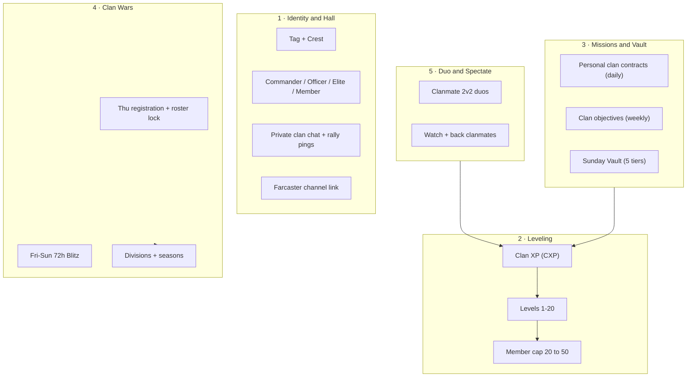
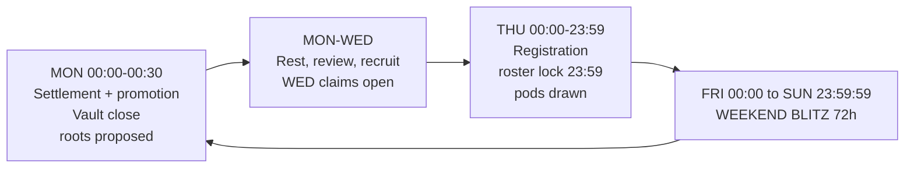
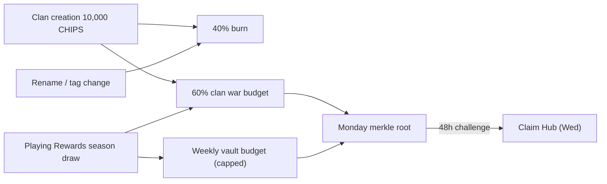
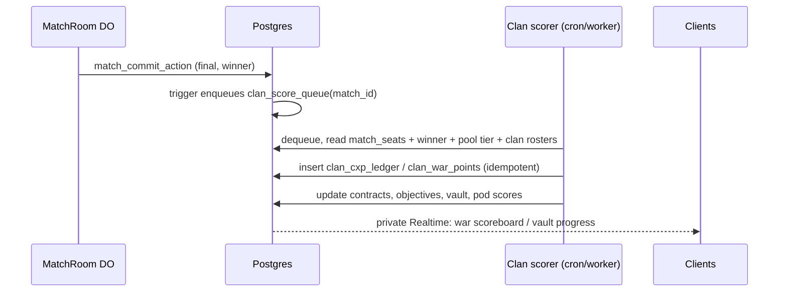

# CLAN_SYSTEM_PLAN.md — Tactical Syndicates (Clans, Leveling, Missions, Wars)

> **Status:** Research + product design **LOCKED for architecture planning** (2026-11-01).
> **Next step:** technical architecture (workload placement, migrations, routes, RPCs, gates).
> **Scope:** product rules, economy, anti-abuse, and the integration constraints the
> architecture must respect. No code lands from this doc directly.
> **Related:** `AGENTS.md` (trust model), `docs/tokenomics/TOKEN_PARAMS.md` (fee tiers,
> paid-volume floor), `docs/tokenomics/SYBIL_MODEL.md`, `docs/architecture/WALLET_SIGNING_POLICY.md`,
> `docs/architecture/WORKLOAD_PLACEMENT_MATRIX.md`, `docs/research/COMPETITIVE_LUDO_WORLD_LUDO_KING.md` §10.

---

## 0. Locked owner decisions

| # | Decision | Value |
| --- | --- | --- |
| D1 | Member cap | **Starts at 20**, grows with **clan level** (max 50 at L20) — see §4 |
| D2 | Creation cost | **10,000 CHIPS** (= one High-roller entry, `TOKEN_PARAMS` §3.5) |
| D3 | War rhythm | **Weekend Blitz: Friday 00:00 → Sunday 23:59:59 UTC (72 h)** — Bangladesh (UTC+6): Fri 06:00 → Mon 05:59 |
| D4 | Model | **Hybrid "Tactical Syndicate"**: off-chain social + progression, server-authoritative scoring, on-chain value only at the edges (creation spend, CHIPS claims) |

---

## 1. Why clans, and why this model

Ludo Base already has the pieces clans amplify but no layer that binds them:

| Existing asset | What clans add |
| --- | --- |
| 2v2 engine (`TEAM_PAIRINGS` Green+Blue vs Red+Yellow, trap truce, assist) | Organized duos instead of random teammates who go AFK |
| Live Arena + spectator bets | Clan rivalries create *reasons to watch* (`[BASE] vs [DEGEN]`) |
| Missions (`mission_catalog`, `MissionClaim`) | Collective goals — losses still contribute, softening loss aversion |
| Season rank (`rxp`, `SeasonClaim` merkle) | Team prestige layer above individual rank |
| Farcaster identity (Neynar, Frame SDK) | Channels map naturally to clans; war results are castable |
| Onboarding track `clan` (`lib/onboardingShared.ts`, 100 CHIPS, already defined, never wired) | Finally has a feature behind it |

Competitor gap (research doc §10.2): *"Creator/guild distribution has no stage."*

### Models evaluated

| | Casual co-op (Ludo King / Monopoly GO) | Pure on-chain DAO | **Tactical Syndicate (chosen)** |
| --- | --- | --- | --- |
| Core loop | Shared bar → gift box | Governance, multisig vault | Weekly vault + missions + 2v2 duos + weekend wars |
| Friction | None | Signature/gas per action | Zero for play; signature only for value |
| CDP passkey / mobile frame fit | Good | Poor | Good |
| Competitive depth | Shallow | Governance-heavy | High |
| Verdict | Too thin for a paid-pool game | Alienates casuals | **Best fit** |

---

## 2. Non-negotiable constraints (inherited from the trust model)

These override any feature idea in this doc. The architecture review must check each one.

1. **Clans never touch the game state.** No dice, move, power, timer, or capture effect.
   No "clan passive perks" in matches. Paid pools must stay identical for clan and
   solo players, and `npm run check:engine` parity (`lib/engine/core.ts` ↔ `src/room/engine.ts`) stays untouched.
2. **Score authority = recorded outcome.** CXP, mission progress, and War Points derive only
   from server-recorded results (`match_states.state.winner`, MatchRoom commits via
   `match_commit_action`, `match_seats`). Never from client reports, relay messages, or the P2P host.
3. **Relay is not authority (TU-1).** Clan chat / war feeds use **private** Realtime channels
   (`202610180005_private_realtime` pattern) with membership checks — never a public
   `game-room-*`-style topic anyone can publish to.
4. **RLS on every clan table**, `revoke all from anon, authenticated`; writes through
   service-role API routes / RPCs only. Each new route enters `lib/routeAuthority.ts`
   (route-auth matrix gate) and `lib/rateLimitRoutes.ts`.
5. **Wallet Guard.** Every value-moving signature or tx (creation spend, escrow deposit,
   claim) goes through `SignWaitModal` with Tier-1 custom copy; chain gate 84532.
   No Ludo passkey/biometric prompts for external wallets (`useWalletMode()`).
6. **Clan tag on the wire is server-sourced.** MatchRoom / profile sync attaches the tag
   from the DB by wallet; a client-claimed tag is ignored (prevents tag spoofing).
7. **Paid-volume floor applies** (`TOKEN_PARAMS` §3.3): CHIPS rewards from clans need
   ≥1 paid on-chain join that week. Free-only players earn CXP and cosmetics, not CHIPS.
8. **Migrations** go only in `supabase/migrations/`; `ENGINE_LOGIC.md` updated if settlement docs change.

---

## 3. Pillars overview



> **Change from the first research draft:** the "Power Armory" (donating Shields/Boosts) is
> **removed**. Powers are match-scoped items that expire in 3–5 min (`POWER_EXPIRY_MS`) and
> there is no persistent power inventory (`lib/inventory.ts` holds cosmetics only).
> Donating powers would require a new inventory *and* create pay-to-win in paid pools,
> violating constraint 2.1. Replaced by **Duo and Spectate** (Pillar 5).

---

## 4. Pillar 2 — Clan leveling (D1)

### 4.1 Clan XP (CXP) sources

CXP is earned per member and summed into the clan. **Clan level never decreases.**

| Source | CXP | Notes |
| --- | --- | --- |
| Paid match win (any shape) | 30 | Recorded winner only |
| Paid match loss / non-winning finish | 10 | Completed match only — abandon/AFK-kick = 0 |
| Free online match win | 10 | MatchRoom/recorded matches only |
| Free online match loss | 3 | |
| Offline / vs AI | 0 | Never counts (same rule as welcome grant) |
| 2v2 with a clanmate as teammate | ×1.25 on the above | Both teammates share `clan_id` at match start |
| Personal clan contract complete | 20–60 | §5.1 |
| Weekly clan objective complete | 500–1,500 (to clan) | §5.2 |
| War participation (≥3 scoring war matches) | 100 per member | §6 |

**Caps:** per member **300 CXP/day** from matches + contracts (objectives and war bonuses are
clan-level and excluded). Matches where clanmates sit on **opposing** sides award **0 CXP** to
both (anti-farm).

### 4.2 Level curve

`CXP required to reach level n = 1,000 × (n − 1)²` (same quadratic family as player LXP in
`lib/progression.ts`). Max level **20**.

| Level | Total CXP | Pace at ~100 CXP/member/day, 20–30 members |
| --- | --- | --- |
| 2 | 1,000 | Day 1 |
| 5 | 16,000 | ~1 week |
| 10 | 81,000 | ~6 weeks |
| 15 | 196,000 | ~10–12 weeks |
| 20 | 361,000 | ~4–5 months |

Initial tuning — retune from telemetry before the first season locks.

### 4.3 Level unlocks

| Level | Member cap | Officer slots | Unlock |
| --- | --- | --- | --- |
| 1 | **20** | 2 | Tag, basic crest, private chat, 3 vault tiers |
| 3 | 22 | 2 | **Clan War eligibility** (also needs ≥5 members) |
| 4 | 22 | 2 | Vault tier 4 |
| 5 | 25 | 3 | Crest frame I |
| 7 | 25 | 3 | Vault tier 5 |
| 8 | 30 | 3 | Custom tag colour |
| 10 | 30 | 4 | Crest frame II, clan banner on victory screen |
| 11 | 35 | 4 | |
| 12 | 35 | 4 | Animated banner |
| 14 | 40 | 5 | |
| 15 | 40 | 5 | Crest frame III |
| 17 | 45 | 5 | |
| 20 | **50** | 6 | Crest frame IV (prestige), Hall of Fame entry |

All unlocks are **cosmetic or organizational** — none affect match outcomes.

---

## 5. Pillar 3 — Clan missions and the Weekly Vault

Three mission layers. All progress is computed server-side from recorded outcomes
(constraint 2.2). Clan missions live in a **separate `clan_mission_catalog`**, not in
`mission_catalog`, so that table's CHIPS 5..20 reward band and its on-chain periodId semantics
stay intact. Clan missions pay **CXP / WP**; CHIPS reach players only via the Vault and War
payouts (§5.3, §6.7).

### 5.1 Personal clan contracts (daily, per member)

Three contracts are rolled per member per UTC day from a weighted pool. Rerolls: 1/day.

| Example contract | Target | Reward |
| --- | --- | --- |
| Play 3 online matches | 3 | 20 CXP |
| Win a 2v2 with a clanmate | 1 | 60 CXP |
| Capture 5 tokens (online) | 5 | 30 CXP |
| Win a paid match | 1 | 40 CXP |
| Finish all 4 tokens in a match | 1 | 30 CXP |
| Spectate a clanmate's live match for 3 min | 1 | 20 CXP (low weight: presence evidence is weak) |

### 5.2 Clan objectives (weekly, collective)

Four objectives rotate each ISO week (Mon 00:00 UTC). Targets scale with
`active_members = max(10, members who played this week)` so small clans are not locked out.

| Example objective | Target formula | Clan reward |
| --- | --- | --- |
| Clan wins N online matches | 6 × active_members | 1,000 CXP |
| N clanmate-duo 2v2 wins | 1.5 × active_members | 1,500 CXP |
| Capture N tokens | 25 × active_members | 500 CXP |
| N distinct members complete ≥3 contracts | 0.6 × active_members | 1,000 CXP |

### 5.3 Weekly Vault (Sunday chest)

Weekly CXP (Mon 00:00 → Sun 23:59 UTC) fills the vault. Tier thresholds are **per active member**:

| Tier | Weekly clan CXP ≥ | CHIPS per eligible member | Extra | Needs clan level |
| --- | --- | --- | --- | --- |
| T1 | 150 × active | 10 | — | 1 |
| T2 | 350 × active | 25 | — | 1 |
| T3 | 600 × active | 50 | Vault badge | 1 |
| T4 | 900 × active | 90 | — | 4 |
| T5 | 1,300 × active | 150 | Weekly crest flair | 7 |

- Pays the **highest tier reached** (not cumulative).
- **Eligibility:** member contributed ≥150 CXP that week, was a member at Sunday 23:59, and meets the
  paid-volume floor for the CHIPS part (otherwise cosmetics only).
- **Calibration:** daily missions pay 5–20 CHIPS each; one Standard 2v2 pot is 4,000 CHIPS.
  T5 = 150 CHIPS/week is deliberately "meaningful, not farmable".
- **Delivery:** batched weekly merkle via the `SeasonClaim` pattern (frozen root, 48 h challenge)
  or a dedicated `ClanClaim` epoch on the same contract family — decided in architecture.
  Root proposed Monday → claimable **Wednesday** (48 h challenge). Claim lives in Claim Hub.
- **Budget:** weekly global cap from the Playing Rewards season draw; if the sum exceeds the cap,
  payouts scale pro-rata. Line item must be added to `TOKEN_PARAMS.md` before launch.

---

## 6. Pillar 4 — Full Clan War system (D3)

### 6.1 Weekly calendar (UTC)



| Phase | Window (UTC) | What happens |
| --- | --- | --- |
| Registration | Thu 00:00 → 23:59 | Commander/Officer opts in. Requires clan L3+, ≥5 members. |
| Roster lock | Thu 23:59 | Snapshot of members. Joiners after lock cannot score this war. Leavers keep earned WP for their old clan; their new clan gets 0 from them. |
| Pod draw | Fri 00:00 | Pods of **5 clans** (fallback 4–6) within the same division, balanced by Clan War Rating (CWR) and roster size band. |
| Blitz | Fri 00:00 → Sun 23:59:59 | Scoring matches accrue WP. Live pod scoreboard. |
| Grace | Sun 23:59 → Mon 00:15 | Matches that **finished** before the end but are inside a MatchPool `disputeWindow` (≤10 min) finalize. Matches finishing after 23:59:59 do not count; matches started before Fri 00:00 do not count. |
| Settlement | Mon 00:15 | Idempotent job computes final standings, promotion/relegation, CWR, rewards; proposes merkle root. |
| Claims | Wed ~00:15 | Root activates after 48 h challenge → claim in Claim Hub. |

### 6.2 What counts as a scoring war match

All must be true:

1. Finished inside the Blitz window, with a winner recorded server-side (`match_states.state.winner`); for paid pools, settlement finalized (not disputed / refunded).
2. **Paid pool** match (Casual 100 / Standard 1,000 / High roller 10,000). Free matches weight is a config flag `war_free_match_weight`, **default 0** (Sybil: free matches are farmable with alts).
3. Player was on their clan's locked roster.
4. **No clanmates on opposing sides** (match voids WP for that clan).
5. Not vs bots; not offline.
6. Under caps: ≤40 scoring matches per member per war; ≤3 scoring matches vs the same opponent wallet per war.

### 6.3 War Points (per player)

| Shape | Win | Non-win (completed) |
| --- | --- | --- |
| 1v1 | 100 | 15 |
| 2v2 with clanmate teammate | **150 each** | 20 each |
| 2v2 with non-clan teammate | 100 | 15 |
| 4P FFA | 160 (winner) | 15 |

Multipliers (multiplicative, win WP only):

| Modifier | × |
| --- | --- |
| Tier: Casual / Standard / High roller | 1.0 / 1.5 / 2.0 |
| **Rival hit**: an opponent is on another clan in your pod | 1.5 |

Bonuses: +5 WP per capture (max +20/match). Abandon / AFK-kick = 0 and counts against the 40-match cap.

### 6.4 Clan war score

```
clan_score = Σ WP of the clan's top-10 contributors
           + 100 × (roster members with ≥3 scoring matches), max 20 members counted
```

Top-10 limits raw headcount advantage; the participation term rewards breadth.
Tiebreak: more scoring wins → more rival hits → earlier time to reach final score.

**War missions** (shown in the War Room, clan-wide, bonus WP to clan score):
"Land 10 rival hits" (+500), "15 clanmate-duo wins" (+750), "Every roster member plays 1 scoring match" (+500).

### 6.5 Divisions, promotion, CWR

Divisions: **Bronze → Silver → Gold → Platinum → Diamond → Apex**. New clans start in Bronze.

| Pod place (of 5) | Result |
| --- | --- |
| 1st | Promote (Apex: stay, +Apex star) |
| 2nd–4th | Stay |
| 5th | Relegate (Bronze: stay) |

**CWR** (Elo-style, starting 1,000) updates from pairwise pod results; used only for pod balance
and the Clan leaderboard.

**Forfeit:** registered but <3 roster members play a scoring match → automatic 5th, relegation,
and a 1-war registration cooldown.

### 6.6 Seasons

A **Clan Season = 4 wars** (≈1 month), independent of the player `season_id` but displayed alongside it.
Season end: division badge + season crest frame for all members with ≥6 scoring matches in the
season, Hall of Fame entry for the top Apex clans, season bonus from the war budget.

### 6.7 War rewards

Per-pod pots (CHIPS), funded from the clan war budget line:

| Division | Pod pot | 1st | 2nd | 3rd | 4th | 5th |
| --- | --- | --- | --- | --- | --- | --- |
| Bronze | 2,000 | 45% | 25% | 15% | 10% | 5% |
| Silver | 4,000 | ″ | ″ | ″ | ″ | ″ |
| Gold | 8,000 | ″ | ″ | ″ | ″ | ″ |
| Platinum | 15,000 | ″ | ″ | ″ | ″ | ″ |
| Diamond | 25,000 | ″ | ″ | ″ | ″ | ″ |
| Apex | 40,000 | ″ | ″ | ″ | ″ | ″ |

- A clan's share is distributed **pro-rata to members' WP**, min 3 scoring matches, paid-volume
  floor applies. **No clan treasury custody in v1** (everything goes straight to member claims).
- Delivered in the same Monday merkle root as the Vault.

### 6.8 War Room UI

Live pod scoreboard (Realtime on a read-only score view), member contribution list,
war missions, rival-hit feed, countdown, "Find a war match" CTA, and castable results
("[BASE] took 1st in Gold Pod 12").

### 6.9 War queue preference (phase C4)

During the Blitz, ranked matchmaking may **prefer** opponents from rival pod clans with a short
timeout fallback to the normal pool. This touches `matchmaking_queue` / `/api/matchmaking/join`
and must be designed against the shape-aware matchmaking migrations; it is a soft preference,
never a requirement.

---

## 7. Pillar 1 — Identity, roles, lifecycle

### 7.1 Identity

- **Name** 3–24 chars, **Tag** 3–5 `[A-Z0-9]`, both unique (case-insensitive), profanity filter,
  reserved list (`LUDO`, `BASE`, `ADMIN`, `MOD`, …). Tag renders as `[TAG]` on board seats,
  lobby slots, leaderboards, Arena cards, profiles.
- **Crest:** SVG emblem + frame + two accents from the theme palette (cyan `#00E5FF`, amber, emerald,
  crimson…); must render in both Retro and Daybreak themes. No purple (design rule).
- **Bio** ≤200 chars, **region/language** tags (discovery filters).
- **Farcaster channel** link (optional; verified by Commander's FID being a channel host/member via Neynar).

### 7.2 Roles

| Role | Can |
| --- | --- |
| Commander (1) | Everything; edit identity; set join policy; promote/demote; register for war; transfer command; disband |
| Officer (2–6 by level) | Accept/decline/kick members (not officers); register for war; pin messages; send rally pings |
| Elite (auto) | Top-5 WP last war — badge only |
| Member | Play, chat, contribute |

### 7.3 Lifecycle rules

| Rule | Value |
| --- | --- |
| Create prerequisites | Player level ≥5, not in a clan, 10,000 CHIPS |
| Join policy | `open` / `request` (default) / `invite_only`, optional min RXP and min level |
| One clan per wallet | Enforced by unique constraint |
| Leave/kick cooldown | 24 h before joining another clan |
| Commander inactivity | 14 days → command passes to the officer with most CXP in last 30 days (else top member) |
| Disband | Commander only, outside Blitz; no refund; tag reserved for 30 days |
| Last member leaves | Clan archived; tag reserved 30 days |
| Rename / tag change | Name 1,000 CHIPS, tag 2,000 CHIPS, 30-day cooldown, not during Blitz |

### 7.4 Creation payment (D2)

Reuse the **CHIPS escrow spend rail** from the marketplace
(`202609300017_chips_marketplace.sql`): server-priced, buyer signs a canonical intent
`{wallet, action:"clan_create", name, tag, total, requestId, issuedAt}`, atomic debit of
`chips_escrow_accounts`, idempotent on `(wallet, request_id)`, new ledger reason `clan_create`.
Clan row and debit commit in one RPC — no paid-but-no-clan state. If escrow balance is short, the
UI routes to the existing deposit flow (Wallet Guard transaction mode with Pre-Flight Telemetry).

**Fee destination (proposal, to confirm in architecture):** 40% burn / 60% earmarked to the
clan war budget. This is the sink side that partly funds §6.7.

### 7.5 Onboarding hook

Wire the existing `clan` onboarding track (100 CHIPS) via `recordSocialOnboarding(db, wallet, 'clan')`.
Anti-farm: progress fires only after the player has been a member ≥24 h **and** completed one online
match while in the clan; one lifetime grant per wallet regardless of clan hopping.

### 7.6 Hall, chat, notifications

- **Clan chat:** private Realtime channel `clan:<clanId>`, membership enforced by Realtime RLS.
  Plaintext server-side in v1 (group E2E deferred); length caps mirror `live_chat`; reportable via
  `user_reports`; Officers can delete messages.
- **Rally pings:** "Satoshi and Vitalik entered a 10,000 CHIPS 2v2" → in-app + web push
  (`push_subscriptions`), rate-limited (max 3 per member per hour).
- **Scrims:** 0-stake private clan matches via the existing invite lobby (room secret). Award no
  CXP/WP (prevents farming), so they need no new trust surface.

---

## 8. Pillar 5 — Duo and Spectate

- **Clanmate duo:** invite a clanmate from the Clan panel into a 2v2 invite lobby; they take the
  teammate seats per `TEAM_PAIRINGS` (diagonal). Duo multipliers apply automatically when the
  server sees both teammates share a `clan_id` at match start.
- **Duo queue for matchmaking** (two clanmates queue together into ranked 2v2) is a **dependency**:
  matchmaking currently pairs individual tickets. Party tickets are an architecture item, phase C4.
- **Spectate and back:** Clan panel shows "Live now" clanmates → 1-tap spectate; spectator bets work
  as today (no clan-specific betting rules).

---

## 9. Economy summary



| Flow | Rule |
| --- | --- |
| No MatchPool change | Clan budgets are funded off-chain from treasury / Playing Rewards; MatchPool fee caps (`protocolBps ≤ 500`, `burnBps ≤ 200`) untouched |
| No clan treasury in v1 | Avoids custody; all CHIPS go to individual member claims |
| No gameplay purchases | Nothing a clan buys changes a match |
| Budget sign-off | Vault cap + war pots + fee split must land in `TOKEN_PARAMS.md` before C2/C3 ship |

Order-of-magnitude check: 1,000 clans × ~20 eligible members × ~50 CHIPS avg vault ≈ 1 M CHIPS/week;
200 pods × ~8,000 avg ≈ 1.6 M/week. Combined ≈ 135 M/year — too high against the S1 400 M draw at that
scale, which is why the **global weekly caps with pro-rata scaling** are mandatory, not optional.

---

## 10. Anti-abuse and integrity

| Threat | Mitigation |
| --- | --- |
| Alt-account clans farming vault/war CHIPS | Paid-volume floor; war counts paid matches only; creation 10,000 CHIPS + level ≥5; war needs L3 + ≥5 members |
| Win trading between clanmates | Opposing clanmates → 0 CXP/WP for the match |
| Win trading with a friendly clan | ≤3 scoring matches vs same wallet per war; rival-hit multiplier only across pod clans; anomaly report (pairwise match counts) for ops review |
| Clan hopping before war | Roster lock Thu 23:59; 24 h join cooldown |
| Spoofed clan tags in match | Tags attached server-side by wallet |
| Chat spoofing / injection | Private channels with RLS; server-side inserts; caps; report flow |
| Late or disputed results | Grace window to Mon 00:15; disputed/refunded pools never count |
| Double counting | Append-only score ledger, unique `(match_id, wallet, kind)`; settlement idempotent and recomputable from the ledger |
| Officer abuse (mass kick before payout) | Kicked members keep earned eligibility for the current vault week / war |

---

## 11. Data model sketch (for the architecture phase — not final DDL)

| Table | Purpose |
| --- | --- |
| `clans` | identity, level, total CXP, division, CWR, join policy, caps, status |
| `clan_members` | `wallet_address` **unique**, role, joined_at, left_at (history kept) |
| `clan_join_requests` / `clan_invites` | pending flows with expiry |
| `clan_cxp_ledger` | append-only CXP events (source, match_id, amount), unique per source |
| `clan_mission_catalog` | contract + objective definitions (CXP/WP rewards) |
| `clan_member_contracts` | daily rolled contracts + progress |
| `clan_objectives` | weekly objectives + progress per clan |
| `clan_vault_weeks` | weekly CXP, tier reached, settlement status |
| `clan_wars` / `clan_war_pods` / `clan_war_entries` | war instance, pods, registered clans + roster snapshot |
| `clan_war_points` | append-only WP ledger, unique `(war_id, match_id, wallet, kind)` |
| `clan_reward_leaves` | per-wallet CHIPS amounts per epoch → merkle builder |
| `clan_score_queue` | outbox filled on match finalization (pattern: `free_match_sync_queue`) |

All `wallet_address` columns lowercase-checked and FK to `players(wallet_address)`.

### Scoring pipeline (proposal)



Placement (DO vs Postgres trigger vs Worker cron) is decided against `WORKLOAD_PLACEMENT_MATRIX.md`.
Default: keep MatchRoom unaware of clans except for attaching tags to the roster.

---

## 12. UI surfaces

| Surface | Change |
| --- | --- |
| `app/page.tsx` | New `activeTab: 'clan'` in the social cluster (Friends / Leaderboard / Clan) |
| `ClanPanel.tsx` (new) | Sub-tabs: **Hall** (chat, live clanmates, rally), **Missions** (contracts, objectives, vault), **War** (War Room), **Members**, **Settings** — same sandwich-shell contract as `FriendsPanel` / `ArenaPanel` |
| Discovery | Search, filters (division, level, region, open slots), recommended, Farcaster channel |
| Board / lobby | `[TAG]` beside names (server-sourced); victory banner for clan duo wins |
| Leaderboard | New "Clans" tab (CWR / division / season) |
| Arena | Clan tags on live cards; "Clash" label for rival-pod matches |
| Profile | Clan crest + role on `PublicProfileModal` / `PlayerProfileSheet` |
| Claim Hub | Vault + war claims as new rows |
| Onboarding | `clan` track becomes actionable |

Gates: `visual:diff` for layout-shifting changes (board/lobby tag), motion gate, Retro + Daybreak.

---

## 13. Phased delivery

| Phase | Scope | Exit |
| --- | --- | --- |
| **C0 — Sign-off** | This doc, budget lines in `TOKEN_PARAMS.md`, fee split, architecture doc + ADR | Owner approval |
| **C1 — Foundation** | Clans, members, roles, create (10,000 CHIPS escrow spend), join/leave/requests, discovery, tags (server-sourced), private chat, onboarding hook | RLS + route-auth + schema gates green; creation idempotency tests |
| **C2 — Progression** | CXP ledger + scorer pipeline, leveling + caps, daily contracts, weekly objectives, Vault + weekly merkle claims | Scorer replay test (recompute = stored); farm-case tests |
| **C3 — Wars** | Registration, roster lock, pod draw, WP scoring, War Room, settlement, divisions, CWR, seasons, war payouts | Full simulated war week in tests; dispute/grace cases |
| **C4 — Social polish** | Farcaster channel link + casts, rally push, war queue preference, duo party tickets, Hall of Fame | Netcode/matchmaking drills updated |

---

## 14. KPIs

- D7 / D30 retention: clan members vs non-members (target: +15 pts D7).
- % of 2v2 matches with a clanmate teammate.
- War participation: registered clans, % roster with ≥3 scoring matches.
- Paid-pool joins per clan member vs solo players.
- Arena spectators per clan-tagged match.
- Abuse: flagged pairwise-farming rate, voided WP %.

---

## 15. Open questions for the architecture session

1. Fee split for the 10,000 CHIPS: confirm **40% burn / 60% war budget**?
2. Should free online matches give **any** war weight on Sepolia Alpha (where paid volume is thin), or stay 0?
3. Vault/war claims: reuse `SeasonClaim` epochs, or deploy a dedicated `ClanClaim` (same frozen-root pattern)?
4. Group E2E for clan chat now, or plaintext v1 with moderation?
5. Duo party tickets in matchmaking: C4, or pull into C3 so clanmate 2v2 wars are easy to queue?
6. Max level 20 / cap 50 — final, or leave headroom (e.g. L25 → 60) for later seasons?
