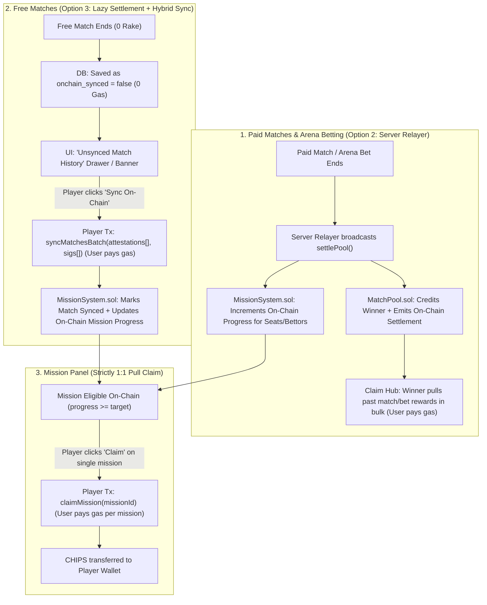

# On-Chain Settlement, Lazy Free-Match Sync & Pull Claims Plan

## 1. Architecture Overview (Locked Decisions)

| Surface | Settlement / Progress Mechanism | Who Pays Settlement Gas? | Reward Claim Mechanism | Who Pays Claim Gas? |
| :--- | :--- | :--- | :--- | :--- |
| **Paid Matches** (`MatchPool` - `Match`) | **Option 2: Server Relayer** auto-submits `settlePool()` on match end and records on-chain mission progress for all seats. | **Server Relayer** (covered by match protocol rake) | **Pull via Claim Hub** (`ClaimHub.claimMany` / `claimMatch`) | **Player** (bulk or single) |
| **Arena Betting** (`MatchPool` - `Predict`) | **Option 2: Server Relayer** auto-settles prediction pools on resolution and records spectate/predict progress. | **Server Relayer** (covered by betting pool rake) | **Pull via Claim Hub** (`ClaimHub.claimMany` / `claimMatch`) | **Player** (bulk or single) |
| **Free Matches** (0-fee / Casual / Bot) | **Option 3: Lazy Settlement + Hybrid Sync.** Stored off-chain as `onchain_synced = false` with server EIP-712 attestation. Player clicks **"Sync On-Chain"** to batch-sync unsynced matches. | **Player** (1 tx syncs all pending free matches) | Unlocks on-chain mission eligibility once synced | **Player** |
| **Missions** (Daily / Weekly / Onboarding) | Progress derived from settled Paid Matches, settled Bets, and Player-Synced Free Matches on-chain. | N/A (bundled in match settle / sync) | **Strictly 1:1 Individual Pull** in `MissionPanel` (`claimMission(missionId)`) | **Player** (1 tx per mission claim) |

---

## 2. System Flow

---

## 3. Task Breakdown & File Map

### Phase 1: Smart Contracts (`contracts/src/MissionSystem.sol`)
- **Task 1.1 — Decouple Progress from Payout (Pull-only `claimMission`):**
  - Modify `_complete()` in `contracts/src/MissionSystem.sol` so reaching `target` marks `completed[wallet][missionId][period] = true` and `claimable[wallet][missionId][period] = reward` **without** auto-transferring CHIPS.
  - Add `claimMission(bytes32 missionId, bytes32 period)` (`external nonReentrant`) where `msg.sender` pulls their reward for that single mission and pays the gas.
- **Task 1.2 — Add Player Batch Sync (`syncFreeMatches`):**
  - Add EIP-712 signed struct `FreeMatchAttestation(bytes32 matchId, address player, uint8 won, uint8 isPvp, uint16 captures, uint64 playedAt, uint64 deadline)` signed by `progressOracle` / `edgeSigner`.
  - Add `mapping(bytes32 => mapping(address => bool)) public matchSynced` for replay protection.
  - Add `syncFreeMatches(FreeMatchAttestation[] calldata matches, bytes[] calldata sigs)` so a player can sync all their unsynced free matches in 1 transaction, automatically incrementing `daily_play_3`, `daily_win_1`, `daily_capture_2`, `weekly_play_10`, `weekly_win_3`, `weekly_capture_10`, and `weekly_pvp_2`.
- **Verification:** `forge test --match-contract MissionSystemTest` passes all pull-claim and batch-sync replay tests.

### Phase 2: Database & Backend Relayer (`supabase/migrations/`, `lib/`, `app/api/`)
- **Task 2.1 — Unsynced Free Match Tracking Migration:**
  - Create migration `supabase/migrations/20261027000001_unsynced_free_matches.sql` adding `player_match_sync_queue` (`id`, `match_id`, `player_id`, `is_paid`, `won`, `is_pvp`, `captures`, `played_at`, `onchain_synced`, `sync_tx_hash`).
- **Task 2.2 — Paid Match & Betting Server Relayer (`lib/poolRelayer.ts`):**
  - Implement server relayer that automatically submits `MatchPool.settlePool` (Mode B / dual-signed) when a Paid Match or `PoolKind.Predict` Betting pool concludes, funded by the protocol rake.
  - Remove fire-and-forget `reportProgress` calls for free matches from `/api/match/record/route.ts`. Instead, insert free match participant stats into `player_match_sync_queue` with `onchain_synced = false`.
- **Task 2.3 — Unsynced Match History & Attestation API:**
  - Create `GET /api/matches/unsynced` — returns the player's unsynced free matches (`onchain_synced = false`) along with server-signed EIP-712 `FreeMatchAttestation` payloads.
  - Create `POST /api/matches/sync-confirm` — verifies the on-chain sync transaction hash and flips `onchain_synced = true` in the DB.
- **Verification:** API unit tests verify free matches queue as unsynced and paid/betting matches trigger relayer settlement.

### Phase 3: Frontend — Unsynced Matches UI & 1:1 Mission Claims (`hooks/`, `app/components/`)
- **Task 3.1 — `useUnsyncedMatches` Hook & Sync Modal/Banner:**
  - Create `hooks/useUnsyncedMatches.ts` to fetch unsynced free matches and call `MissionSystem.syncFreeMatches(...)`.
  - Create `app/components/UnsyncedMatchesPanel.tsx` integrated into `MissionPanel.tsx` showing:
    - List of unsynced free matches (date, mode, result, captures).
    - Summary badge (e.g., `"4 Unsynced Matches — Sync On-Chain to update mission progress"`).
    - **"Sync On-Chain"** button (player pays gas once to sync all pending free matches).
- **Task 3.2 — Individual 1:1 Pull Claim in `MissionPanel.tsx` & `OnboardingPanel.tsx`:**
  - Update `MissionPanel.tsx` so completed missions (`completed && !claimed`) show an active **"Claim"** button (never auto-"Received").
  - Clicking **Claim** calls `MissionSystem.claimMission(missionId, period)` (or voucher fallback) for that single mission; player pays gas per mission claim.
- **Task 3.3 — Bulk Match & Betting Claims in Claim Hub:**
  - Ensure `ClaimHub` UI surfaces all settled Paid Match pools and Arena Betting pools for one-click bulk pull via `ClaimHub.claimMany(poolIds)`.
- **Verification:** `npx tsc -p tsconfig.json --noEmit` (0 errors), `npm run lint`, and `npm test`.

---

## 4. Open Alignment Questions Before Implementation

1. **Free Match Sync Expiry Window:** Should unsynced free matches be valid to sync for Daily Missions only if they were played within the current UTC day (`playedAt >= currentDayStart`), while still counting toward Weekly Missions if played within the current week?
2. **Social / Non-Match Missions (`daily_poke_back`, `weekly_friend_dm_3`, `daily_bonus`):** Since these are not matches, should they remain direct 1:1 on-chain voucher claims (`MissionClaim.claim`) where the user clicks Claim in the Mission Panel and pays gas?
