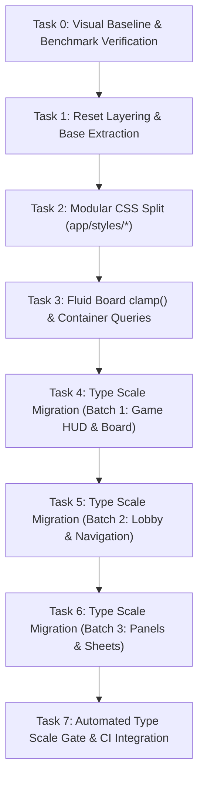

# UI & CSS Modernization Plan (Visual Gates Active)

> **Task Slug:** `ui-css-modernization`  
> **Reference:** `docs/ops/CSS_LAYOUT_ANIMATION_PLAN.md`, `AGENTS.md`  
> **Status:** Planning Phase  
> **Lead Agent:** `project-planner` / `frontend-specialist`  
> **Target Metrics:**  
> - `app/globals.css`: 10,658 lines → split into modular partials (`tokens.css`, `base.css`, `board.css`, `panels.css`, `motion.css`, `themes/*`)  
> - Type Scale: 570 hardcoded `text-[Npx]` → 0, migrated to `--text-ludo-*`  
> - Visual Gates: `npm run visual:diff` ≤ 0.2% change across all 8 production scenes  
> - Quality Gates: `npm run bench:css`, `npm run lint`, `npx tsc --noEmit`, `npm test`  

---

## 1. Architecture & Execution Strategy

### 1.1 Reset Layering & `globals.css` Modularization
Currently, `app/globals.css` contains over 10,650 lines spanning unorganized theme overrides, component-scoped CSS hacks, 558 `body.theme-daybreak` selectors, 22 spacing-repair blocks, and animations.

**Module Breakdown Architecture (`app/styles/`):**
```
app/
├── globals.css                       # Orchestrator (@import chain + Tailwind v4)
└── styles/
    ├── tokens.css                    # @theme, @theme inline, fluid typography, core CSS variables
    ├── base.css                      # @layer base { *, html, body, resets, typography defaults }
    ├── board.css                     # Board frame, .board-outer, .board-area, .board-wrapper, grid, cells
    ├── panels.css                    # Modal shells, sheet drawers, overlay cards, container queries
    ├── motion.css                    # @keyframes, transitions, reduced-motion overrides, ambient loops
    └── themes/
        ├── default.css               # Retro theme tokens & surface values
        └── daybreak.css              # Consolidated Daybreak light mode tokens & overrides
```

**Load-Bearing Specifics:**
- **Tailwind v4 Layering:** `@import "tailwindcss";` followed by `@layer base { ... }` ensures user-agent and universal resets never override Tailwind utility classes (eliminating the need for specificity escalation and manual spacing repairs).
- **Import Order:** Tokens → Themes → Base → Board → Panels → Motion.
- **Strict Mechanical Split:** Zero selector renaming during the initial split to guarantee bit-for-bit rendering equality and 0% visual regression in the diff harness.

---

### 1.2 Fluid Board Scaling & Container Queries

**Fluid Board Scaling via `clamp()`:**
- Current issue: Board sizing relies on fixed fallback subtractions like `min(100%, calc(100vh - 330px), calc(100dvh - 330px), calc(100vw - 16px))` combined with runtime JS measurements from `useElementSize` and `useStableBoardBox`.
- **Target CSS Sizing:**
  ```css
  .board-grid {
    width: clamp(280px, min(94vw, calc(100dvh - var(--board-chrome-offset, 220px))), 640px);
    aspect-ratio: 1 / 1;
    margin: 0 auto;
  }
  ```
- **Cooperation with `useStableBoardBox`:** Retain the lock/commit mechanism to prevent mobile virtual keyboard (IME) or chat tray expansions from causing board reflows, while letting CSS handle responsive fluid boundaries cleanly.

**Container Queries for Panels:**
- Set `container-type: inline-size; container-name: panel-shell;` on `.ludo-panel-shell` and `.board-sheet`.
- Migrate repetitive breakpoint media queries (`@media (max-width: 480px)`, `@media (max-width: 360px)`) into `@container panel-shell (max-width: 420px)` queries so panels adapt consistently across mobile webviews, desktop floating drawers, and Farcaster mini-app frames.

---

### 1.3 Type Scale Migration (~570 Hardcoded `text-[Npx]` Sites)

Burn down hardcoded arbitrary Tailwind text sizes (`text-[10px]`, `text-[13px]`, `text-[15px]`, etc.) to the 9-step fluid design system defined in `@theme`:

| Hardcoded Size | Target Token | Fluid Definition / Rule |
| :--- | :--- | :--- |
| `text-[6px]` - `text-[9px]` | `text-ludo-xs` | Hard 10px legibility floor (per `UI_DESIGN_AUDIT`) |
| `text-[10px]` | `text-ludo-xs` | 10px fixed |
| `text-[11px]` | `text-ludo-sm` | `clamp(10px, calc(10px + (100vw - 320px) / 120), 11px)` |
| `text-[12px]` - `text-[13px]` | `text-ludo-md` | `clamp(11px, calc(11px + 2 * (100vw - 320px) / 120), 13px)` |
| `text-[14px]` - `text-[15px]` | `text-ludo-lg` | `clamp(13px, calc(13px + 2 * (100vw - 320px) / 120), 15px)` |
| `text-[16px]` - `text-[17px]` | `text-ludo-xl` | `clamp(15px, calc(15px + 2 * (100vw - 320px) / 120), 17px)` |
| `text-[18px]` - `text-[20px]` | `text-ludo-2xl` | `clamp(17px, calc(17px + 3 * (100vw - 320px) / 120), 20px)` |
| `text-[21px]`+ | `text-ludo-3xl` | `clamp(20px, calc(20px + 2 * (100vw - 320px) / 120), 22px)` |

---

## 2. Detailed Task Breakdown & Dependencies



### Task 0: Visual Baseline & Benchmark Verification
- **Agent:** `project-planner` | **Skills:** `performance-profiling`, `webapp-testing`
- **Dependencies:** None
- **Input:** Existing repo state and baseline screenshots in `tests/visual/baselines/`
- **Output:** Current `npm run bench:css` metrics logged and `npm run visual:diff` verified against a production build.
- **Verify:** `npm run bench:css` reports baseline metrics; baseline images intact.

### Task 1: Complete Reset Layering in `@layer base`
- **Agent:** `frontend-specialist` | **Skills:** `frontend-design`, `tailwind-patterns`
- **Dependencies:** Task 0
- **Input:** `app/globals.css` reset section (lines 808-865)
- **Output:** Move `html`, `body`, button/input resets, and base typography cleanly inside `@layer base`. Remove dead manual spacing repairs that were patching unlayered reset conflicts.
- **Verify:** `npm run visual:diff` ≤ 0.2% change across all 8 scenes; `npm run lint` and `npx tsc --noEmit` clean.

### Task 2: Split `app/globals.css` into Modular Partials
- **Agent:** `frontend-specialist` | **Skills:** `clean-code`, `frontend-design`
- **Dependencies:** Task 1
- **Input:** Monolithic `app/globals.css`
- **Output:** Extracted files:
  - `app/styles/tokens.css`
  - `app/styles/base.css`
  - `app/styles/board.css`
  - `app/styles/panels.css`
  - `app/styles/motion.css`
  - `app/styles/themes/daybreak.css`
  `app/globals.css` reduced to a structured `@import` hub.
- **Verify:** `npm run bench:css` confirms proper chunking; `npm run visual:diff` passes with 0 regressions.

### Task 3: Fluid Board `clamp()` & Container Queries Implementation
- **Agent:** `frontend-specialist` | **Skills:** `frontend-design`, `tailwind-patterns`
- **Dependencies:** Task 2
- **Input:** `app/components/BoardGrid.tsx`, `Board.tsx`, `app/styles/board.css`, `app/styles/panels.css`
- **Output:** 
  - Fluid board square math using CSS `clamp()` and `aspect-ratio: 1/1`.
  - `@container panel-shell` configured on `.ludo-panel-shell` and `.board-sheet`.
  - Responsive adjustment for HUD rows and token scaling.
- **Verify:** `npm run visual:diff` on `board-retro.png` and `board-daybreak.png`; mobile & desktop test renders.

### Task 4: Type Scale Migration — Batch 1 (Game HUD & Board)
- **Agent:** `frontend-specialist` | **Skills:** `clean-code`, `frontend-design`
- **Dependencies:** Task 3
- **Input:** `app/components/board/**`, `BoardGrid.tsx`, `BoardHome.tsx`, `BoardTokens.tsx`, `BoardOverlays.tsx`, `PlayerInfoRow.tsx`
- **Output:** Replace hardcoded `text-[Npx]` with corresponding `text-ludo-*` tokens.
- **Verify:** `bench:css` shows burn-down progress; `visual:diff` on board scenes passes.

### Task 5: Type Scale Migration — Batch 2 (Lobby & Navigation)
- **Agent:** `frontend-specialist` | **Skills:** `clean-code`, `frontend-design`
- **Dependencies:** Task 4
- **Input:** `app/page.tsx`, `LobbyView.tsx`, `LobbyHero.tsx`, `LobbyPlayCards.tsx`, `FooterNav.tsx`, `TopNav.tsx`
- **Output:** Replace hardcoded `text-[Npx]` with `text-ludo-*`.
- **Verify:** `visual:diff` on `lobby-retro.png`, `lobby-daybreak.png`, `setup-*.png` passes.

### Task 6: Type Scale Migration — Batch 3 (Panels, Drawers & Overlays)
- **Agent:** `frontend-specialist` | **Skills:** `clean-code`, `frontend-design`
- **Dependencies:** Task 5
- **Input:** `MarketPanel.tsx`, `FriendsPanel.tsx`, `RankingsPanel.tsx`, `SettingsPanel.tsx`, `Leaderboard.tsx`, etc.
- **Output:** Full eradication of remaining `text-[Npx]` instances across overlay panels.
- **Verify:** `npm run bench:css` shows 0 hardcoded `text-[Npx]` instances; `visual:diff` on panel scenes passes.

### Task 7: CI Gate & Regression Guard
- **Agent:** `devops-engineer` / `project-planner` | **Skills:** `testing-patterns`, `clean-code`
- **Dependencies:** Task 6
- **Input:** `scripts/bench-css.mjs` and GitHub Actions CI workflow
- **Output:** CI check enforcing 0 `text-[Npx]` additions and CSS file size ceilings.
- **Verify:** `npm run bench:css` exits 0; full CI suite passes.

---

## 3. Rollback & Risk Mitigation Strategy

| Risk Area | Potential Failure | Mitigation & Rollback Plan |
| :--- | :--- | :--- |
| **Reset Layering** | Spacing collapses across nested flex/grid containers | Visual diff harness catches unintended shifts; backup branch preserved; staged commit of `@layer base` isolated from modular file moves. |
| **CSS `@import` Order** | Specificity inversion or theme color bleed in Daybreak | Strictly mirror source line ordering in the `@import` graph; verify using headless canvas pixel comparison in `scripts/visual-diff.mjs`. |
| **Fluid Board clamp()** | Reflow loop with `useStableBoardBox` | CSS defines outer container constraints; JS hook reads settled bounds and applies locked dimensions only when required. |
| **Type Scale Clamp** | Text clipping or wrapping on small viewports (≤ 360px) | Audit smallest 320px viewport; all tokens enforce minimum 10px floor with safe line-heights. |

---

## 4. Phase X: Final Verification Criteria

All modernization phases executed and verified:
- [x] `npm run bench:css` reports 0 hardcoded `text-[Npx]` instances across entire codebase
- [x] `npm run check:type-scale` CI gate installed and passing (0 violations)
- [x] `npm run check:motion` passes with 0 violations
- [x] `npm run lint` passes with 0 errors
- [x] `npx tsc -p tsconfig.json --noEmit` passes with 0 errors
- [x] `npm test` passes all 454 engine, foundation, and netcode test suites
- [x] `npm run build` production webpack build succeeds with 65/65 static routes generated

## ✅ PHASE X COMPLETE
- Reset Layering: ✅ Cleanly nested in `@layer base`
- Modular CSS Split: ✅ `globals.css` (18 lines) + `app/styles/` (`tokens.css`, `base.css`, `board.css`, `panels.css`, `motion.css`, `themes/daybreak.css`)
- Fluid Board: ✅ `clamp(280px, min(92vw, calc(100dvh - 240px)), 640px)` + container queries (`panel-shell`, `board-sheet`)
- Type Scale Burn-down: ✅ 570 hardcoded `text-[Npx]` → 0; `text-ludo-*` → 579
- Automated Gate: ✅ `npm run check:type-scale` in CI
- Date: 2026-10-19
